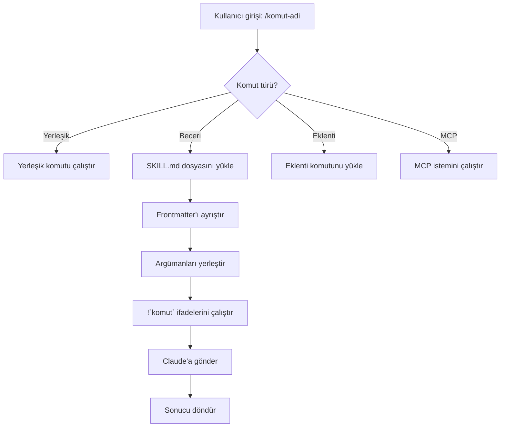
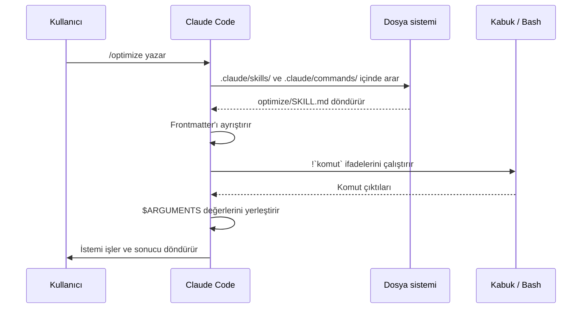

# Claude Code Başlıyorum

> Bu not, Claude Code'u öğrenirken kullandığım kişisel notların düzenlenmiş halidir. Yazım hataları düzeltildi, başlıklar yeniden düzenlendi ve sonuna **Claude'un Eklemeleri** bölümü eklendi.

---

## 1. Matt Pocock Becerileri

Birkaç beceri indirdim; özellikle Matt Pocock'un mühendisler için hazırladığı **"Skills for Real Engineers"** deposundaki beceriler. Bu beceriler yapay zekayı rastgele kod üreten bir araçtan çıkarıp **disiplinli, test odaklı ve mimari kararlar alan** bir mühendislik asistanına dönüştürmek için tasarlanmış.

Beceriler iki gruba ayrılır:

- **User-invoked (Kullanıcı komutlu):** Yalnızca sen komutla çalıştırırsın.
- **Model-invoked (Model komutlu):** Hem sen çağırabilirsin hem de Claude gerektiğinde arka planda otomatik devreye sokar.

### Kurulum

Bu beceriyi kullanabilmek için her yeni projede bir kez, proje içindeki terminalde şunu yazmam gerekiyor:

```bash
claude
/setup-matt-pocock-skills
```

### 1.1 Mühendislik (Engineering)

Günlük kod yazma, mimari tasarım ve hata ayıklama süreçlerinde kullanılan temel araçlar.

#### Kullanıcı komutlu

| Komut | Ne işe yarar |
|---|---|
| `/setup-matt-pocock-skills` | Proje için ilk kurulum. Issue tracker tercihini (GitHub, GitLab, yerel dosyalar) ve doküman yollarını ayarlar. Her yeni projede bir kez çalıştırılır. |
| `/ask-matt` | Durumuna veya sorununa uygun beceriyi/akışı gösteren bir yönlendirici (router). |
| `/grill-with-docs` | Kod yazmadan veya büyük bir değişiklikten önce seni sorguya çeken mülakat oturumu. Sonunda projenin terimler sözlüğünü (`GLOSSARY.md`) ve mimari kararlarını (`ADR`) günceller. |
| `/to-spec` | Sohbeti ve fikirleri resmi bir teknik şartnameye (spec) dönüştürüp issue tracker'a gönderir. |
| `/to-tickets` | Bir plan veya şartnameyi küçük, yönetilebilir biletlere (görevlere) böler. |
| `/implement` | Bir şartnameyi veya biletleri `/tdd` ve `/code-review` kurallarına sadık kalarak uygular. |
| `/implement-spec` | Bütün bir şartnameyi entegrasyon dalında (branch), paralel alt ajanlarla uygular. |
| `/wayfinder` | Tek bir oturuma sığmayacak kadar büyük işleri, karar biletlerinden oluşan haritalara bölerek adım adım çözer. |
| `/triage` | Görevleri/issue'ları belirli roller ve kurallar çerçevesinde bir durum makinesinden geçirerek sınıflandırır. |
| `/improve-codebase-architecture` | Kod tabanını tarar, modülleri derinleştirme fırsatlarını raporlar ve seçtiğin iyileştirme üzerinde seninle çalışır. |
| `/retro` | Bir oturum bittiğinde ajanın çevresini (navigasyon, otomatik kontroller, standartlar) iyileştirmek için öneriler sunar. |

#### Model komutlu

| Beceri | Ne işe yarar |
|---|---|
| `/tdd` | Test odaklı geliştirme disiplini. Önce başarısız bir test yazılır, sonra kod yazılarak test geçirilir ve refaktör yapılır. |
| `/diagnosing-bugs` | Zor hatalar ve performans düşüşleri için adım adım hipotez kurma ve izleme döngüsü. |
| `/code-review` | Yazılan kodun diff çıktısını hem standartlara uyum (temizlik, kirlilik analizi) hem de şartnameye uygunluk açısından paralel alt ajanlarla inceler. |
| `/domain-modeling` | Projenin alan modelini geliştirir; terimleri sözlükte test eder, edge-case senaryolarla güçlendirir. |
| `/codebase-design` | Derin modüller tasarlamak (küçük bir arayüzün arkasında çok işlevsellik) için ortak disiplin ve kelime dağarcığı sağlar. |
| `/prototype` | Tasarım sorularını çözmek için geçici prototipler (ör. tek dosyalık interaktif HTML) üretir. |
| `/research` | Güvenilir birincil kaynaklardan araştırma yapar ve bulguları repoya markdown dosyası olarak kaydeder. |
| `/pr` | Pull Request metnini en sade görsel özet, kanıt ve birleştirme riski (blast radius) içerecek şekilde biçimlendirir. |
| `/wizard` | Altyapı kurulumu, credential ayarı veya manuel üçüncü taraf adımlarında yönlendiren interaktif bir bash sihirbazı üretir. |

### 1.2 Verimlilik (Productivity)

Koda odaklı olmayan; iletişim ve doküman yönetimini düzenleyen araçlar.

#### Kullanıcı komutlu

| Komut | Ne işe yarar |
|---|---|
| `/grill-me` | Herhangi bir plan veya tasarım fikrini, açık uçlar kalmayana kadar sorgulayarak olgunlaştırır. |
| `/handoff` | Oturum bittiğinde veya bağlam sınırı dolduğunda yapılanları kompakt bir devir teslim belgesine sıkıştırır. |
| `/wait-what` | Ajanın cevabı kafa karıştırıcıysa çalıştırılır; ajanı durdurup eksik bağlamı sade bir dille yeniden anlatmasını sağlar. |
| `/teach` | Mevcut dizini durum tutan bir çalışma alanı gibi kullanarak çok oturumlu öğretim yapar. |
| `/to-questionnaire` | Yanıtlayamadığın kararları, projeye dışarıdan destek veren kişilere iletmek üzere Markdown anketine dönüştürür. |

#### Model komutlu

| Beceri | Ne işe yarar |
|---|---|
| `/grilling` | `/grill-me` ve `/grill-with-docs` gibi araçların arkasındaki temel mülakat motoru. |
| `/writing-for-agents` | `AGENTS.md`, `CLAUDE.md` gibi ajanların okuyacağı dosyaların en anlaşılır ve hatasız şekilde yazılmasını sağlar. |

---

## 2. Claude Code'un Temel Parçaları

### CLAUDE.md (Proje Hafızası ve Kuralları)

- Proje kökündeki bu markdown dosyası, Claude Code'un her oturumda **ilk okuduğu kılavuzdur**.
- Kod standartlarını, mimari kararları ve tercih edilen kütüphaneleri buraya yazarsın. Böylece Claude kuralları her seferinde baştan unutmaz.
- Ayrıntılar için [Claude'un Eklemeleri](#claudeun-eklemeleri) bölümüne bak (`AGENTS.md` konusu).

### Otomatik bellek (Auto memory)

Claude, seninle çalışırken oturumlar arasında öğrendiği bazı bilgileri kendisi kaydeder.

### Özel beceriler (Custom Skills)

Sık tekrarladığın iş akışlarını tek komuta dönüştürüp hem kendin hem ekibin kullanabileceği yetenek dosyalarıdır. Matt Pocock'un becerileri de bu mantıkla çalışır.

### Hook'lar (Kancalar)

Claude Code belirli bir olayın öncesinde veya sonrasında otomatik olarak shell komutu çalıştırmanı sağlar. Örneğin Claude her dosya düzenlediğinde otomatik formatlama (black, prettier) çalıştırmak bu şekilde ayarlanır.

### Arka plan ajanları (Lider ve alt ajanlar)

Büyük bir görevi (ör. büyük bir refaktör) tek bir ajana yüklemek yerine ana oturum işi parçalara bölüp alt ajanlara (subagents) dağıtabilir. Alt ajanlar paralel çalışır ve sonuçlar ana oturuma döner. Sen de tek ekrandan süreci izlersin. Ayrıntı için [Claude'un Eklemeleri](#claudeun-eklemeleri) bölümüne bak.

### Agent SDK (Özel orkestrasyon)

Hazır komutlar yetmezse Anthropic'in **Agent SDK**'sı ile kendi ajan ağını kodlayabilirsin. Hangi ajanın hangi araca erişeceğini, izinleri ve görev zincirini kendin programlarsın.

### Uzaktan kontrol ve mobil devamlılık

- Bilgisayarda başlattığın bir oturumu telefondan veya başka bir cihazdan kontrol etmeye devam edebilirsin (`/remote-control`, kısaca `/rc`).
- Mobil uygulama için `/mobile` QR kodu gösterir.

### Zamanlanmış bulut görevleri

Claude'u her gece belirli bir saatte çalışacak şekilde zamanlayabilirsin. Bulut tabanlı görevler için `/schedule` (takma adı `/routines`) kullanılır.

### CI/CD ve otomatik kod incelemesi

GitHub Actions veya GitLab CI ile her Pull Request'e otomatik kod incelemesi yaptırabilirsin. `/install-github-app` GitHub Actions kurulumunu yapar.

### Tarayıcı entegrasyonu

Claude, Chrome üzerinden canlı web uygulamalarını test edip hata ayıklayabilir. Kurulum için `/chrome` komutu kullanılır.

---

## 3. Terminal Komutları

Bunları Claude Code dışında, terminalde çalıştırırsın:

| Komut | Ne yapar |
|---|---|
| `claude` | Etkileşimli modu başlatır. |
| `claude "organize my notes"` | Etkileşimli modu ilk komutla birlikte başlatır. |
| `claude -p "summarize today's note"` | Tek seferlik sorgu çalıştırır, sonra çıkar. |
| `claude -c` | Bulunulan dizindeki en son konuşmaya devam eder. |
| `claude --fork-session` | Bir konuşmayı `--resume` veya `--continue` ile açarken yeni bir dala ayırır. |

---

## 4. Oturum İçi Temel Komutlar

| Komut | Ne yapar |
|---|---|
| `/clear` | Yeni bir sohbet başlatır (`/reset`, `/new` ile aynı). |
| `/context` | Bağlam kullanımını gösterir. |
| `/branch` | Konuşmanın bir kopyasını oluşturur; farklı yolları denemek için kullanılır. Orijinal konuşma korunur. |
| `/rewind` | Konuşmayı ve/veya kodu geri sarar (`/undo`, `/checkpoint` ile aynı). Riskli bir değişiklikten geri dönmek için. |
| `/help` | Kullanılabilir komutları gösterir. |
| `/exit` | Claude Code'dan çıkar. |

> **Not:** `/context` bağlam miktarını, `/branch` ve `/rewind` ise "geri alma" ihtiyacını karşılar.

---

## 5. Obsidian Kullanıcıları İçin İpuçları

- **İsteklerinde net ol.**
  - *Şunun yerine:* "clean up my notes"
  - *Şunu dene:* "clean up the markdown formatting in the 2026/06 folder, fixing broken links"
- **Adım adım talimat ver.** Karmaşık görevleri parçalara böl:
  1. `scan all markdown files for missing tags`
  2. `add standard frontmatter YAML to notes that lack it`
  3. `generate an index note linking them all together`
- **Önce keşfetmesine izin ver.** Değişiklik yapmadan önce kasanı okumasını iste:
  - `analyze the folder structure of my vault`
  - `find all notes related to my university courses`
- **Kısayollarla zaman kazan:**
  - `/` yazarak komutları ve becerileri görürsün.
  - `Tab` ile dosya adını tamamlarsın.
  - `↑` ile komut geçmişine dönersin.
  - `Shift+Tab` ile izin modları arasında geçersin (sor / otomatik düzenle / plan).

### Sohbet havasında ilerle

İlk komutun kusursuz olmak zorunda değil. "Giriş yapma hatasını çöz" diye başlayıp, Claude yanlış yöne giderse "Hayır, sorun oturum yönetiminde" diye düzeltebilirsin. Üst üste koyarak ilerlersin.

### Müdahale et ve yönlendir

- Claude çalışırken yanlış yöne gittiğini görürsen `Esc` ile durdur.
- Claude çalışırken yazıp `Enter`'a basarsan mesajın sıraya alınır; Claude mevcut işi bitirince mesajını okuyup rotasını düzeltir.

### Dikte etme, devret

"Şu dosyayı aç, 15. satıra in, şu kodu sil" yerine bir mühendise iş verir gibi anlat:

> *"Süresi dolmuş kredi kartlarında ödeme akışı çöküyor. Kod `src/payments/` içinde. Sorunu bulup çözer misin?"*

---

## 6. Görünmez Kurallar ve Bağlam

- **Sistem hatırlatıcıları (system reminders):** Claude bazen senin açıkça söylemediğin kuralları uygular; örneğin commit mesajlarına `Co-Authored-By` satırı ekleyebilir. Bunlar arka planda eklenen sistem hatırlatıcılarından gelir.
- **Claude'un sohbete eklediği bağlamlar:**
  - Projedeki `CLAUDE.md` dosyalarının içeriği
  - Çıktı stili (output style) talimatları
  - Okuduğu bir dosyanın diskte değiştiğine dair notlar
  - Git commit ve PR için atıf (attribution) satırları
- **Bu davranışları ayarlamak:**
  - Atıf satırları için `attribution` ayarı.
  - Git talimatlarını tamamen kaldırmak için `includeGitInstructions` ayarı `false` yapılır.
  - Bu ayarlar `settings.json` içinde yapılır; `/config` ile de açılabilir.

---

## 7. Eğik Çizgi Komutları (Slash Commands)

### Komut türleri

- **Yerleşik komutlar (Built-in):** Claude Code ile gelir (`/help`, `/clear`, `/model`).
- **Beceriler (Skills):** `SKILL.md` dosyalarıyla oluşturulan komutlar (`/optimize`, `/pr`).
- **Eklenti komutları (Plugin):** Yüklü eklentilerden gelir (`/eklenti-adi:komut`).
- **MCP komutları:** MCP sunucularının sunduğu istemler (`/mcp__sunucu__istem`).

> **Not:** `.claude/commands/` dizinindeki eski komut dosyaları hâlâ çalışır, ancak önerilen yöntem artık becerilerdir (`.claude/skills/`). Aynı adda hem beceri hem komut varsa **beceri önceliklidir**.

### Yerleşik komutlar referansı

| Komut | Amacı |
|---|---|
| `/add-dir <yol>` | Çalışma dizini ekler. |
| `/advisor [model\|off]` | Danışmanı yapılandırır. |
| `/artifacts` | Sahip olduğun veya seninle paylaşılan artifact'leri listeler. |
| `/auto-mode-setup` | `autoMode.environment` ayarlarını taslak olarak hazırlar. |
| `/branch [ad]` | Konuşmanın kopyasına geçer; orijinali korur (`/resume` ile dönebilirsin). |
| `/fork [istem]` | Konuşmayı yeni bir **arka plan oturumuna** kopyalar; sen burada çalışmaya devam edersin. |
| `/subtask <görev>` | Konuşmayı devralan çatallanmış bir alt ajan çalıştırır; bitince sonucu bu konuşmaya döner. |
| `/btw [soru]` | Ana bağlamı kirletmeden yan soru sorar. |
| `/cd <yol>` | Önbelleği bozmadan oturumu yeni bir dizine taşır. |
| `/chrome` | Chrome entegrasyonunu yapılandırır. |
| `/clear` | Konuşmayı temizler (`/reset`, `/new`). |
| `/color [renk\|default]` | İstem çubuğu rengini ayarlar. |
| `/compact [talimat]` | Konuşmayı özetleyerek sıkıştırır. |
| `/config` | Ayarları açar (`/settings`). |
| `/context` | Bağlam kullanımını renkli ızgara olarak gösterir. |
| `/copy [N]` | Asistan yanıtını panoya kopyalar; `w` dosyaya yazar. |
| `/cost` | `/usage` için kısayol. |
| `/desktop` | Masaüstü uygulamasında devam eder (`/app`). |
| `/diff` | Kaydedilmemiş değişiklikler için etkileşimli fark görüntüleyici. |
| `/doctor` | Kurulum sağlığını teşhis eder ve onayınla onarır. |
| `/effort [low\|medium\|high\|xhigh\|max\|ultracode]` | Efor seviyesini ayarlar. |
| `/exit` | Çıkar (`/quit`). |
| `/export [dosya]` | Konuşmayı dosyaya veya panoya aktarır. |
| `/usage-credits` | Hız sınırları için ekstra kullanımı yapılandırır (eski adı `/extra-usage`). |
| `/fast [on\|off]` | Hızlı modu açıp kapatır. |
| `/feedback` | Geri bildirim gönderir. |
| `/focus` | Odak görünümünü değiştirir. |
| `/goal <hedef>` | Oturum düzeyinde bir tamamlama koşulu kaydeder; hedef karşılanana kadar çalışılır (`/goal clear` ile temizlenir). |
| `/help` | Yardımı gösterir. |
| `/hooks` | Hook yapılandırmalarını gösterir. |
| `/ide` | IDE entegrasyonlarını yönetir. |
| `/init` | `CLAUDE.md` dosyasını oluşturur/başlatır. |
| `/insights` | Oturum analiz raporu oluşturur. |
| `/install-github-app` | GitHub Actions uygulamasını kurar. |
| `/install-slack-app` | Slack uygulamasını kurar. |
| `/keybindings` | Tuş atamalarını açar. |
| `/fewer-permission-prompts` | Sık kullanılan araçlar için izin beyaz listesi oluşturur. |
| `/login` / `/logout` | Hesap girişi / çıkışı. |
| `/mcp` | MCP sunucularını ve OAuth yetkilendirmesini yönetir. |
| `/memory` | `CLAUDE.md` dosyasını düzenler, otomatik belleği ayarlar. |
| `/mobile` | Mobil uygulama için QR kodu gösterir. |
| `/model [model]` | Modeli seçer. |
| `/output-style [ad]` | Çıktı stillerini listeler ve değiştirir. |
| `/passes` | Ücretsiz bir haftalık Claude Code davetiyesi paylaşır. |
| `/permissions` | İzinleri görüntüler veya günceller. |
| `/plan [açıklama]` | Plan moduna girer. |
| `/plugin` | Eklentileri yönetir. |
| `/proactive` | `/loop` için takma ad. |
| `/powerup` | Özellikleri animasyonlu demolarla öğretir. |
| `/privacy-settings` | Gizlilik ayarları. |
| `/release-notes` | Sürüm notlarını gösterir. |
| `/recap` | Oturuma dönerken özet gösterir. |
| `/reload-plugins` / `/reload-skills` | Eklentileri veya becerileri yeniden yükler. |
| `/remote-control` | Uzaktan kontrolü açar (`/rc`). |
| `/remote-env` | Varsayılan uzak ortamı yapılandırır. |
| `/rename [ad]` | Oturumu yeniden adlandırır. |
| `/restart` | Güncellemeyi uygulamak için Claude Code'u yeniden başlatır. |
| `/resume [oturum]` | Konuşmaya devam eder (`/continue`). |
| `/review` | `/code-review` takma adı. |
| `/rewind` | Konuşmayı ve/veya kodu geri sarar (`/checkpoint`, `/undo`). |
| `/sandbox` | Sandbox modunu değiştirir. |
| `/schedule [açıklama]` | Bulut tabanlı zamanlanmış görevleri yönetir (`/routines`). |
| `/scroll-speed` | Tam ekran modunda fare kaydırma hızını ayarlar. |
| `/security-review` | Dalı güvenlik açıkları için inceler. |
| `/skill-doctor` | Kullanılmayan becerileri ve bağlam maliyetlerini gösterir. |
| `/skills` | Mevcut becerileri listeler. |
| `/stats` | `/usage` için kısayol. |
| `/status` | Sürüm, model, hesap ve oturum durumunu gösterir. |
| `/statusline` | Durum satırını yapılandırır. |
| `/tasks` | Arka plan görevlerini listeler ve yönetir. |
| `/team-onboarding` | Ekip arkadaşları için alışma kılavuzu oluşturur. |
| `/teleport` | Web oturumuna bu terminalden devam eder (`/tp`). |
| `/terminal-setup` | Terminal tuş atamalarını yapılandırır. |
| `/theme` | Tema seçiciyi açar. |
| `/tui [default\|fullscreen]` | Terminal arayüzü modunu ayarlar. |
| `/ultrareview` | Eski takma ad; bkz. [Claude'un Eklemeleri](#claudeun-eklemeleri). |
| `/upgrade` | Yükseltme sayfasını açar. |
| `/usage` | Kullanım kontrol panelini açar. |
| `/voice` | Bas-konuş ile sesle yazmayı açıp kapatır. |
| `/workflows` | Çalışan ve tamamlanmış dinamik iş akışlarını gösterir. |

> **Neden `/cd` önemli?** Dizin değiştirmek eskiden önbellek sıcaklığını kaybettirirdi; `/cd` geçiş sırasında istem önbelleğini korur.

### Yerleşik beceriler (Bundled)

| Beceri | Amacı |
|---|---|
| `/batch <talimat>` | Worktree'ler kullanarak büyük ölçekli paralel değişiklikleri organize eder. |
| `/claude-api` | Proje dili için Claude API referansını yükler. |
| `/dataviz` | Grafik ve kontrol paneli tasarımı rehberliği. |
| `/debug [açıklama]` | Hata ayıklama günlüklerini etkinleştirir. |
| `/design [açıklama]` | Görsel bir tasarım tuvali oluşturur. |
| `/loop [aralık] [istem]` | İstemi belirtilen aralıkla tekrarlar. |
| `/code-review ...` | Mevcut farkı, bir PR'ı veya dalı inceler. `--fix` ile düzeltmeleri uygular. |
| `/simplify` | Yalnızca temizlik (yeniden kullanım, sadeleştirme, verimlilik) incelemesi yapar ve uygular; hata aramaz. |

---

## 8. Özel Komutlar (Beceri Olarak)

Özel komutlar artık **becerilerle** birleştirildi. Her ikisi de `/komut-adi` ile çağrılır.

| Yaklaşım | Konum | Durum |
|---|---|---|
| **Beceriler (önerilen)** | `.claude/skills/<ad>/SKILL.md` | Güncel standart |
| **Eski komutlar** | `.claude/commands/<ad>.md` | Hâlâ çalışıyor |

### Basit bir beceri

Dosya: `.claude/skills/my-command/SKILL.md`

```yaml
---
name: my-command
description: Bu komutun ne işe yaradığı ve ne zaman kullanılacağı
---

# Komutum

Bu komut çağrıldığında Claude'un izleyeceği talimatlar.

1. Birinci adım
2. İkinci adım
3. Üçüncü adım
```

### Beceri olarak neden?

- **Dizin yapısı:** Betikleri, şablonları ve referans dosyalarını paketler.
- **Otomatik çağırma:** Claude uygun durumlarda beceriyi kendisi tetikleyebilir.
- **Çağırma kontrolü:** Yalnızca sen, yalnızca Claude veya ikisi de çağırabilir.
- **Alt ajan yürütme:** `context: fork` ile izole bağlamda çalıştırılabilir.

### Frontmatter alanları

| Alan | Amacı | Varsayılan |
|---|---|---|
| `name` | Komut adı (`/name` olur) | Dizin adı |
| `description` | Kısa açıklama; Claude'un ne zaman kullanacağını anlamasını sağlar | İlk boş olmayan satır |
| `argument-hint` | Otomatik tamamlamada gösterilen argümanlar | Yok |
| `allowed-tools` | İzin istemeden kullanılabilecek araçlar | Devralınır |
| `model` | Kullanılacak model | Devralınır |
| `disable-model-invocation` | `true` ise yalnızca sen çağırabilirsin | `false` |
| `user-invocable` | `false` ise `/` menüsünden gizlenir | `true` |
| `context` | `fork` ile izole alt ajanda çalışır | Yok |
| `agent` | `context: fork` ile kullanılacak ajan türü | `general-purpose` |
| `hooks` | Beceri çalışırken kaydedilen hook'lar | Yok |

### Argümanlar

- `$ARGUMENTS`: Tüm argümanlar. `/fix-issue 123` → `$ARGUMENTS` = `123`
- `$0`, `$1`, ...: Tek tek argümanlar. `/review-pr 456 high` → `$0` = `456`, `$1` = `high`

### Kabuk komutlarıyla dinamik bağlam

Beceri çalışmadan önce bir shell komutunun çıktısını eklemek için `` !`komut` `` kullanılır:

```yaml
---
name: commit
description: Bağlamla bir git commit oluşturur
allowed-tools: Bash(git *)
---

## Bağlam

- Mevcut durum: !`git status`
- Mevcut fark: !`git diff HEAD`
- Mevcut dal: !`git branch --show-current`
- Son commit'ler: !`git log --oneline -5`

## Görev

Yukarıdaki değişikliklere dayanarak tek bir git commit oluştur.
```

### Dosya referansları

`@` ile dosya içeriğini dahil edebilirsin: `@src/utils/helpers.js içindeki uygulamayı incele`

### Yalnızca kullanıcının çağırdığı beceri

Yan etkisi olan işlemler (ör. deploy) için:

```yaml
---
name: deploy
description: Üretime dağıtım yapar
disable-model-invocation: true
allowed-tools: Bash(npm *), Bash(git *)
---

Uygulamayı üretime dağıt:

1. Testleri çalıştır
2. Uygulamayı derle
3. Dağıtım hedefine gönder
4. Dağıtımı doğrula
```

### Kurulum seçenekleri

```bash
# Beceri olarak (önerilen)
mkdir -p .claude/skills
mkdir -p .claude/skills/optimize
cp 01-slash-commands/optimize.md .claude/skills/optimize/SKILL.md

# Proje genelinde eski tarz komut
mkdir -p .claude/commands
cp 01-slash-commands/*.md .claude/commands/

# Kişisel kullanım
mkdir -p ~/.claude/commands
cp 01-slash-commands/*.md ~/.claude/commands/
```

### En iyi uygulamalar

| Yapılacaklar | Yapılmayacaklar |
|---|---|
| Açık, eylem odaklı isimler kullan | Tek seferlik görevler için komut oluşturma |
| Tetikleyici koşulları içeren `description` ekle | Komutların içine karmaşık mantık gömme |
| Komutları tek bir göreve odaklı tut | Hassas bilgileri (şifre, anahtar) dosyaya gömme |
| Yan etkisi olanlarda `disable-model-invocation` kullan | `description` alanını atlama |
| Dinamik bağlam için `!` önekini kullan | Claude'un mevcut durumu bildiğini varsayma |
| İlgili dosyaları beceri dizininde tut | Her şeyi tek dosyaya koyma |

---

## 9. Mimari Akış





---

## 10. Eklentiler, Hook'lar ve Yetenekler

- **Eklentiler (Plugins):** Paketlenmiş komut koleksiyonları. `/plugin` ile yönetilir.
- **Hook'lar (Kancalar):** Olay odaklı otomasyon; ayarlar `settings.json` içindedir.
- **Alt ajanlar (Subagents):** Görevleri devredilen yapay zekâ ajanları; `.claude/agents/` dosyalarıyla tanımlanır.
- **Bellek:** `CLAUDE.md` ile kalıcı bağlam.

---

## 11. Örnek Komut Fikirleri

Bu komutlar `01-slash-commands` klasöründeki örneklerdir; beceri veya eski tarz komut olarak kurulabilir.

1. **`/optimize`**: Performans sorunları, bellek sızıntıları ve optimizasyon fırsatları için kodu analiz eder.
2. **`/pr`**: Lint, test ve commit biçimi dahil PR hazırlık kontrol listesi üzerinden yönlendirir.
3. **`/generate-api-docs`**: Kaynak kodundan kapsamlı API dokümantasyonu üretir.
4. **`/commit`**: Depodan dinamik bağlam alarak git commit oluşturur.
5. **`/push-all`**: Değişiklikleri sahneler, commit'ler ve güvenlik kontrolleriyle uzak sunucuya gönderir.
6. **`/doc-refactor`**: Proje dokümantasyonunu açıklık ve erişilebilirlik için yeniden yapılandırır.
7. **`/setup-ci-cd`**: Pre-commit hook'ları ve GitHub Actions kurar.
8. **`/unit-test-expand`**: Test edilmemiş dalları ve uç durumları hedefleyerek test kapsamını artırır.

---

## 12. Sorun Giderme

- **Komut bulunamıyor:**
  - Dosyanın `.claude/skills/<ad>/SKILL.md` veya `.claude/commands/<ad>.md` içinde olduğunu kontrol et.
  - Frontmatter'daki `name` alanının komut adıyla eşleştiğini doğrula.
  - Claude Code oturumunu yeniden başlat (`/reload-skills` de işe yarayabilir).
  - Mevcut komutları görmek için `/help` çalıştır.
- **Komut beklendiği gibi çalışmıyor:**
  - Daha net talimatlar ve örnekler ekle.
  - Bash kullanıyorsan `allowed-tools` alanını kontrol et.
  - Önce basit girdilerle dene.
- **Ayarlarda sorun varsa:** `/doctor` çalıştır.

---

## 13. Son Değişiklikler (Notlar)

Sürüm numaraları bu notun yazıldığı döneme aittir; kendi sürümünü `/status` veya `claude --version` ile kontrol et.

- `/fork` ve `/subtask` rolleri (v2.1.212) yer değiştirdi: `/fork` artık arka plan oturumu açar, `/subtask` çatallanmış alt görevi çalıştırır.
- `/resume` (v2.1.212) görünür listeden kaldırılmış oturumları da gösterir.
- `/output-style` (v2.1.269) geri eklendi; başsız oturumlarda da çalışır.
- `/review`, `/code-review` takma adı oldu (v2.1.223).
- `/code-review ultra` bulut tabanlı çoklu ajan incelemesinin ana komutu oldu (v2.1.223).
- `/effort` ile efor seviyesi ayarlanır; `max` Opus 4.6 ve üzerinde kullanılabilir.
- `/goal` (v2.1.139), `/workflows` (v2.1.154), `/reload-skills` (v2.1.152), `/simplify` (v2.1.154) eklendi.
- `/team-onboarding` (v2.1.101), `/tui` (v2.1.110), `/focus` (v2.1.110), `/recap` (v2.1.108) eklendi.

---

## Claude'un Eklemeleri

Bu bölümde notun yanlış veya eksik kaldığı yerleri düzelttim. Sürüme göre komut adları değişebildiği için emin olmadığım noktaları **(doğrula)** ile işaretledim.

### A. Düzeltmeler

- **`AGENTS.md` otomatik okunmaz.** Claude Code yalnızca `CLAUDE.md` dosyasını okur. `AGENTS.md` kullanıyorsan `CLAUDE.md` içine `@AGENTS.md` yazarak içe aktar.
- **`CLAUDE.md` konumları birden fazladır:**
  - Proje kökü: `CLAUDE.md` veya `.claude/CLAUDE.md`
  - Kullanıcı geneli: `~/.claude/CLAUDE.md` (tüm projelerde geçerli)
  - Alt dizinler: O dizinde çalışırken o klasördeki `CLAUDE.md` dosyası da okunur.
- **Hook'lar "commit'ten önce" diye bir olayı tetiklemez.** Hook'lar `PreToolUse`, `PostToolUse`, `Stop` gibi olaylara bağlanır. Commit öncesi kontrol için `PreToolUse` içinde Bash komutunu eşleştirip `git commit` içerenleri yakalarsın. Hook'lar `settings.json` içinde tanımlanır ve Claude'un kendisi değil, Claude Code harness'ı tarafından çalıştırılır.
- **"Her zaman X yap" tipi kurallar hafızaya değil hook'a yazılmalı.** Hafıza Claude'un hatırlamasına yardım eder; garanti değildir. Her dosya düzenlemesinden sonra formatlama gibi zorunlu bir adımsa hook kullan.
- **Lider ajan otomatik değildir.** Claude Code bir işi kendiliğinden lider + alt ajan yapısına çevirmez. Alt ajanlar, sen istediğinde veya Claude gerekli gördüğünde başlatılır ve sonuçlarını ana oturuma döndürür. Tek bir temiz PR'ı da sen veya Claude oluşturursunuz; bu otomatik birleştirme değildir. Büyük paralel işler için `/batch` veya `/implement-spec` gibi beceriler kullanılabilir.
- **`/ultrareview` artık eski bir takma ad.** Ana komut `/code-review ultra`'dır. Bulut incelemesi ücretlidir ve yalnızca sen başlatırsın; Claude onu kendi başına çalıştıramaz.
- **`/agents` artık çalışmaz.** Alt ajan tanımlarını `.claude/agents/` dosyalarından yönetirsin veya Claude'dan oluşturmasını istersin.
- **`claude --cloud` bayrağını doğrulayamadım (doğrula).** Uzaktan kontrol için listelenen komut `/remote-control` (`/rc`); mobil erişim için `/mobile`. Telegram, Discord veya iMessage entegrasyonları ayrı kurulum gerektirir; kurulumu ayrıca doğrulaman gerekir.
- **`--fork-session` bir CLI bayrağıdır.** Genellikle `--resume` veya `--continue` ile birlikte kullanılır. Konuşmanın içinden kopya almak için `/branch` kullanılır.
- **"Dikte et, devret" ve "sohbet havasında" bölümleri doğrudur;** yalnızca `Enter` ile mesaj kuyruğa alınır, mevcut işi bölmez.

### B. Eksik kalan önemli kavramlar

- **MCP (Model Context Protocol):** Claude'un dış sistemlere (GitHub, Slack, Gmail, Figma, veritabanları vb.) bağlanmasını sağlayan açık bir protokoldür. Bağlandıktan sonra bu sistemlerle doğal dille çalışabilirsin.
  - Eklemek için terminalde `claude mcp add` (ayrıntılar için `claude mcp --help`).
  - Oturum içinde `/mcp` ile sunucuları görür, bağlanır ve OAuth yetkilendirmesi yaparsın.
  - Dikkat: Her MCP sunucusu Claude'a yeni araçlar ve erişim verir. Yalnızca güvendiğin sunucuları ekle.
- **Plan modu:** Değişiklik yapmadan önce planı çıkarır ve onayını bekler. `Shift+Tab` ile veya `/plan` ile girilir. Büyük değişikliklerde önce plan modu kullanmak iyi bir alışkanlıktır.
- **İzin modları:** `Shift+Tab` ile döngüsel olarak geçilir. Varsayılan modda her işlem için onay istenir; "accept edits" modunda dosya düzenlemeleri otomatik onaylanır. Hangi komutların sorulmadan çalışacağı `settings.json` ile veya `/permissions` ile ayarlanır. Masaüstü uygulamasında `/permissions` yalnızca mod seçiciyi açar.
- **Bağlam yönetimi:** Konuşma uzadıkça bağlam dolar. `/context` ile kullanımı görürsün, `/compact` ile konuşmayı özetleyip sıkıştırırsın, `/clear` ile sıfırlarsın. Yeni bir oturuma devretmek için Matt Pocock'un `/handoff` becerisi kullanılabilir.
- **Geri alma:** Riskli bir değişiklikten dönmek için `/rewind` (`/undo`) kullan. `/branch` farklı yolları denemek içindir, geri almak için değil.
- **`/btw`:** Ana işi bölmeden yan bir soru sormak için kullanılır; cevap ana bağlama karışmaz.
- **`/goal`:** Bir hedef tanımlarsın ve hedef karşılanana kadar Claude çalışmaya devam eder.
- **Beceri ile komut ayrımı:**
  - `disable-model-invocation: true`: Yalnızca sen çağırırsın (ör. deploy).
  - `user-invocable: false`: Beceri `/` menüsünde görünmez; Claude arka planda kullanır.
  - `context: fork`: Beceri ana konuşmayı kirletmeden ayrı bir alt ajanda çalışır.
- **Eklentiler (`/plugin`):** Bir marketplace'ten paket kurulur. Matt Pocock becerilerinin nasıl kurulduğunu kontrol et (doğrula).
- **Matt Pocock kurulumu hakkında not:** Bu oturumda listelenen becerilerde `setup-matt-pocock-skills`, `ask-matt`, `grill-with-docs` gibi komutlar yer almıyor. Listede `tdd`, `grilling`, `diagnosing-bugs`, `prototype`, `research`, `domain-modeling`, `codebase-design`, `code-review`, `pr`, `wizard` ve `writing-for-agents` gibi beceriler var. Kurulumdan sonra `/` yazarak tam listeyi kontrol et; isimler farklıysa bu notu ona göre güncelle.
- **Görünmez kurallar:** Claude'un commit'e eklediği `Co-Authored-By` satırı, sistem hatırlatıcısından gelir. Bu satırı kapatmak için `attribution` ayarını değiştirebilirsin.

### C. Kullanım önerileri

- Yeni bir projede önce `/init` ile `CLAUDE.md` oluştur, sonra kuralları ekle.
- Büyük değişikliklerde: plan modu → `/grill-with-docs` veya `/to-spec` → `/to-tickets` → `/implement` → `/code-review` sırası iyi çalışır.
- Hata ayıklamada önce `/diagnosing-bugs` akışını, sonra `/tdd` ile düzeltmeyi kullan.
- Bağlam dolmaya başladığında `/compact` veya `/handoff` kullan; uzun konuşmada tutarlılık düşebilir.
- Her yeni projede `/setup-matt-pocock-skills` komutunu bir kez çalıştır.
