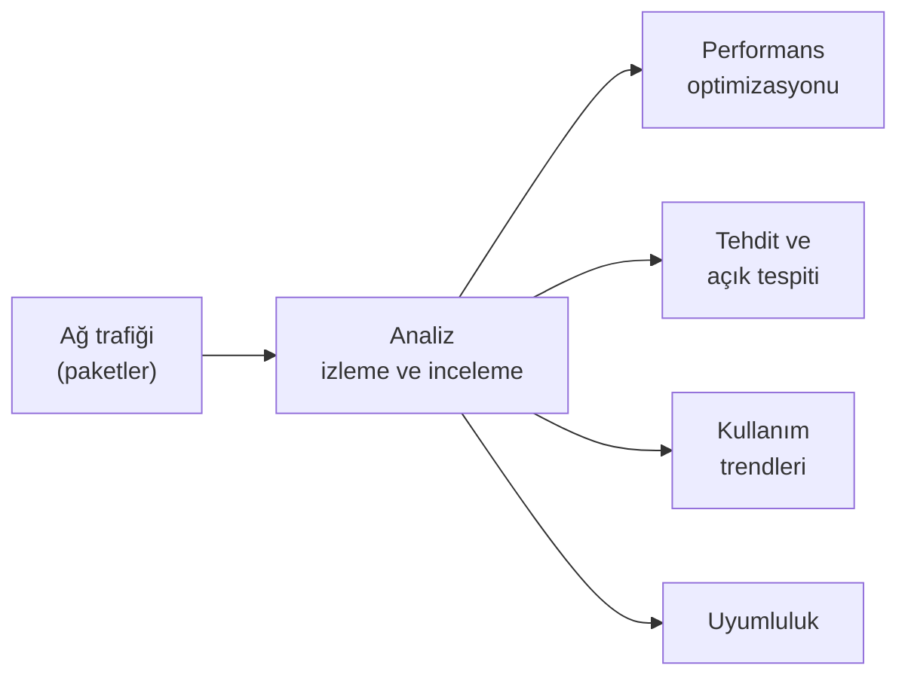

# Bölüm 1 - Giriş

> 📚 [İndeks](00_A%C4%9F_Trafi%C4%9Fi_Analizi_%C4%B0ndeks.md)

## 1. Ağ Trafiği Analizi Nedir?
**Ağ Trafiği Analizi (Network Traffic Analysis, NTA)**, bir bilgisayar ağındaki **veri paketlerinin akışını izleme ve analiz etme** işlemidir.

Bu analiz şunlar için kullanılır:
- **Ağ performansını optimize etmek**
- **Güvenlik açıklarını ve tehditleri belirlemek**
- **Ağ kullanım trendlerini anlamak**

Ayrıca güvenlik standartlarının karşılanmasını da kolaylaştırır.

## 2. Neden Önemli?
Saldırganlar **tespitten kaçınmak için yöntemlerini sürekli günceller**; bu yüzden güvenlik analistlerinin onları bulması ve önlem alması zorlaşabilir. Ağ trafiği, saldırganın bırakamayacağı bir iz olduğu için (veri ağdan geçmek zorundadır), böyle durumlarda analiz özellikle önem kazanır.

## 3. Kullanım Alanları
Bu teknoloji sıklıkla şunlar için kullanılır:

| Kullanım | Ne sağlar? |
|---|---|
| **Anormallik tespiti** | Ağdaki sıra dışı ve şüpheli trafik modellerini belirleyerek siber saldırıların **erken aşamada** tespit edilmesini sağlar. |
| **Uyumluluk raporlama** | Ağ güvenliğinin ilgili yasalara ve düzenlemelere uymasını sağlamaya yardımcı olur. |
| **Monitörleme** | Standart dışı portlardan gelen trafiği, şüpheli kaynakları ve HTTP hataları veya TCP sorunları gibi **ağ protokolü arızalarını** tespit etmeyi sağlar. |
| **Botnet ve uzaktan erişim saldırılarını tespit** | Botnet tarafından kontrol edilen cihazların ağdaki faaliyetlerini izleyerek botnet saldırılarının önlenmesine yardımcı olur. |

> [!TIP]
> **Örnekler**
> - *Standart dışı port:* Web sunucusu olmayan bir makineden `4444` gibi alışılmadık bir porta giden bağlantı şüphelidir.
> - *Protokol arızası:* Çok sayıda HTTP `403`/`500` hatası ya da TCP yeniden iletimleri hem arızaya hem saldırı denemesine işaret edebilir.
> - *Botnet:* Bir cihazın düzenli aralıklarla aynı dış adrese bağlanması (beacon) komuta-kontrol (C2) iletişimi belirtisi olabilir.

## 4. Diğer Notlarla İlişkisi
- Ağ trafiğini yakalayan ve merkezi olarak analiz eden araçlar (tcpdump, Wireshark, ELK, SIEM): [Bölüm 3 - Temel Araçlar](03_Temel_Ara%C3%A7lar.md)
- Port ve bağlantı komutları (`ss`, `netstat`, `ping`): [Ağ Yapılandırması ve Güvenliği](../Linux_Komutlar%C4%B1/06_A%C4%9F_Yap%C4%B1land%C4%B1rmas%C4%B1_ve_G%C3%BCvenli%C4%9Fi.md)
- Trafiği filtreleyen güvenlik duvarı: [Iptables](../Linux_Komutlar%C4%B1/07_Iptables_G%C3%BCvenlik_Duvar%C4%B1.md)
- Kablosuz ağda paket yakalama ve çözme: [Wi-Fi Hackleme](../Wi-Fi%20Hackleme/00_Wi-Fi_Hackleme_%C4%B0ndex.md)

---
> 📚 [İndeks](00_A%C4%9F_Trafi%C4%9Fi_Analizi_%C4%B0ndeks.md) · [Bölüm 2 - Hatırlatmalar](02_Hat%C4%B1rlatmalar.md) ▶
