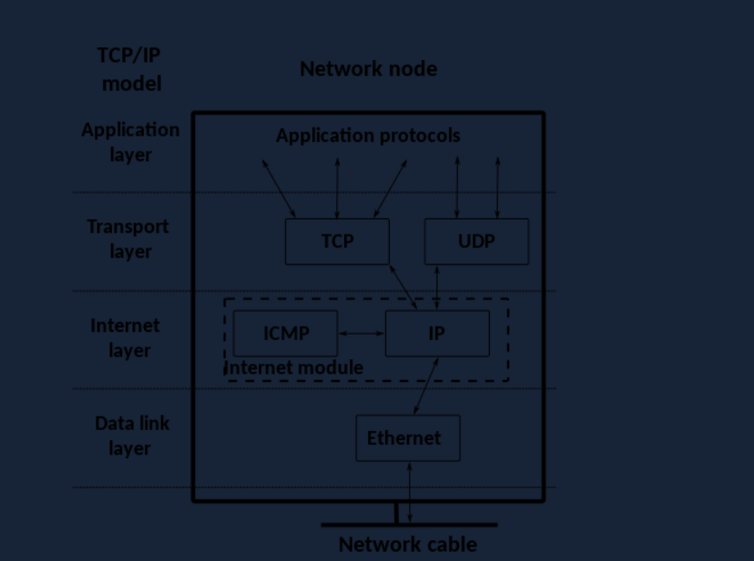
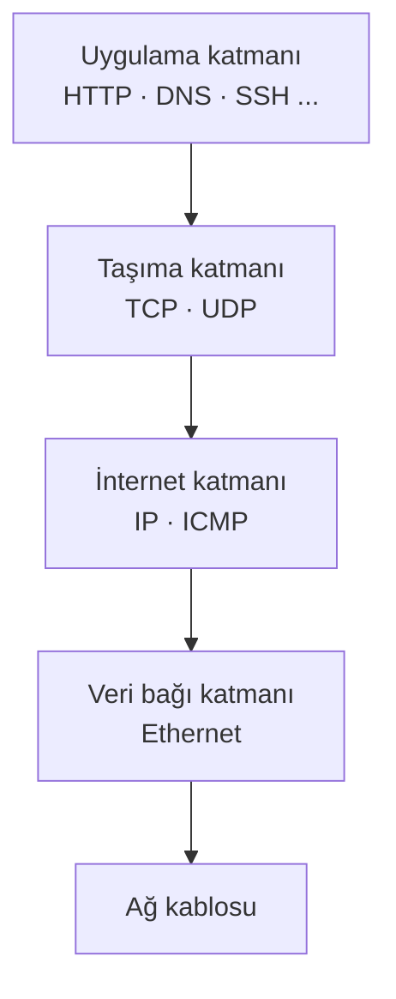

# Bölüm 2 - Hatırlatmalar

> ◀ [Bölüm 1 - Giriş](01_Giri%C5%9F.md) · 📚 [İndeks](00_A%C4%9F_Trafi%C4%9Fi_Analizi_%C4%B0ndeks.md)

`tcpdump` ve Wireshark gibi ağ analizi araçlarına geçmeden önce ağ temellerini kısaca tekrar ediyoruz.

## 1. Ağ Yapıları
**Ağ**, birbirleriyle iletişim kurabilen birden fazla bilgisayar ve cihazdan oluşan bir sistemdir.

### Ağ türleri

| Tür | Açıklama |
|---|---|
| **LAN** (Yerel Alan Ağı) | Kablolu veya kablosuz bağlantıyla, sınırlı bir alanda (bina, ofis) bir araya gelen cihazlar arasındaki ağ. |
| **WAN** (Geniş Alan Ağı) | Şehirlerarası veya kıtalararası bağlantıları içeren geniş coğrafi alanlardaki ağ. |
| **MAN** (Metropoliten Alan Ağı) | Bir şehir gibi belirli bir coğrafi bölgeyi kapsayan ağ. |

### Ağ cihazları

| Cihaz | Görevi |
|---|---|
| **Yönlendirici (Router)** | **Farklı ağlar** arasındaki veri paketlerini yönlendirir. |
| **Anahtar (Switch)** | **Aynı ağdaki** cihazlar arasındaki veri iletişimini sağlar. |
| **Modem** | İnternet servis sağlayıcısının ağına bağlantıyı sağlar. |
| **Ağ Arabirimi Kartı (NIC)** | Bir bilgisayarın ağa bağlanmasını sağlar. |

### Temel kavramlar

| Kavram | Açıklama |
|---|---|
| **Ağ protokolü** | Ağdaki cihazların birbirleriyle nasıl iletişim kuracağını tanımlayan kurallar bütünü. **TCP/IP** en yaygın olanıdır. |
| **IP adresi** | Ağdaki her cihaza atanan **benzersiz sayısal kimlik.** |
| **MAC adresi** | Bir ağ arabirimi kartına (NIC) atanan **benzersiz fiziksel kimlik.** |
| **Alt ağ (Subnet)** | Bir ağın daha küçük parçalara bölünmesi; trafiği optimize etmeye ve güvenliği artırmaya yardımcı olur. |
| **VPN** (Sanal Özel Ağ) | İnternet üzerinden güvenli bağlantı kurarak özel bir ağ oluşturur. |
| **DNS** (Alan Adı Sistemi) | Alan adlarını IP adreslerine çevirerek internette gezinmeyi kolaylaştırır. |
| **DHCP** (Dinamik Ana Bilgisayar Yapılandırma Protokolü) | Ağdaki cihazlara **otomatik IP adresi** atar. |
| **NAT** (Ağ Adresi Çevirisi) | Birden fazla cihazın **tek bir IP adresiyle** internete erişmesini sağlar. |
| **Güvenlik duvarı (Firewall)** | Yetkisiz erişimi engelleyip ağ güvenliğini sağlar. |

> [!TIP]
> IP ve MAC farkı: **IP adresi** ağa göre değişebilir (mantıksal adres), **MAC adresi** kartın fiziksel kimliğidir. Paket analizinde ikisi de ayrı katmanlarda görünür (aşağıda). Linux'ta adresleri `ip a` ile görürsün: [Ağ Yapılandırması ve Güvenliği](../Linux_Komutlar%C4%B1/06_A%C4%9F_Yap%C4%B1land%C4%B1rmas%C4%B1_ve_G%C3%BCvenli%C4%9Fi.md). Güvenlik duvarı kuralları için: [Iptables](../Linux_Komutlar%C4%B1/07_Iptables_G%C3%BCvenlik_Duvar%C4%B1.md).

## 2. TCP/IP
**TCP/IP (Transmission Control Protocol / Internet Protocol - İletim Denetim Protokolü / İnternet Protokolü)**, modern internetin ve birçok özel bilgisayar ağının temelini oluşturan **iletişim protokolleri ailesidir.** İnternetteki cihazların birbiriyle nasıl iletişim kurduğunu tanımlayan standartlaştırılmış kurallar bütünüdür.

TCP/IP, farklı donanım ve yazılıma sahip cihazların farklı ağlar üzerinden **kesintisiz veri alışverişi** yapabilmesini sağlar. Verinin kaynaktan hedefe giderken izlediği yolu, **paketlere bölünmesini, iletilmesini, birleştirilmesini** ve hataların nasıl kontrol edileceğini tanımlar.

Şemadaki katmanlar (yukarıdan aşağıya):

| Katman | Şemadaki karşılığı | Görev |
|---|---|---|
| **Application layer** (Uygulama) | Uygulama protokolleri | Kullanıcıya hizmet veren protokoller (HTTP, DNS, SSH...) |
| **Transport layer** (Taşıma) | **TCP**, **UDP** | Veriyi uçtan uca taşır; portlar bu katmandadır. |
| **Internet layer** (İnternet) | **IP**, **ICMP** | Adresleme ve yönlendirme (IP); hata/durum mesajları (ICMP). |
| **Data link layer** (Veri bağı) | **Ethernet** | Fiziksel ağ kablosu üzerinden iletişim; MAC adresleri burada. |

Şemanın en altında **ağ kablosu (network cable)** yer alır.

> [!NOTE]
> Paket analizinde bir paket bu katmanların **iç içe sarılmış** hali olarak görünür (Ethernet → IP → TCP/UDP → uygulama verisi). Wireshark'ta paket detayları bu sırayla listelenir. `ping`, ICMP kullanır ([Ağ Yapılandırması](../Linux_Komutlar%C4%B1/06_A%C4%9F_Yap%C4%B1land%C4%B1rmas%C4%B1_ve_G%C3%BCvenli%C4%9Fi.md)).

## 3. Yaygın Portlar ve Servisler
**Port**, bir bilgisayar programının ağ üzerinden veri gönderip alabildiği **sanal bir bağlantı noktasıdır.** Her port numarası belirli bir servise ayrılmıştır.

| Port | Servis | Açıklama |
|---|---|---|
| `21` | **FTP** | Dosya Transfer Protokolü |
| `22` | **SSH** | Güvenli Kabuk Protokolü |
| `23` | **Telnet** | Uzaktan Erişim Protokolü |
| `25` | **SMTP** | Basit E-posta Aktarım Protokolü |
| `53` | **DNS** | Alan Adı Sistemi |
| `80` | **HTTP** | Hiper Metin Transfer Protokolü (Web) |
| `110` | **POP3** | Postane Ofisi Protokolü 3 (gelen e-posta) |
| `143` | **IMAP** | İnternet Mesaj Erişim Protokolü (gelen e-posta) |
| `161` | **SNMP** | Basit Ağ Yönetim Protokolü |
| `443` | **HTTPS** | Güvenli HTTP |
| `3389` | **RDP** | Uzaktan Masaüstü Protokolü |

> [!WARNING]
> **Analiz gözüyle portlar**
> - **Şifresiz protokoller:** FTP (`21`), Telnet (`23`), HTTP (`80`), POP3 (`110`) ve IMAP (`143`) varsayılan olarak veriyi (kullanıcı adı, parola dahil) **düz metin** taşır; trafik yakalanırsa doğrudan okunabilir. SSH (`22`) ve HTTPS (`443`) şifrelidir.
> - **Standart dışı port:** Bu tablodaki servislerin dışında bir portta yoğun trafik görmek, [Bölüm 1'deki](01_Giri%C5%9F.md) "monitörleme" kullanım alanıdır ve şüphe uyandırır (örn. bilinmeyen bir servis ya da arka kapı).
> - **Yönetim portları:** SSH (`22`), RDP (`3389`) ve Telnet (`23`) kaba kuvvet saldırılarının sık hedefidir. Linux'ta dinleyen portları görmek için `ss -tulpn` ([Ağ Yapılandırması](../Linux_Komutlar%C4%B1/06_A%C4%9F_Yap%C4%B1land%C4%B1rmas%C4%B1_ve_G%C3%BCvenli%C4%9Fi.md)).

> [!TIP]
> DNS (`53`) genelde **UDP**, web (`80`/`443`), SSH ve SMTP gibi güvenilir aktarım isteyen servisler **TCP** kullanır. Hangisinin kullanıldığı taşıma katmanı başlığında görünür.

---
> ◀ [Bölüm 1 - Giriş](01_Giri%C5%9F.md) · 📚 [İndeks](00_A%C4%9F_Trafi%C4%9Fi_Analizi_%C4%B0ndeks.md)
