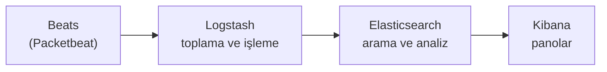

# Bölüm 3 - Temel Araçlar

> ◀ [Bölüm 2 - Hatırlatmalar](02_Hat%C4%B1rlatmalar.md) · 📚 [İndeks](00_A%C4%9F_Trafi%C4%9Fi_Analizi_%C4%B0ndeks.md)

Ağ trafiği analizinde kullanılan araçlar iki gruba ayrılır:

| Grup | Araçlar | Ne yapar? |
|---|---|---|
| **Temel araçlar** | tcpdump, Wireshark | Paketleri yakalar ve inceler |
| **Merkezi analiz platformları** | Elastic (ELK) Stack, SIEM | Çok sayıda kaynaktan gelen veriyi toplar, arar, görselleştirir |

## 1. Temel Araçlar

### tcpdump
Güçlü bir **komut satırı** aracıdır. Farklı filtrelere (protokol, IP adresi, port numarası gibi) dayalı olarak bir ağ arabiriminde **paketleri yakalamanı** sağlar.

| Avantajları | Zorlukları |
|---|---|
| Son derece hızlı ve esnek | Grafik arayüzü yok |
| Hafif | Büyük yakalamaları analiz etmek zor olabilir |
| Birçok Unix benzeri sistemde bulunur | |

### Wireshark
Zengin kullanıcı arayüzüne sahip, popüler **grafiksel** paket analiz aracıdır. Kapsamlı analiz özellikleri, protokol ayrıştırıcıları (dissector) ve görselleştirmeler sunar.

| Avantajları | Zorlukları |
|---|---|
| Derin paket incelemesi | Etkili kullanmak için pratik gerekir |
| Kullanıcı dostu arayüz | |
| Filtreleme yetenekleri | |
| Yakalama dosyalarını kaydetme ve yükleme | |

> [!TIP]
> **Hangisi ne zaman?** Sunucuda (arayüz yokken, SSH ile) hızlıca yakalama yapmak için **tcpdump**; yakalanan dosyayı ayrıntılı incelemek için **Wireshark**. İkisi birlikte kullanılır: tcpdump ile yakala, Wireshark'ta aç.

## 2. Merkezi Analiz Platformları

### Elastic (ELK) Stack
Açık kaynaklı araçlardan oluşan bir pakettir. Birden fazla veri kaynağında güçlü arama ve analiz, özelleştirilebilir görselleştirmeler ve büyük ölçekli izleme için ölçeklenebilirlik sunar. İlk başta **kurması ve ayarlaması zor** olabilir.

Şu bileşenlerden oluşur:

| Bileşen | Görevi |
|---|---|
| **Elasticsearch** | Ölçeklenebilir arama ve analiz motoru |
| **Logstash** | Log toplama ve işleme hattı |
| **Beats** (örn. **Packetbeat**) | Ağ verileri için hafif veri taşıyıcılar |
| **Kibana** | Veri görselleştirme ve gösterge panosu arayüzü |

### SIEM (Güvenlik Bilgileri ve Olay Yönetimi)
Ağ trafiği dahil çeşitli **günlük (log) ve olay verilerini** toplayan özel güvenlik platformlarıdır. Örnekler: **Splunk, QRadar, ArcSight.**

| Avantajları | Zorlukları |
|---|---|
| Farklı kaynaklardan gelen logların **korelasyonu** | Pahalı olabilir |
| Tehdit algılama ve **uyarma** | Karmaşık kurulum ve bakım gerektirebilir |
| Olay müdahale (**SOAR**) desteği | Sürekli monitörleme yapacak güvenlik analistleri gerekebilir |

## 3. Karşılaştırma

| | tcpdump | Wireshark | ELK Stack | SIEM |
|---|---|---|---|---|
| Arayüz | Komut satırı | Grafiksel | Web (Kibana) | Web |
| Ölçek | Tek arabirim/yakalama | Tek yakalama dosyası | Çok kaynak, büyük ölçek | Çok kaynak, büyük ölçek |
| Ana iş | Paket yakalama | Derin paket inceleme | Arama, görselleştirme | Korelasyon, uyarı |
| Maliyet/kurulum | Hafif, hazır | Kolay | Açık kaynak, kurulumu zor | Genelde pahalı |

---
> ◀ [Bölüm 2 - Hatırlatmalar](02_Hat%C4%B1rlatmalar.md) · 📚 [İndeks](00_A%C4%9F_Trafi%C4%9Fi_Analizi_%C4%B0ndeks.md)
