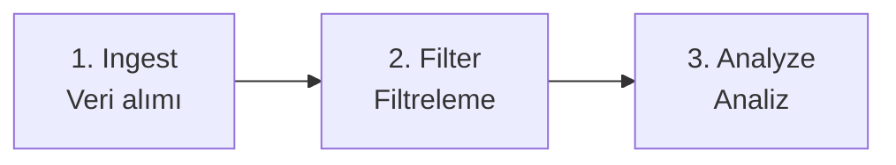

# Bölüm 4 - Ağ Analizi Süreci

> ◀ [Bölüm 3 - Temel Araçlar](03_Temel_Ara%C3%A7lar.md) · 📚 [İndeks](00_A%C4%9F_Trafi%C4%9Fi_Analizi_%C4%B0ndeks.md)

Ağ trafiği analizi, karmaşıklığı değişken bir süreçtir. Basit bir gözlemden karmaşık veri yakalama ve analizlere kadar geniş bir yelpazede uygulanabilir.

| Seviye | Nasıl yapılır? | Ne için? |
|---|---|---|
| **Basit** | Wireshark veya tcpdump ile **canlı trafik akışını izlemek** | Ağdaki aktiviteler hakkında genel fikir edinmek, sorun gidermek, trafik modellerini anlamak |
| **Karmaşık** | Ağdan veri yakalamak için **taps** kullanmak, verileri **SIEM** ile entegre etmek, yakalanan paketleri (**PCAP dosyaları**) titizlikle incelemek | Güvenlik odaklı çalışmalarda saldırı imzalarını ve şüpheli aktiviteleri belirlemek |

> [!NOTE]
> **Tap (Test Access Point):** Ağ kablosuna takılan, trafiği kopyalayıp analiz cihazına ileten donanım ya da yazılım noktasıdır. Böylece trafiğe müdahale etmeden kayıt alınır. **PCAP**, yakalanan paketlerin kaydedildiği dosya biçimidir; Wireshark ve tcpdump bu dosyaları üretir ve açar ([Bölüm 3](03_Temel_Ara%C3%A7lar.md)).

## 1. İş Akışı
Genel olarak tüm analizler **3 adımdan** oluşur:

### 1. Ingest (Veri Alımı)
- **Veri yakalama:** tcpdump, Wireshark veya Elastic Stack'teki Beats gibi araçlarla ağ trafiği yakalanır.
- **Toplama:** Mevcut loglardan (güvenlik duvarı, uygulama, web sunucusu logları vb.) ek veri toplanabilir; böylece ağ etkinliğinin **daha kapsamlı** bir görünümü oluşur.
- **Veri saklama ve dizine ekleme:** Yakalanan trafik Wireshark'ta **pcap dosyaları** olarak saklanabilir ya da veriyi depolamak ve dizinlemek (indeks) için Elastic Stack veya bir **SIEM** gibi merkezi bir sisteme gönderilebilir.

### 2. Filter (Filtreleme)
- **Hedeflerin tanımlanması:** Neyi aradığın açık olsun: belirli bir saldırı tipi, sorun giderme için bir anormallik, performans sorunları vb.
- **Arama sorgularının oluşturulması:** Araçlarla aradığın trafik türüne uyan filtreler oluştur. Örneğin:
  - Belirli bir **protokol** (HTTP, DNS vb.)
  - **Kaynak/hedef IP adresi** ile ilgili trafik
  - Belirli **portları** kullanan iletişim ([yaygın portlar](02_Hat%C4%B1rlatmalar.md))
- **Filtrelenen verilerin işlenmesi:** Filtreler uygulandıktan sonra artık **daha küçük, odaklanmış** verilerle çalışırsın.

### 3. Analyze (Analiz)
- **Kalıpların ve anormalliklerin aranması:** Hedeflerine bağlı olarak filtrelenmiş trafikte dikkat çekici kalıplar ararsın. Örneğin:
  - Trafikteki **büyük artışlar** veya **beklenmedik düşüşler**
  - Şüpheli portlardaki veya hedef protokollerle ilgili trafik
  - **Yetkisiz erişim girişimleri** belirtileri (giriş denemelerinde başarısızlıklar gibi)
- **Temel çizginin (baseline) karşılaştırılması:** "Normal" trafiğin nasıl göründüğünü anlamak, işleri bağlama oturtmak için önemlidir. Temel çizgi anormallikleri tanımlamana yardımcı olur.
- **Araştırma ve raporlama:** Anomali bulunca nedenlerini belirlemek için daha derin araştırma yapılır. Bulguları ve alınabilecek önlemleri içeren bir **rapor** oluşturman gerekebilir.

> [!TIP]
> Bu aşamada **not almak** (kağıt, markdown, mind-mapping vb.) ve bulguların özetini geçmek önem kazanır.

| Adım | Soru | Çıktı |
|---|---|---|
| **Ingest** | Veriyi nasıl toplarım? | Pcap dosyaları, loglar, merkezi depo |
| **Filter** | Ne arıyorum? | Küçük, odaklı veri kümesi |
| **Analyze** | Normalden farkı ne? | Bulgular ve rapor |

## 2. Analiz Yaklaşımı

### Önce standart protokoller
**HTTP, DNS, DHCP** gibi yaygın protokollerin anlaşılması önemlidir. Bu protokollerle ilgili gerçekleşen trafik ile beklentilerin arasındaki farklar, sorun veya saldırı belirtilerini ortaya çıkarabilir.

> **Örnek:** İç ağda SSH bağlantıları çok kullanılmıyorsa, bir anda **birden çok sunucuya** yollanan SSH istekleri dikkatini çekmelidir.

### Hedef odaklı ol
Neyi aradığına net karar ver: performans sorunları mı, güvenlik ihlali mi, sıra dışı durumlar mı? Filtrelerini bu hedeflere göre tasarla.

> **Örnek:** Bir güvenlik ihlalini araştırırken belirli bir IP adresine yapılan tüm TCP bağlantılarını filtrele ve bu bağlantılardaki paketlerin içeriğini (**payload**) analiz et.

### Kalıpları ara
Trafik yoğunluğundaki dalgalanmalar, sıra dışı protokoller, başarısız erişim denemeleri gibi kalıpları gözle.

> **Örnek:** Birden çok istemci aynı anda bir sunucuya istek atıyorsa bu bir **C&C (komuta-kontrol) sunucusu** olabilir.

### Uçtan uca bağlantıları incele
Bireysel cihazlar arasındaki iletişime dikkat et. Kötü niyetli aktivitede şüpheli hedef IP, yetkisiz erişim denemeleri gibi göstergelere rastlayabilirsin.

> **Örnek:** İç ağlarda genelde client'tan client'a bağlantı çok olmaz. Yönetici dışındaki bir istemci sunucuya **RDP veya VNC** ile bağlanmaya çalışıyorsa alarmlar çalmaya başlayabilir.

### Ayrışan olayları ara
Ağında normalde görülmeyen olaylar (nadir kullanılan portlar, bilinmeyen protokoller) dikkatle incelenmelidir.

> **Örnek:** Bir sunucu, web sunucusu olmadığı halde başka bir istemciyle **443 portu** üzerinden konuşmaya başlıyorsa bu şüpheli bir olaydır.

### Yardım istemekten korkma
Ağ trafiği analizi karmaşık olabilir. Daha deneyimli kişilerle işbirliği yap, farklı bakış açılarından faydalan.

## 3. Yaklaşımların Özeti

| İlke | Kısaca | Şüpheli örnek |
|---|---|---|
| Önce standart protokoller | HTTP, DNS, DHCP'yi bil | Birden çok sunucuya anlık SSH istekleri |
| Hedef odaklı ol | Neyi aradığını bil | Belirli IP'ye giden TCP bağlantıları ve payload |
| Kalıpları ara | Dalgalanma, başarısız deneme | Çok istemcinin aynı sunucuya istek atması (C&C?) |
| Uçtan uca incele | Cihazlar arası iletişime bak | Yönetici olmayan istemciden RDP/VNC |
| Ayrışan olayları ara | Normal dışı port/protokol | Web sunucusu olmayan makinede 443 trafiği |
| Yardım iste | Birlikte çalış | - |

> [!TIP]
> Buradaki örnekler, [Bölüm 1'deki](01_Giri%C5%9F.md) kullanım alanlarının (anormallik tespiti, monitörleme, botnet tespiti) uygulamadaki karşılığıdır.

---
> ◀ [Bölüm 3 - Temel Araçlar](03_Temel_Ara%C3%A7lar.md) · 📚 [İndeks](00_A%C4%9F_Trafi%C4%9Fi_Analizi_%C4%B0ndeks.md)
