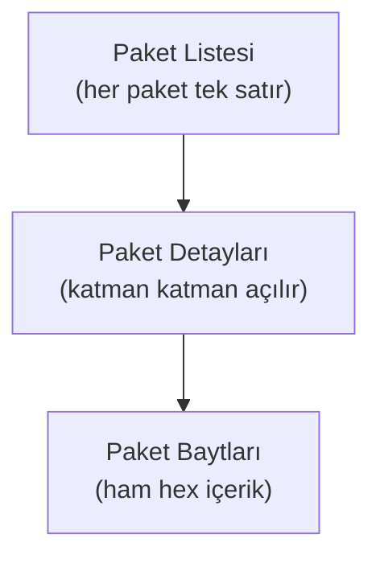

# Bölüm 6 - Wireshark ile Ağ Analizi

> 📚 [İndeks](00_A%C4%9F_Trafi%C4%9Fi_Analizi_%C4%B0ndeks.md) · ◀ [Bölüm 5 - tcpdump](05_tcpdump_Temelleri.md)

**Wireshark**, ağ trafiğini yakalamak, incelemek ve sorun gidermek için kullanılan ücretsiz ve açık kaynaklı bir paket analiz aracıdır. En yaygın ağ analiz araçlarından biridir. [tcpdump](05_tcpdump_Temelleri.md) komut satırında hızlıdır, Wireshark ise aynı işi grafik arayüzle ve çok daha ayrıntılı yapar.

---

## 1. Özellikler

| Özellik | Açıklama |
|---|---|
| Canlı paket yakalama | Ethernet, Wi-Fi, Bluetooth gibi arabirimlerden canlı trafik yakalar |
| Derin inceleme | Yüzlerce protokolü (TCP, UDP, HTTP, DNS, DHCP...) çözümler, alanlarını tek tek gösterir |
| Güçlü filtreleme | Protokole, IP'ye, porta ve diğer kriterlere göre zengin bir filtre dili sunar |
| Paket yeniden oluşturma | TCP oturumlarını ve veri akışlarını birleştirir. Web sayfası ve dosya aktarımı yeniden kurulabilir |
| Platform desteği | Windows, macOS, Linux |
| Grafik arayüz | Yeni başlayanlar için de kolay |

**Kullanmanın şartları**
- **Yetki:** Canlı yakalama için root/yönetici yetkisi ya da `wireshark` grubu gerekir.
- **Temel ağ bilgisi:** Protokolleri ve katmanları bilmek işi çok kolaylaştırır ([Bölüm 2](02_Hat%C4%B1rlatmalar.md)).
- **Sabır:** Sorun bulmak zaman alır.

---

## 2. Linux'a Kurulum

```bash
# Debian / Ubuntu / Kali
sudo apt update
sudo apt install wireshark

# RHEL / Fedora
sudo dnf install wireshark
```

Kurulum sırasında "root olmayan kullanıcılar paket yakalayabilsin mi?" diye sorulursa **Evet** de. Sonradan değiştirmek için `sudo dpkg-reconfigure wireshark-common` kullanılır.

Canlı yakalama için kullanıcıyı `wireshark` grubuna ekle:

```bash
sudo usermod -aG wireshark <KULLANICI_ADI>
```

Grup değişikliğinin geçerli olması için **oturumu kapatıp yeniden aç**. Sonra başlat:

```bash
wireshark
```

> [!TIP]
> Grup üyeliğini `id` komutuyla kontrol edebilirsin. Bkz. [Grup Yönetimi](../Linux_Temelleri/11_Grup_Y%C3%B6netimi.md).

> [!WARNING]
> Wireshark'ı `sudo wireshark` ile root olarak çalıştırmak önerilmez. Protokol çözücüleri çok büyük bir kod tabanıdır ve zararlı paketlerle istismar edilebilir. Grup yöntemi daha güvenlidir.

---

## 3. Arayüz Bölümleri

| Bölüm | Görevi |
|---|---|
| **Araç çubuğu** | Başlat/durdur, kaydet, aç, filtre uygula gibi hızlı işlevler |
| **Görüntüleme filtresi çubuğu** | Yakalanan paketleri filtre ifadeleriyle daraltır. Sadece ekranı sınırlar, veriyi değiştirmez |
| **Son dosyalar** | Yakın zamanda açılan yakalama dosyalarına hızlı erişim |
| **Yakalama filtresi ve arabirimler** | Yakalamayı başlatmadan önce arabirimi ve isteğe bağlı yakalama filtresini seçersin |
| **Durum çubuğu** | Paket sayısı, gösterilen paket, profil, olası ağ sorunu mesajları |

> [!NOTE]
> **Yakalama filtresi ile görüntüleme filtresi farklıdır.**
> - **Yakalama filtresi** (BPF, tcpdump ile aynı söz dizimi): Yakalamadan önce uygulanır, filtreye uymayan paket hiç kaydedilmez. Örn: `port 80`
> - **Görüntüleme filtresi** (Wireshark'a özel): Yakalanan paketleri sonradan gizler/gösterir, veri durur. Örn: `tcp.port == 80`

---

## 4. Trafik Yakalama ve Kaydetme

1. Arabirim listesinde aktif olana **çift tıkla** ya da araç çubuğundaki **yüzgeç** simgesine bas. Dinleme başlar.
2. Yeterince paket yakalayınca yüzgecin yanındaki **kırmızı kare** ile durdur.
3. **File → Save** (Ctrl+S) ile `.pcapng` olarak kaydet.

> [!NOTE]
> **Normal modda ne görürsün?**
> Wi-Fi arabirimini (`wlan0`) normal (managed) modda dinlediğinde yalnızca şunları görürsün:
> - Senden çıkan ve sana gelen paketler
> - Herkese giden **broadcast** ve **multicast** paketleri (ARP "Who has...?", SSDP `NOTIFY`, IGMP, LLMNR gibi)
>
> Başka cihazların kendi aralarındaki trafiğini görmek için kartı **monitor moda** almak gerekir. Bkz. [Wi-Fi Çalışma Modları](../Wi-Fi%20Hackleme/05_Wi-Fi_%C3%87al%C4%B1%C5%9Fma_Modlar%C4%B1.md) ve [tcpdump notundaki açıklama](05_tcpdump_Temelleri.md).

---

## 5. Kaydedilmiş Dosyayı (PCAP) Açmak

1. Wireshark'ı aç.
2. **File → Open** (Ctrl+O).
3. Analiz etmek istediğin PCAP dosyasını seç ve **Open**'a tıkla.

Çoğu sistemde dosyayı dosya yöneticisinden Wireshark penceresine **sürükleyip bırakmak** da çalışır.

> [!TIP]
> [tcpdump](05_tcpdump_Temelleri.md) ile `-w output.pcap` diyerek yakaladığın dosyayı doğrudan Wireshark'ta açabilirsin. Sunucuda tcpdump, masaüstünde Wireshark ile analiz yapmak yaygın bir iş akışıdır.

---

## 6. PCAP Verisini Anlamak: Üç Bölme



| Bölme | Konum | İçerik |
|---|---|---|
| **Paket Listesi** | Üst | Her paket tek satır: numara, zaman, kaynak IP, hedef IP, protokol, kısa bilgi (Info) |
| **Paket Detayları** | Orta | Seçilen paketin protokol katmanları (Ethernet, IP, TCP, HTTP...). Katmanı açınca başlık alanlarını görürsün |
| **Paket Baytları** | Alt | Seçilen paketin ham, hexadecimal içeriği |

---

## 7. Paket Renklendirme

Wireshark protokollere ve olağan dışı durumlara göre satırları renklendirir.

| Renk | Anlamı |
|---|---|
| Açık mor | TCP trafiği |
| Açık mavi | UDP trafiği |
| Açık yeşil | HTTP trafiği |
| Siyah (kırmızı yazı) | Hatalı paketler |

> [!NOTE]
> Renkler Wireshark sürümüne ve temaya göre biraz değişebilir. ARP genelde sarımsı görünür. Bir paketin ne olduğunu rengine değil **Protocol** sütununa bakarak anla.

**Kuralları özelleştirmek:** **View → Coloring Rules** menüsünden mevcut kuralları düzenleyebilir veya yenisini ekleyebilirsin. Renk; protokole, port numarasına ya da herhangi bir filtre ifadesine göre ayarlanabilir.

---

## 8. Paket İnceleme

Paket Detayları bölmesi her katmanı ayrı bir satırda gösterir:

| Satır | Katman | Gösterdiği |
|---|---|---|
| **Frame** | Wireshark'ın yakalama bilgisi | Paket numarası, boyut, yakalanan arabirim, zaman |
| **Ethernet II** | Bağlantı (MAC) katmanı | Kaynak ve hedef MAC adresleri, Ethernet tipi |
| **Internet Protocol** | Ağ katmanı | Kaynak ve hedef IP adresleri, TTL |
| **TCP / UDP** | Taşıma katmanı | Kaynak ve hedef portlar, bayraklar, sıra numaraları |
| **HTTP / DNS / FTP...** | Uygulama katmanı | Uygulama protokolünün verisi |

> [!NOTE]
> Ders metni "Frame"i Ethernet düzeyinde çerçeve olarak anlatıyor. Aslında **Frame** satırı Wireshark'ın kendi eklediği yakalama bilgisidir (boyut, zaman, arabirim). MAC adresleri **Ethernet II** satırındadır. Katman eşleşmesi için bkz. [Bölüm 2 - TCP/IP modeli](02_Hat%C4%B1rlatmalar.md).

---

## 9. Paketlerde Gezinme

Büyük yakalamalarda aradığını bulmak için:

### Paket numaraları
Her pakete yakalanma sırasına göre bir numara verilir (listede en soldaki sütun). Belirli bir pakete atıfta bulunmak için kullanılır.

### Go to Packet (Pakete Git)
1. **Go → Go to Packet...** (Ctrl+G)
2. Paket numarasını gir.
3. **Go to Packet**'a tıkla.

### Find Packets (Paketleri Bul)
1. **Edit → Find Packet...** (Ctrl+F)
2. Arama ölçütünü seç:
   - **String**: paket verisinde belirli bir metin
   - **Display filter**: protokole dayalı arama
   - **Hex value**: belirli bir bayt dizisi
3. **Find**'a tıkla.

---

## 10. Sık Kullanılan Görüntüleme Filtreleri

Dersin ötesinde, başlangıçta işe yarayan birkaç filtre:

| Amaç | Filtre |
|---|---|
| Belirli bir IP | `ip.addr == 192.168.1.106` |
| Sadece kaynak IP | `ip.src == 192.168.1.106` |
| Belirli port | `tcp.port == 80` |
| Protokole göre | `dns`, `http`, `arp`, `ssdp` |
| Birleştirme | `ip.addr == 192.168.1.106 && tcp` |
| Belirli MAC | `eth.addr == 54:88:0e:75:b3:2e` |
| Metin arama | `frame contains "password"` |

> [!TIP]
> Filtre çubuğu yazarken **yeşil** olursa ifade geçerlidir, **kırmızı** olursa hatalıdır. Bir alana sağ tıklayıp **Apply as Filter → Selected** diyerek filtreyi otomatik de oluşturabilirsin.

> [!TIP]
> Bir TCP paketine sağ tıkla → **Follow → TCP Stream** ile o oturumun tüm konuşmasını tek ekranda okuyabilirsin. Düz metin protokollerde (HTTP, FTP, Telnet) şifre ve içerik açıkça görünür. Bu yüzden şifreli protokoller (HTTPS, SSH) önemlidir.

---

## Hızlı Özet

| Konu | Not |
|---|---|
| Kurulum | `sudo apt install wireshark` |
| Yetki | `sudo usermod -aG wireshark <kullanıcı>` + oturumu yeniden aç |
| Başlat | `wireshark` |
| Yakalamaya başla | Arabirime çift tıkla / yüzgeç |
| Durdur | Kırmızı kare |
| Dosya aç | Ctrl+O |
| Pakete git | Ctrl+G |
| Paket bul | Ctrl+F |
| Renk kuralları | View → Coloring Rules |
| Yakalama filtresi vs görüntüleme filtresi | Biri kaydı sınırlar (BPF), diğeri ekranı |

---
> ◀ [Bölüm 5 - tcpdump Temelleri](05_tcpdump_Temelleri.md) · 📚 [İndeks](00_A%C4%9F_Trafi%C4%9Fi_Analizi_%C4%B0ndeks.md) · [Bölüm 7 - Filtreleme](07_Wireshark_Filtreleme.md) ▶
