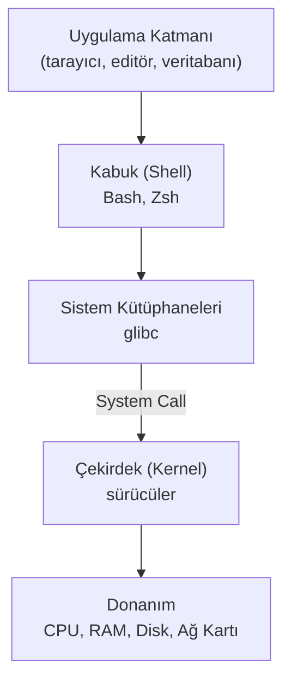
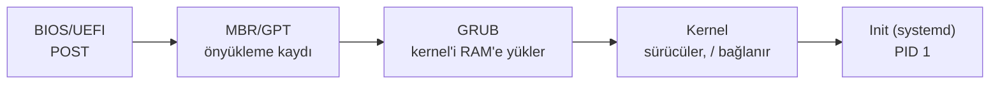

# Bölüm 1 - Linux'a Giriş

> 📚 [İndeks](00_Linux_Temelleri_%C4%B0ndeks.md)

Bu bölümde Linux'un temel kavramları, tarihçesi, günümüzdeki önemi ve işletim sisteminin dayandığı ana ilkeler ele alınıyor.

## 1. Linux Nedir?
Linux, 1991'de **Linus Torvalds** tarafından geliştirilen, **Unix mimarisine dayanan**, ücretsiz ve açık kaynaklı bir işletim sistemidir (OS). Hâlâ geliştirilmeye devam eder.
- Süper bilgisayarlardan sunuculara, telefonlardan kişisel bilgisayarlara kadar her yerde kullanılır.
- **Stabilitesi, güvenliği ve esnekliğiyle** tanınır; hem kişisel hem profesyonel kullanımda popülerdir.

## 2. Linux ve Windows Karşılaştırması

| Özellik | Linux | Windows |
|---|---|---|
| **Kaynak Kodu** | Açık kaynak (Open Source). Herkes kodu görebilir ve değiştirebilir. | Kapalı kaynak (Closed Source). Kod Microsoft'a aittir. |
| **Lisans** | Genellikle ücretsiz (GPL). | Ücretli lisans gerektirir. |
| **Dosya Sistemi** | Tek kök dizin (`/`) ve hiyerarşik yapı. Sürücü harfi yoktur. | Sürücü harfleri (`C:\`, `D:\`) kullanılır. |
| **Kullanıcı Arayüzü** | İsteğe bağlı. Birden çok masaüstü ortamı (GNOME, KDE) seçilebilir. | Yerleşik ve standart bir arayüzü vardır. |
| **Güvenlik** | İzin tabanlı yapı ve açık kaynak sayesinde zararlılara karşı daha dirençli. | Kullanıcı kitlesi büyük olduğu için zararlı yazılımların ana hedefi. |
| **Donanım Desteği** | Sürücüler çekirdekte (kernel) yerleşik gelir, çoğu donanımı otomatik tanır. | Sürücülerin ayrıca yüklenmesi gerekebilir. |

## 3. Linux Felsefesi
Linux, işbirliği ve özgürlük ruhunu temsil eder:
- **Özgürlük:** Kullanıcı yazılımı kontrol edebilir, değiştirebilir ve yeniden dağıtabilir. Bu inovasyonu ve güvenliği teşvik eder.
- **İşbirliği:** Dünya genelinde binlerce geliştirici katkı verir; sistem güncel, güvenli ve kullanıcı ihtiyaçlarına duyarlı kalır.
- **Şeffaflık:** Açık kaynak olması, kapalı (mülkiyetli) sistemlerle kıyaslanamayacak bir şeffaflık sağlar.
- **Her Şey Bir Dosyadır (Everything is a File):** Unix felsefesinin en belirgin özelliği. Dokümanlar, dizinler, diskler, klavye, yazıcı, hatta süreçler (processes) ve ağ bağlantıları birer dosya olarak temsil edilir. Bu, yönetimi ve programlamayı tutarlı hale getirir.
  - Süreçlerin `/proc/` altında dosya olarak tutulması bunun örneğidir → [Süreçler ve Görev Zamanlama](../Linux_Komutlar%C4%B1/04_S%C3%BCre%C3%A7ler_ve_G%C3%B6rev_Zamanlama.md)
- **Küçük ve Özelleşmiş Araçlar:** *"Bir şeyi yap ve onu iyi yap."* Komutlar tek bir görevi iyi yapacak şekilde tasarlanır; karmaşık işler bu araçların birbirine bağlanmasıyla (piping, `|`) yapılır → [Temel Komutlar](../Linux_Komutlar%C4%B1/01_Temel_Komutlar.md)

## 4. Linux Nasıl Çalışır?
- Sistemin kalbinde **Linux çekirdeği (kernel)** vardır. CPU, bellek ve çevre birimleri gibi donanımları yönetir.
- Çekirdek, **yazılım ile donanım arasında köprüdür:** Bir uygulama donanımla ilgili bir şey yapmak istediğinde (dosya kaydetmek, ekrana bir şey çizmek) çekirdeğe istek gönderir; çekirdek bu isteği donanımın anlayacağı talimatlara çevirir.
- Linux **çoklu görev (multitasking)** ve **çok kullanıcılı (multi-user)** bir sistemdir: Birden fazla kullanıcı aynı anda sisteme bağlanabilir ve her biri aynı anda birden fazla program çalıştırabilir. Bu özellikle sunucu ortamlarında önemlidir.

## 5. Linux Dosya Sistemi Hiyerarşisi (FHS)
Linux, sürücü harfleri yerine `/` (root) dizininden başlayan **tek bir ağaç yapısı** kullanır. Bu yapı **Filesystem Hierarchy Standard (FHS)** ile standartlaştırılmıştır.

| Dizin | Açıklama | İçerik Örneği |
|---|---|---|
| `/` (Root) | Dosya sisteminin başlangıç noktası. | Tüm sistem |
| `/bin` | Temel kullanıcı komutları (Binary). | `ls`, `cp`, `cat`, `bash` |
| `/boot` | Sistemin açılması için gereken dosyalar. | `vmlinuz` (Kernel), `initrd`, GRUB |
| `/dev` | Donanım aygıt dosyaları (Devices). | `/dev/sda` (Disk), `/dev/tty` (Terminal) |
| `/etc` | Sistem yapılandırma dosyalarının merkezi. | `/etc/passwd`, `/etc/ssh/sshd_config` |
| `/home` | Kullanıcıların kişisel dosyaları. | `/home/mehmet`, `/home/ali` |
| `/lib` | Programların ihtiyaç duyduğu kütüphaneler. | `libc.so`, kernel modülleri |
| `/mnt` & `/media` | Geçici bağlanan diskler ve USB bellekler. | `/media/usb-disk` |
| `/opt` | Elle kurulan 3. parti uygulamalar. | Google Chrome, TeamViewer |
| `/proc` | Sanal dosya sistemi, sistem bilgisini tutar. | `/proc/cpuinfo`, `/proc/meminfo` |
| `/root` | Sistem yöneticisinin (root) ev dizini. | Root'un özel dosyaları |
| `/sbin` | Sadece yöneticinin kullandığı kritik komutlar. | `iptables`, `fdisk`, `reboot` |
| `/tmp` | Geçici dosyalar. | Uygulama önbellekleri |
| `/usr` | İkincil hiyerarşi, kullanıcı araçları. | `/usr/bin/python`, `/usr/share` |
| `/var` | Boyutu sürekli değişen dosyalar. | Loglar (`/var/log`), web sitesi (`/var/www`) |

> [!TIP]
> Disk bağlama (`mount`, `/etc/fstab`) ve dosya sistemi türleri: [Dosya Sistemi ve Disk Yönetimi](../Linux_Komutlar%C4%B1/05_Dosya_Sistemi_ve_Disk.md) · Loglar (`/var/log`): [Sistem Logları](../Linux_Komutlar%C4%B1/13_Sistem_Loglar%C4%B1.md)

## 6. Linux Mimarisi
Linux, kaynakları yönetmek ve kullanıcı etkileşimini kolaylaştırmak için **katmanlı** bir yapıdadır.

- **Donanım Katmanı (Hardware):** CPU, RAM, disk, ağ kartı gibi fiziksel bileşenler.
- **Çekirdek Katmanı (Kernel):** İşletim sisteminin beyni.
  - **Kernel Space (Çekirdek Alanı):** Sadece çekirdeğin erişebildiği, donanımla doğrudan konuşan korumalı bellek alanı. Sürücüler burada çalışır.
  - **User Space (Kullanıcı Alanı):** Kullanıcı uygulamalarının çalıştığı kısıtlı alan. Donanıma erişmek için çekirdekten izin isterler (**System Call**).
- **Sistem Kütüphaneleri (System Libraries):** Çekirdeğin karmaşık fonksiyonlarını uygulamaların kullanabileceği basit fonksiyonlara çeviren aracılar (örn: `glibc`).
- **Kabuk Katmanı (Shell):** Kullanıcıdan komut alıp çekirdeğe ileten arayüz (Bash, Zsh).
- **Uygulama Katmanı (Applications):** Tarayıcı, metin editörü, veritabanı sunucusu gibi kullanıcının çalıştığı programlar.

## 7. Linux Açılış Süreci (Boot Process)
Güç düğmesine basıldığında sırasıyla:

1. **BIOS/UEFI:** Donanım testi (POST) yapar ve önyüklenebilir disk arar.
2. **MBR/GPT:** Diskin ilk sektöründeki önyükleme kaydını okur.
3. **Bootloader (GRUB):** İşletim sistemi seçim ekranını gösterir, seçilen Linux çekirdeğini RAM'e yükler.
4. **Kernel:** Donanımları tanır, sürücüleri yükler ve kök dosya sistemini (`/`) bağlar.
5. **Init System (systemd / SysVinit):** İlk süreç olarak (**PID 1**) çalışır; arka plan servislerini, ağı ve giriş ekranını başlatır. → Ayrıntı: [Süreçler ve Görev Zamanlama](../Linux_Komutlar%C4%B1/04_S%C3%BCre%C3%A7ler_ve_G%C3%B6rev_Zamanlama.md)

---
> 📚 [İndeks](00_Linux_Temelleri_%C4%B0ndeks.md)
