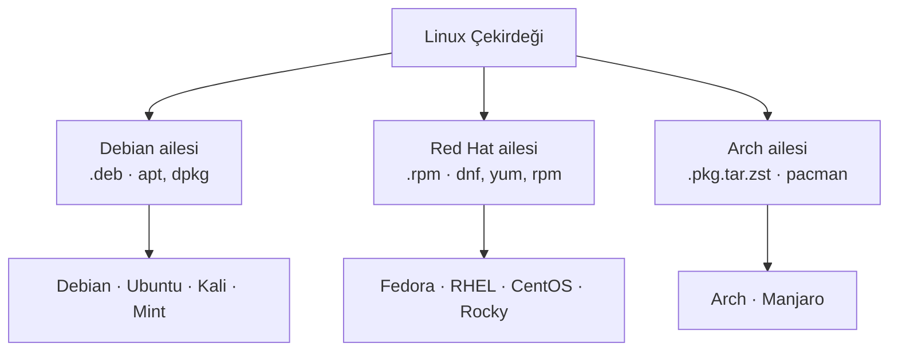

# Bölüm 2 - Linux Dağıtımları

> ◀ [Bölüm 1 - Linux'a Giriş](01_Linux_Giri%C5%9F.md) · 📚 [İndeks](00_Linux_Temelleri_%C4%B0ndeks.md)

Linux tek bir işletim sistemi değil, **Linux çekirdeği üzerine kurulu açık kaynaklı işletim sistemlerinin bir ailesidir**. Bu varyantlara **dağıtım (distro)** denir. Her biri farklı kullanıcı türleri, cihazlar ve amaçlar için özelleştirilmiştir.

## 1. Linux Dağıtımı Nedir?
Linux çekirdeği etrafında inşa edilmiş **tam bir işletim sistemidir**: çekirdek + geniş bir yazılım/kütüphane seti + isteğe bağlı grafik arayüz (GUI). Distrolar kullanım kolaylığı, stabilite, güvenlik veya özelleştirme gibi farklı hedeflere odaklanır; kuruluşlar, topluluklar ve hatta bireyler tarafından geliştirilir.

**Neden bu kadar çok dağıtım var?** Özgürlük ve esneklik felsefesi yüzünden (bkz. [Bölüm 1](01_Linux_Giri%C5%9F.md)). Kişisel bilgisayardan sunucuya, yeni başlayandan uzmana, eski donanım için hafif sistemlerden modern makineler için özellik dolu ortamlara kadar ihtiyaçlar farklıdır; dağıtımlar özel paketler, arayüzler ve yönetim araçlarıyla bunları karşılar.

## 2. Bir Dağıtımın Temel Bileşenleri
- **Linux Çekirdeği:** Donanım kaynaklarını yönetir.
- **Sistem Kütüphaneleri:** Uygulamaların çekirdekle konuşması için standart yollar sağlar.
- **Yazılım Uygulamaları:** Sistem araçlarından son kullanıcı uygulamalarına kadar.
- **Paket Yöneticisi:** Yazılımları kurma, güncelleme, kaldırma aracı.
- **Önyükleyici (Bootloader):** Donanım açıldıktan sonra önyükleme sürecini yöneten yazılım (bkz. [açılış süreci](01_Linux_Giri%C5%9F.md#7-linux-a%C3%A7%C4%B1l%C4%B1%C5%9F-s%C3%BCreci-boot-process)).
- **Grafik Arayüz (GUI):** İsteğe bağlı; çoğu distro GNOME, KDE veya XFCE sunar.

## 3. Hangi Dağıtımı Seçmeliyim?

| İhtiyaç / Kullanıcı Tipi | Önerilen Dağıtım | Neden? |
|---|---|---|
| **Yeni başlayanlar** | Linux Mint, Ubuntu | Kurulumu çok kolay, Windows'a benzer, sürücü sorunu yaşatmaz. |
| **Siber güvenlik / Hacker** | Kali Linux, Parrot OS | Yüzlerce saldırı ve analiz aracı hazır gelir. |
| **Sunucu (Server)** | Ubuntu Server, Debian, Rocky Linux | Grafik arayüzsüz, çok kararlı, düşük kaynak tüketimi. |
| **Geliştirici / Programcı** | Fedora, Manjaro | En güncel dilleri ve kütüphaneleri barındırır. |
| **Eski bilgisayarlar** | Lubuntu, Xubuntu | Çok hafif, eski donanımda bile hızlı. |
| **Linux uzmanları** | Arch Linux | Her şey sıfırdan elle kurulur, tam kontrol sağlar. |

## 4. Paket Yönetim Sistemine Göre Ana Aileler
Dağıtımlar kullandıkları paket formatına göre ailelere ayrılır. **Bir ailedeki paket komutları diğerinde çalışmaz.**

| Aile | Paket Formatı | Paket Yöneticisi | Örnek Dağıtımlar | Özellik |
|---|---|---|---|---|
| **Debian** | `.deb` | `apt`, `dpkg` | Ubuntu, Kali, Mint, Debian | En yaygın aile, geniş topluluk desteği. |
| **Red Hat** | `.rpm` | `dnf`, `yum`, `rpm` | Fedora, CentOS, RHEL, Rocky | Kurumsal dünyada standart. |
| **Arch** | `.pkg.tar.zst` | `pacman` | Arch, Manjaro | Sürekli güncel (Rolling Release). |

> [!TIP]
> `apt` ve `dpkg` komutlarının kullanımı: [Paket Yönetimi](../Linux_Komutlar%C4%B1/03_Paket_Y%C3%B6netimi.md). Komut notlarının geri kalanı Debian tabanlı sistemler (Kali/Ubuntu) için yazılmıştır.

## 5. Popüler Dağıtımlar

### Ubuntu
- **Debian tabanlı.** Hedef kitle: herkes (masaüstü ve sunucu).
- En popüler dağıtımdır; sorun yaşandığında internette çözümü en kolay bulunan sistemdir.
- Masaüstünde varsayılan olarak **GNOME** kullanır.

### Fedora
- **Red Hat tabanlı.** Hedef kitle: geliştiriciler.
- Yenilikçi teknolojileri ilk kullanan dağıtımdır. Linus Torvalds da kullanır.

### CentOS / Rocky Linux
- **RHEL tabanlı.** Hedef kitle: sunucular.
- Ücretli RHEL'in ücretsiz kopyasıdır. Çok kararlıdır, yıllarca kapatmadan çalışabilir.

### Debian
- Hedef kitle: kararlılık isteyenler.
- "Bozulması çok zor" bir sistemdir. Paketler çok test edildiği için sürümler biraz eski olabilir ama çok güvenilirdir.

### Kali Linux
- **Debian tabanlı.** Hedef kitle: **sızma testi uzmanları (pentester)**.
- Günlük kullanım için uygun değildir. Wireshark, Metasploit, Nmap gibi araçlar hazır gelir.
- Root yetkisiyle çalışmaya meyillidir.

### Arch Linux
- Hedef kitle: ileri düzey kullanıcılar.
- Kurulum sihirbazı yoktur, komutlarla kurulur. **Rolling Release** kullanır: sürüm numarası yoktur, hep en son sürümdür.

## 6. Sürüm Modelleri: Fixed vs Rolling

| Model | Nasıl çalışır? | Artı / Eksi | Örnek |
|---|---|---|---|
| **Sabit Sürüm (Fixed Release)** | Windows gibi; yılda bir-iki büyük sürüm çıkar. | Kararlı. | Ubuntu 22.04 → 24.04 |
| **Yuvarlanan Sürüm (Rolling Release)** | Sürüm numarası yok; uygulamalar ve çekirdek sürekli güncellenir. | Her zaman en yeni teknoloji, ama güncelleme sonrası hata riski daha yüksek. | Arch Linux |

---
> ◀ [Bölüm 1 - Linux'a Giriş](01_Linux_Giri%C5%9F.md) · 📚 [İndeks](00_Linux_Temelleri_%C4%B0ndeks.md) · [Bölüm 3 - Linux Kabuğu](03_Linux_Kabu%C4%9Fu_Shell.md) ▶
