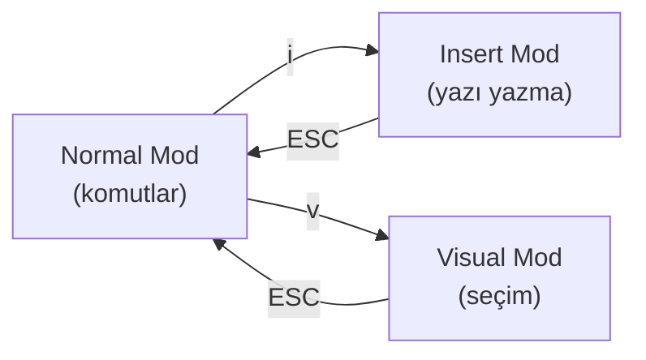

# Bölüm 7 - Metin Düzenleme

> ◀ [Bölüm 6 - Dosya ve Dizinleri Bulma](06_Dosya_ve_Dizinleri_Bulma.md) · 📚 [İndeks](00_Linux_Temelleri_%C4%B0ndeks.md)

Linux, metin dosyalarını oluşturmak, düzenlemek ve görüntülemek için güçlü araçlar sunar. Bu bölümde komut satırından kullanılan iki popüler editör anlatılır: kolay olan **nano** ve ileri düzey kullanıcıların vazgeçilmezi **vim**.

| | nano | vim |
|---|---|---|
| Zorluk | Çok kolay | Öğrenme eğrisi dik |
| Çalışma şekli | Komut gerekmez, kısayollar ekranın altında yazar | Modlu çalışır (Normal / Insert / Visual) |
| Kurulum | Çoğu dağıtımda hazır gelir | Genelde hazır; en azından `vi` her yerde bulunur |
| Kime uygun? | Hızlıca bir dosyayı düzenlemek | Klavyeden elini kaldırmadan hızlı düzenleme |

## 1. Nano Metin Editörü
Linux sistemlerde en çok kullanılan editörlerden biridir. Basit ve etkilidir, dağıtımlarla birlikte hazır gelir. **Ön bilgi gerekmez:** temel işlemler editörün **alt kısmında** gösterilir ve `CTRL` tuşuyla tetiklenir (ekrandaki `^` işareti `CTRL` tuşunu temsil eder).

Bir dosyayı nano ile açmak:
```bash
root@hackerbox:~$ nano note.txt
```
Dosya açılır; imleci hareket ettirip istediğin metni yazabilirsin. (Dosya yoksa kaydedilince oluşturulur.)

### Nano kısayolları

| Kısayol | Eylem |
|---|---|
| `CTRL + O` | Kaydet (**W**rite **O**ut) |
| `CTRL + X` | Çıkış (E**x**it) |
| `CTRL + W` | Arama (**W**here Is) |
| `CTRL + K` | Satırı kes |
| `CTRL + U` | Yapıştır |

**Arama örneği:** `CTRL + W` basınca altta `Search:` satırı belirir. Aranacak kelimeyi (örn. `demo`) yazıp `ENTER`'a basınca imleç eşleşen ilk kelimeye gider.

**Kaydetme akışı:**
1. Değişiklikleri kaydetmek için `CTRL + O` (dosya adını onaylamak için `ENTER`)
2. Editörden çıkmak için `CTRL + X`
3. Kaydedildiğini doğrulamak için `cat` ile içeriği yazdır:
```bash
root@hackerbox:~$ cat note.txt
```
`cat` dosya içeriğini terminale yazdırır ([Temel Komutlar](../Linux_Komutlar%C4%B1/01_Temel_Komutlar.md)).

> [!NOTE]
> Nano'yu [Bölüm 3'te](03_Linux_Kabu%C4%9Fu_Shell.md) `~/.bashrc` dosyasına alias eklerken kullanmıştık (`nano ~/.bashrc` → `CTRL+O` → `CTRL+X`).

## 2. Vim (Vi IMproved)
`vim` (veya klasik `vi`), Linux dünyasının en güçlü editörüdür. Öğrenme eğrisi diktir ama öğrenildikten sonra **fare kullanmadan**, her şeyi klavyeyle çok hızlı yapmanı sağlar.

Dosya açmak:
```bash
vim script.sh
```

### Vim modları
Vim açıldığında **Normal Mod**'da başlar; bu modda yazı yazılmaz, yalnızca komut verilir.

| Mod | Ne için? | Nasıl geçilir? |
|---|---|---|
| **Normal** (varsayılan) | Gezinme, kopyalama, silme | `ESC` her zaman bu moda döndürür |
| **Insert** (ekleme) | Yazı yazma | Normal moddayken `i`. Sol altta `-- INSERT --` yazar |
| **Visual** (seçim) | Metin/blok seçimi | Normal moddayken `v` |



### Temel senaryolar

**Senaryo 1 - Yazı yazmak**
1. `vim test.txt` ile dosyayı aç.
2. `i` tuşuyla Insert moduna geç (`-- INSERT --` görünür).
3. "Merhaba Dünya" yaz.
4. `ESC` ile Normal moda dön.

**Senaryo 2 - Bir satırı silmek**
1. Silinecek satıra yön tuşlarıyla veya `h`, `j`, `k`, `l` ile git.
2. `dd` yaz; satır silinir.

**Senaryo 3 - Kaydedip çıkmak**
1. Normal modda olduğundan emin ol (`ESC`).
2. `:wq` yaz (write and quit) ve `ENTER`'a bas.

### Kısayol tablosu

| Tuş | Eylem |
|---|---|
| `i` | Yazma moduna geç (Insert) |
| `ESC` | Normal moda dön |
| `:w` | Kaydet (Write) |
| `:q` | Çık (Quit) |
| `:wq` | Kaydet ve çık |
| `:q!` | Kaydetmeden zorla çık |
| `dd` | Satırı sil (keser) |
| `yy` | Satırı kopyala |
| `p` | Yapıştır |
| `u` | Geri al (Undo) |
| `/kelime` | "kelime"yi ara (`n` ile sonraki eşleşme) |

> [!TIP]
> **Vim'de takılırsan:** `ESC`'e birkaç kez bas, sonra kaydetmeden çıkmak için `:q!` yaz. Başlangıçta en sık yapılan hata, Insert moda geçmeden (`i`) yazmaya çalışmaktır.

> [!TIP]
> **Güvenlik gözüyle:** Sızma testinde elde edilen kısıtlı bir kabukta (shell) grafik editör olmaz; `vi`/`vim`/`nano` ile dosya düzenlemek (örn. `/etc/passwd`, cron betikleri, config dosyaları) sık gereken bir beceridir.

## 3. Diğer Editörler
- **`view`:** Vim'i **sadece okuma** modunda açar; dosyayı yanlışlıkla değiştirme riskini önler.
  ```bash
  view onemli_dosya.txt
  ```
- **Grafiksel editörler:** Masaüstü ortamın (GNOME, KDE vb.) varsa `gedit`, `kate`, VS Code (`code .`) gibi editörler de kullanılabilir.

---
> ◀ [Bölüm 6 - Dosya ve Dizinleri Bulma](06_Dosya_ve_Dizinleri_Bulma.md) · 📚 [İndeks](00_Linux_Temelleri_%C4%B0ndeks.md) · [Bölüm 8 - Filtreler ve Yönlendirme](08_Filtreler_ve_Y%C3%B6nlendirme.md) ▶
