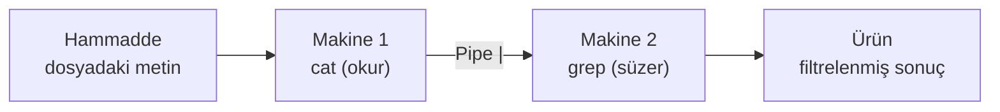

# Bölüm 8 - Filtreler ve Yönlendirme

> ◀ [Bölüm 7 - Metin Düzenleme](07_Metin_D%C3%BCzenleme.md) · 📚 [İndeks](00_Linux_Temelleri_%C4%B0ndeks.md)

**Filtreler**, düz metni (bir dosyadan ya da başka bir programdan gelen) **standart girdi** olarak alıp anlamlı bir biçime dönüştüren ve **standart çıktı** olarak döndüren programlardır. Linux'ta çok sayıda filtre vardır.

## 0. Filtreleme ve Pipe (`|`) Mantığı
Bir komutun çıktısı başka bir komutun girdisi olabilir. Bunu sağlayan mekanizmaya **boru hattı (pipeline)** denir ve `|` ile gösterilir. Fabrikadaki üretim bandı gibi düşün:



Böylece tek başına basit olan komutlar birleşerek çok karmaşık işleri yapar ("küçük ve özelleşmiş araçlar", bkz. [Bölüm 1 - Felsefe](01_Linux_Giri%C5%9F.md)).

## 1. Yönlendirme (Redirection)
Her programın 3 kapısı vardır:

| Kapı | Numara | Varsayılan |
|---|---|---|
| **STDIN** (Giriş) | `0` | Klavye |
| **STDOUT** (Çıkış) | `1` | Ekran |
| **STDERR** (Hata) | `2` | Ekran (hata mesajları) |

Bu kapılar dosyalara yönlendirilebilir:

| Operatör | Açıklama | Örnek |
|---|---|---|
| `>` | Çıktıyı dosyaya yazar (**eskisini siler**). | `ls > liste.txt` (ekrana basmaz, dosyaya yazar) |
| `>>` | Çıktıyı dosyanın **sonuna ekler**. | `echo "Son satır" >> not.txt` |
| `2>` | **Sadece hataları** dosyaya kaydeder. | `ls /olmayan_dizin 2> hata.txt` |
| `<` | Dosyayı komuta **girdi** olarak verir. | `wc -l < liste.txt` |
| `\|` | Birinci komutun çıktısını ikinciye gönderir (Pipe). | `cat dosya \| grep "aranan"` |

**Senaryo: Hataları gizleyerek arama.** `find` erişemediği dizinler için "Permission denied" basar. Bunları `/dev/null` (kara delik) dosyasına atarak temiz çıktı alırız:
```bash
user@hackerbox:~$ find / -name "gizli_dosya" 2> /dev/null
/home/admin/gizli_dosya
```
Hata mesajları görünmez, sadece bulunan sonuç kalır. ([Bölüm 6 - find](06_Dosya_ve_Dizinleri_Bulma.md))

> [!WARNING]
> `>` mevcut dosyanın üzerine yazar ve içeriği siler. Eklemek istiyorsan `>>` kullan.

## 2. Metin İşleme Araçları
Örneklerde kullanılacak `isimler.txt`:
```bash
user@hackerbox:~$ cat isimler.txt
Ali Veli
Ayşe Yılmaz
Mehmet Öz
Ali Veli
```

### `cat`
Bir veya birden fazla metin dosyasının içeriğini terminalde gösterir.
```bash
root@hackerbox:~$ cat /etc/ssh/sshd_config
# Port 22
# AddressFamily any
# ListenAddress 0.0.0.0
# ListenAddress ::
PermitRootLogin no
PasswordAuthentication yes
PermitEmptyPasswords no
ChallengeResponseAuthentication no
UsePAM yes
```
SSH servisinin ayar dosyası `cat` ile ekrana yazdırıldı. (Yorum satırlarını gizleme: [Metin İşleme ve Regex](../Linux_Komutlar%C4%B1/02_Metin_%C4%B0%C5%9Fleme_ve_Regex.md))

### `head`
Dosyanın **başından** belirli sayıda satır gösterir. Varsayılan **ilk 10 satırdır**, `-n` ile değiştirilir. İçeriğin tamamı yerine başlangıç kısmına hızlıca göz atmak için kullanışlıdır.
```bash
root@hackerbox:~$ head -n 3 /var/log/apache2/access.log
192.168.1.1 - - [15/Mar/2024:10:00:00 +0000] "GET /index.html HTTP/1.1" 200 612 "-" "Mozilla/5.0 (Windows NT 10.0; Win64; x64)"
192.168.1.2 - - [15/Mar/2024:10:00:02 +0000] "POST /login.php HTTP/1.1" 200 452 "http://example.com/login" "Mozilla/5.0 (Linux; Android 6.0; Nexus 5 Build/MRA58N)"
192.168.1.3 - - [15/Mar/2024:10:00:03 +0000] "GET /wp-admin HTTP/1.1" 403 497 "-" "Mozilla/5.0 (Macintosh; Intel Mac OS X 10_11_6)"
```
Apache erişim kayıtlarının ilk 3 satırı yazdırıldı.

### `tail`
Dosyanın **sonundan** belirli sayıda satır gösterir. Varsayılan **son 10 satırdır**, `-n` ile değiştirilir. Sürekli büyüyen log dosyalarının en yeni kayıtlarını görmek için çok yararlıdır.
```bash
root@hackerbox:~$ tail -n 3 /var/log/auth.log
Mar 15 12:00:00 servername sshd[23456]: Failed password for invalid user admin from 192.168.1.1 port 54321 ssh2
Mar 15 12:01:00 servername sshd[23457]: Accepted password for user1 from 192.168.1.2 port 65432 ssh2
Mar 15 12:02:00 servername sshd[23458]: Failed password for user2 from 192.168.1.3 port 76543 ssh2
```
`auth.log`, kullanıcı kimlik doğrulama olaylarının kaydedildiği log dosyasıdır ([Sistem Logları](../Linux_Komutlar%C4%B1/13_Sistem_Loglar%C4%B1.md)).

**Canlı log takibi (`tail -f`):** `-f` (follow) dosyayı sürekli izler; örneğin sunucuya gelen istekleri anlık görmek için.
```bash
user@hackerbox:~$ tail -f /var/log/syslog
Aug 1 10:00:01 server CRON[123]: (root) CMD (command)
Aug 1 10:05:01 server sshd[456]: Accepted password for user...
```
Yeni log düştükçe ekran akar. Çıkmak için `CTRL+C`.

### `sort`
Dosyanın içeriğini **alfabetik** sıralar.
```bash
root@hackerbox:~$ cat names.txt
Bob
Charlie
Alice

root@hackerbox:~$ sort names.txt
Alice
Bob
Charlie
```
> [!TIP]
> Sık kullanılan bayraklar: `-r` (ters sıra), `-n` (sayısal sıralama).

### `uniq`
**Ardışık** tekrar eden satırları filtreler, benzersiz satırları gösterir. Tek başına sadece **yan yana** duran tekrarları yakaladığı için genellikle `sort` ile birlikte kullanılır.
```bash
root@hackerbox:~$ cat names.txt
Alice
Charlie
Alice
Bob

root@hackerbox:~$ sort names.txt | uniq
Alice
Bob
Charlie
```
`-c` her satırın **tekrar sayısını** gösterir (Count):
```bash
user@hackerbox:~$ sort isimler.txt | uniq -c
      2 Ali Veli
      1 Ayşe Yılmaz
      1 Mehmet Öz
```

> [!TIP]
> **Güvenlik kullanımı: en çok deneme yapan IP'ler.** `sort | uniq -c | sort -nr` kalıbı, log analizinde en sık geçen kayıtları bulmak için çok kullanılır:
> ```bash
> grep "Failed password" /var/log/auth.log | awk '{print $(NF-3)}' | sort | uniq -c | sort -nr | head
> ```
> (Alan numarası log biçimine göre değişir; önce `head` ile satırın yapısına bak.)

### `grep`
Dosyalardaki belirli metin dizelerini arar, satırları filtreler. Log, konfigürasyon veya herhangi bir metin dosyasında sık kullanılır.
```bash
root@hackerbox:~$ grep '192.168.1.1' /var/log/apache2/access.log
192.168.1.1 - - [15/Mar/2024:10:00:00 +0000] "GET /index.html HTTP/1.1" 200 612 "-" "Mozilla/5.0 (Windows NT 10.0; Win64; x64)"
192.168.1.1 - - [15/Mar/2024:10:00:02 +0000] "POST /login.php HTTP/1.1" 200 452 "http://example.com/login" "Mozilla/5.0 (Linux; Android 6.0; Nexus 5 Build/MRA58N)"
192.168.1.1 - - [15/Mar/2024:10:00:03 +0000] "GET /wp-admin HTTP/1.1" 403 497 "-" "Mozilla/5.0 (Macintosh; Intel Mac OS X 10_11_6)"
```
Erişim loglarında yalnızca IP adresi `192.168.1.1` olan kayıtlar yazdırıldı.

**İleri düzey parametreler:**
- `-i` : Büyük/küçük harf duyarsız
- `-v` : Eşleşmeyenleri göster (hariç tut)
- `-r` : Dizin içinde özyineli (recursive) arama

> Regex ve diğer bayraklar: [Bölüm 6 - grep](06_Dosya_ve_Dizinleri_Bulma.md) · [Metin İşleme ve Regex](../Linux_Komutlar%C4%B1/02_Metin_%C4%B0%C5%9Fleme_ve_Regex.md)

### `wc`
`wc` (word count) dosyanın ne kadar veri içerdiğini hızlıca gösterir.
```bash
root@hackerbox:~$ wc /etc/passwd
46   67 2544 /etc/passwd
```

| Değer | Açıklama |
|---|---|
| `46` | Satır sayısı |
| `67` | Kelime sayısı |
| `2544` | Bayt (byte) sayısı (çoğunlukla karakter sayısına eşittir) |
| `/etc/passwd` | Dosya yolu |

Sadece satır sayısı için `wc -l`.

### `cut`
Satırları böler ve istenen sütunu alır; `/etc/passwd` buna en iyi örnektir.
```bash
user@hackerbox:~$ cut -d ":" -f 1 /etc/passwd | head -n 3
root
daemon
bin
```
`-d` ayırıcı karakter (`:`), `-f` sütun numarası (`1`).

### `awk`
Metin ve veri işleme için tasarlanmıştır; özellikle **sütun bazlı** verilerde etkilidir. Dosyayı satır satır okur, her satırı boşluk/tab'a göre alanlara ayırır ve koşullara göre işlem yapar.
```bash
root@hackerbox:~$ cat names.txt
John Doe
Emily Clark
Alex Turner

root@hackerbox:~$ awk '{print $1}' names.txt
John
Emily
Alex
```
`{print $1}` her satırın ilk alanını (isim) yazdırır.

**Gelişmiş örnek:** `ps aux` çıktısından yalnızca kullanıcı adı (`$1`) ve komut (`$11`) sütunları:
```bash
user@hackerbox:~$ ps aux | awk '{print $1, $11}' | head -n 3
USER COMMAND
root /sbin/init
root [kthreadd]
```

### `sed`
**Stream editor.** Metinleri işlemek, değiştirmek, eklemek, silmek için kullanılır; genelde metin filtrelemek ve dönüştürmek için.
```bash
root@hackerbox:~$ cat names.txt
Alice
Charlie
Bob

root@hackerbox:~$ sed 's/Alice/George/' names.txt
George
Charlie
Bob
```
`Alice` → `George` olarak değişti. Ama `sed` **dosyada değişiklik yapmadı**, yalnızca ekrana yeni halini yazdırdı. Dosyayı **kalıcı** değiştirmek için `-i` kullanılır.

### `tee`
Çıktıyı **hem ekrana basar hem dosyaya yazar** (T bağlantısı gibi).
```bash
user@hackerbox:~$ echo "Log Kaydı" | tee log.txt
Log Kaydı
```
> [!TIP]
> `tee -a` dosyanın sonuna ekler (`>>` gibi). Pipe'ın ortasına koyup ara sonucu dosyaya kaydetmek için de kullanılır.

### `diff`
İki dosya arasındaki **farkları** gösterir.
```bash
user@hackerbox:~$ diff dosya1.txt dosya2.txt
< Eski satır
> Yeni satır
```
`<` ilk dosyadaki, `>` ikinci dosyadaki satırdır.

### `tr`
Karakter değişimi yapar.
```bash
user@hackerbox:~$ echo "merhaba" | tr "a-z" "A-Z"
MERHABA
```
Küçük harfler büyüğe çevrildi.

## 3. Özet Tablo

| Komut | Görev |
|---|---|
| `cat` | Dosya içeriğini göster |
| `head` / `tail` | Baştan / sondan satır göster (`tail -f` canlı takip) |
| `sort` | Sırala |
| `uniq` | Tekrarları ayıkla (`-c` say) |
| `grep` | Satır filtrele |
| `wc` | Satır/kelime/bayt say |
| `cut` / `awk` | Sütun seç |
| `sed` | Bul-değiştir |
| `tee` | Hem ekrana hem dosyaya yaz |
| `diff` | İki dosyayı karşılaştır |
| `tr` | Karakter dönüştür |

---
> ◀ [Bölüm 7 - Metin Düzenleme](07_Metin_D%C3%BCzenleme.md) · 📚 [İndeks](00_Linux_Temelleri_%C4%B0ndeks.md) · [Bölüm 9 - Paket Yönetimi](09_Paket_Y%C3%B6netimi.md) ▶
