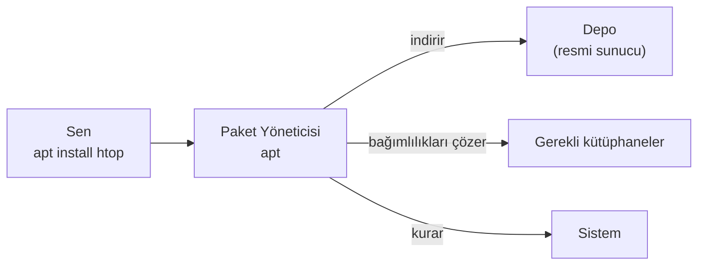

# Bölüm 9 - Paket Yönetimi

> ◀ [Bölüm 8 - Filtreler ve Yönlendirme](08_Filtreler_ve_Y%C3%B6nlendirme.md) · 📚 [İndeks](00_Linux_Temelleri_%C4%B0ndeks.md)

Yazılım paketlerinin yönetimi, günlük kullanımda ve sistem yönetiminde kritik öneme sahiptir. Dağıtımlar kurulum, güncelleme ve kaldırmayı kolaylaştıran **paket yöneticileri** sunar; bunlar yazılımları paket formatında, **bağımlılıklarıyla birlikte** yönetir. Her dağıtım ailesi kendi sistemini kullanır ([Bölüm 2 - Paket aileleri](02_Linux_Da%C4%9F%C4%B1t%C4%B1mlar%C4%B1.md)). Bu bölümde Debian tabanlı sistemlerin araçları anlatılır.

> [!NOTE]
> Kali'de sık kullanılan araçlarla (`apt-cache search`, `git clone`, `wget` + `dpkg`) yazılmış komut notu: [Paket Yönetimi (komutlar)](../Linux_Komutlar%C4%B1/03_Paket_Y%C3%B6netimi.md). Bu bölüm temel mantığı ve `update/upgrade/remove/purge` gibi bakım komutlarını tamamlar.

## 0. Paket ve Depo (Repository) Nedir?
Windows'ta program kurmak için internetten `.exe` indirip "İleri > İleri" dersin. Linux'ta işler daha **güvenli ve düzenlidir**:

- **Paket (Package):** Bir programın çalışması için gereken tüm dosyaların (kod, kütüphane, resim) sıkıştırılmış tek dosya hali (örn. `.deb`, `.rpm`).
- **Depo (Repository):** Binlerce paketin saklandığı güvenli, resmi sunucular. App Store veya Google Play gibi düşün.
- **Paket Yöneticisi (Package Manager):** Senin yerine depoya bağlanıp paketi indiren, kuran ve güncelleyen araç (örn. `apt`).

Yazılımlar resmi kaynaklardan indirildiği için **zararlı yazılım bulaşma riski düşüktür.**



## 1. Paket Yöneticilerinin Temel Özellikleri
- **Paket indirme:** Paketleri ve bağımlılıklarını internetten otomatik indirir.
- **Bağımlılık çözümleme:** Bir paketin gerektirdiği diğer paketleri belirler ve otomatik kurar.
- **Kurulum ve kaldırma:** Paketleri kurar, gerektiğinde kaldırır.
- **Güncelleme ve yükseltme:** Yeni sürümleri kontrol eder ve günceller.
- **Yapılandırma dosyaları ve dizinleri:** Paketlerin ayar dosyaları ve dizinleri için standartlar sunar.

## 2. Paket Yöneticisi Karşılaştırması

| Sistem | Format | Yönetici | Dağıtımlar | Örnek komut |
|---|---|---|---|---|
| **APT** | `.deb` | `apt`, `dpkg` | Debian, Ubuntu, Kali | `apt install git` |
| **RPM** | `.rpm` | `dnf`, `yum` | Fedora, RHEL, CentOS | `dnf install git` |
| **Pacman** | `.pkg.tar.zst` | `pacman` | Arch, Manjaro | `pacman -S git` |
| **Snap / Flatpak** | Kapsayıcı | `snap`, `flatpak` | Hepsi | `snap install spotify` |

## 3. APT (Advanced Package Tool)
Debian ve türevlerinde yazılım yönetimi için güçlü bir araçtır: yeni yazılım kurar, mevcutları günceller, gereksizleri kaldırır ve bunları yaparken **bağımlılıkları otomatik çözer.** Ubuntu/Debian sistemlerde `apt` kullanılır.

### 3.1 Güncelleme (`apt update`)
Önce paket listesini internetten güncellemelisin.
```bash
user@hackerbox:~$ sudo apt update
Hit:1 http://security.ubuntu.com/ubuntu bionic-security InRelease
Reading package lists... Done
All packages are up to date.
```
> [!TIP]
> `update` sadece **listeyi** yeniler, programları güncellemez. Programları güncelleyen komut `upgrade`'dir (3.3).

### 3.2 Arama ve Bilgi Alma
Paketin tam adını bilmiyorsan arayabilirsin. Normal arama açıklamalarda da arar; `--names-only` sadece paket isimlerinde arar.

```bash
# İsim ve açıklamalarda arama
user@hackerbox:~$ sudo apt search htop
aha - ANSI color to HTML converter
htop - interactive processes viewer
libauthen-oath-perl - Perl module for OATH One Time Passwords

# Sadece paket isimlerinde arama
user@hackerbox:~$ sudo apt search --names-only htop
htop - interactive processes viewer

# Regex ile arama: ismi "htop" ile başlayanlar
user@hackerbox:~$ sudo apt search ^htop
htop - interactive processes viewer
```

Daha ayrıntılı bilgi (sürüm, boyut vb.) için `apt show` veya `apt-cache`:
```bash
user@hackerbox:~$ apt show htop
Package: htop
Version: 2.2.0-2build1
...

user@hackerbox:~$ apt-cache policy htop
htop:
  Installed: 2.2.0-2build1
  Candidate: 2.2.0-2build1
```
`Installed` kurulu sürümü, `Candidate` depodaki kurulabilir sürümü gösterir.

### 3.3 Yükleme ve Yükseltme
```bash
user@hackerbox:~$ sudo apt install htop
Reading package lists... Done
Building dependency tree
Reading state information... Done
The following NEW packages will be installed:
  htop
0 upgraded, 1 newly installed, 0 to remove and 0 not upgraded.
Need to get 80.0 kB of archives.
After this operation, 201 kB of additional disk space will be used.
Get:1 http://archive.ubuntu.com/ubuntu bionic/universe amd64 htop amd64 2.1.0-3 [80.0 kB]
Fetched 80.0 kB in 1s (110 kB/s)
Selecting previously unselected package htop.
Preparing to unpack .../htop_2.1.0-3_amd64.deb ...
Unpacking htop (2.1.0-3) ...
Setting up htop (2.1.0-3) ...
Processing triggers for man-db (2.8.3-2ubuntu0.1) ...
```
Çıktıda sırayla: yeni kurulacak paket, indirilecek boyut, diskte kaplayacağı yer, indirme, açma (`Unpacking`) ve yapılandırma (`Setting up`) adımları görülür.

Sistemdeki **bütün paketleri** güncellemek için:
```bash
user@hackerbox:~$ sudo apt upgrade
```
`upgrade` ekstra paket yüklemez ve artık kullanılmayan paket/kütüphaneleri kaldırmaz. Bunu önemsemiyorsan:
```bash
user@hackerbox:~$ sudo apt dist-upgrade
```

| Komut | Ne yapar? |
|---|---|
| `apt update` | Paket **listesini** yeniler |
| `apt upgrade` | Kurulu paketleri günceller (yeni paket eklemez/silmez) |
| `apt dist-upgrade` | Gerekirse paket ekleyip/kaldırarak tam yükseltme yapar |

### 3.4 Kaldırma
- **`remove`:** Programı kaldırır, **ayarları saklar.**
- **`purge`:** **Her şeyi** (ayar dosyaları dahil) siler.

```bash
user@hackerbox:~$ sudo apt remove htop
...
The following packages will be REMOVED:
  htop
0 upgraded, 0 newly installed, 1 to remove and 0 not upgraded.
After this operation, 201 kB disk space will be freed.
Removing htop (2.1.0-3) ...

# Tamamen temizlemek için
user@hackerbox:~$ sudo apt purge htop
...
Removing htop (2.1.0-3) ...
Purging configuration files for htop (2.1.0-3) ...
```
`purge` çıktısındaki ek satır (`Purging configuration files`) ayar dosyalarının da silindiğini gösterir.

### 3.5 Temizlik
Gereksiz bağımlılıkları (artık kullanılmayan kütüphaneleri) siler.
```bash
sudo apt autoremove
```

## 4. DPKG (Debian Package)
İnternetten indirdiğin bir **`.deb`** dosyasını (örn. Discord, Google Chrome) kurmak için kullanılır; `apt` bunu tek başına yapmaz.

**Senaryo: Discord kurulumu**
```bash
user@hackerbox:~$ sudo dpkg -i discord.deb
(Reading database ... 100%
Unpacking discord ...
dpkg: dependency problems prevent configuration of discord:
 discord depends on libgconf...
```
**Hata alırsan:** `dpkg` bağımlılıkları çözemez. Kurulum yarıda kalırsa düzeltmek için:
```bash
user@hackerbox:~$ sudo apt install -f
```
Bu komut eksik parçaları internetten indirip kurulumu tamamlar.

> [!WARNING]
> `.deb` dosyalarını yalnızca **güvendiğin, resmi kaynaklardan** indir. Depolar imzalı ve denetimlidir; elle indirilen paket bu korumayı atlar ve kurulum sırasında root yetkisiyle betik çalıştırabilir.

## 5. Modern Paketler (Snap)
Bağımlılık derdi olmadan çalışan, yeni nesil **kapsayıcı** paketlerdir.
```bash
user@hackerbox:~$ sudo snap install spotify
spotify 1.1.84 from Spotify installed
```

## 6. Hızlı Özet

| İş | Komut |
|---|---|
| Listeyi güncelle | `sudo apt update` |
| Paket ara | `apt search <ad>` |
| Bilgi al | `apt show <ad>` / `apt-cache policy <ad>` |
| Kur | `sudo apt install <ad>` |
| Hepsini güncelle | `sudo apt upgrade` |
| Kaldır (ayarlar kalır) | `sudo apt remove <ad>` |
| Tamamen sil | `sudo apt purge <ad>` |
| Gereksizleri temizle | `sudo apt autoremove` |
| `.deb` kur | `sudo dpkg -i <dosya>.deb` |
| Bağımlılık hatasını düzelt | `sudo apt install -f` |
| Snap ile kur | `sudo snap install <ad>` |

---
> ◀ [Bölüm 8 - Filtreler ve Yönlendirme](08_Filtreler_ve_Y%C3%B6nlendirme.md) · 📚 [İndeks](00_Linux_Temelleri_%C4%B0ndeks.md)
