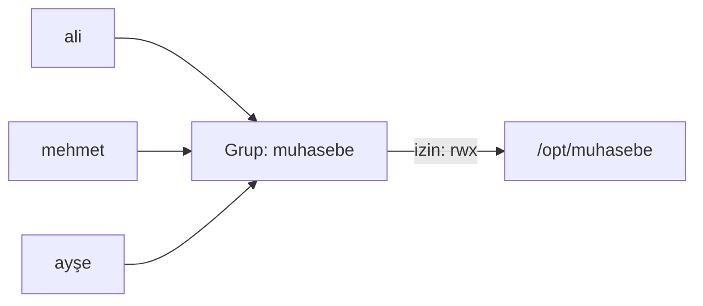

# Bölüm 11 - Grup Yönetimi

> ◀ [Bölüm 10 - Kullanıcı Yönetimi](10_Kullan%C4%B1c%C4%B1_Y%C3%B6netimi.md) · 📚 [İndeks](00_Linux_Temelleri_%C4%B0ndeks.md)

Grup yönetimi, kullanıcı yönetimi kadar önemlidir. Gruplar, **birden fazla kullanıcıya aynı erişim haklarını toplu olarak** vermek için kullanılır; böylece kaynaklara erişim kolayca kontrol edilir. Bu bölümde grupların nasıl oluşturulduğu, yönetildiği ve silindiği anlatılır.

> [!NOTE]
> `usermod -aG` ve `chown`/`chmod` temelleri [Temel Komutlar](../Linux_Komutlar%C4%B1/01_Temel_Komutlar.md) ve [Bölüm 10](10_Kullan%C4%B1c%C4%B1_Y%C3%B6netimi.md) içinde de geçti. Burada bunlar gruplar üzerinden bir bütün olarak toplanıyor.

## 0. Grup Nedir ve Neden Kullanılır?
Bir grup, belirli izinlere ve erişim haklarına sahip **kullanıcılar topluluğudur.** Dosya sistemindeki erişim kontrolünü ve kullanıcı yönetimini kolaylaştırır.

**Örnek:** Bir şirkette "Muhasebe" departmanındaki 50 kişinin yalnızca muhasebe dosyalarına erişmesi gerekiyor.

| Grup sistemi **olmasaydı** | Grup sistemi **ile** |
|---|---|
| 50 kişi için tek tek dosya izni ayarlanır | "Muhasebe" grubu oluşturulur |
| Yeni biri gelince yine tek tek izin verilir | Dosyaların izni gruba verilir |
| | 50 kullanıcı gruba eklenir |
| | Yeni biri gelince sadece gruba eklenir |

Gruplar yetki yönetimini toplu hale getirir, işi kolaylaştırır ve güvenliği artırır.



## 1. Temel Komutlar

| Komut | Açıklama |
|---|---|
| `groupadd` | Grup oluşturur. |
| `groupdel` | Grubu siler. |
| `groups` | Üye olunan grupları gösterir. |
| `getent group` | Bir grubun detaylarını gösterir. |
| `gpasswd -d` | Kullanıcıyı gruptan çıkarır. |
| `usermod -aG` | Kullanıcıyı gruba ekler. |

## 2. `/etc/group` Dosyası
Grupların tanımlandığı dosya `/etc/group`'tur. Örnek satır:
```
yazilim:x:1002:mehmet,ali
```

| Alan | Örnek | Açıklama |
|---|---|---|
| Grup adı | `yazilim` | Grubun ismi. |
| Parola | `x` | Grup parolası (genelde kullanılmaz). |
| GID | `1002` | Grup kimlik numarası (Group ID). |
| Üyeler | `mehmet,ali` | Gruba dahil kullanıcıların listesi. |

([Bölüm 10 - /etc/passwd](10_Kullan%C4%B1c%C4%B1_Y%C3%B6netimi.md) ile aynı mantık: `:` ile ayrılmış alanlar.)

**Örnek: Grup oluşturma ve sorgulama**
```bash
user@hackerbox:~$ sudo groupadd yazilim
user@hackerbox:~$ getent group yazilim
yazilim:x:1002:
```
Grup oluşturuldu, henüz üyesi yok (son alan boş).

## 3. Gruba Üye Ekleme
En güvenli yöntem `usermod -aG`'dir.

**Senaryo: Mehmet'i `yazilim` grubuna ekle**

Önce kontrol:
```bash
user@hackerbox:~$ id mehmet
uid=1001(mehmet) gid=1001(mehmet) groups=1001(mehmet)
```
Ekle:
```bash
user@hackerbox:~$ sudo usermod -aG yazilim mehmet
```
Tekrar kontrol:
```bash
user@hackerbox:~$ id mehmet
uid=1001(mehmet) gid=1001(mehmet) groups=1001(mehmet),1002(yazilim)
```
`yazilim` grubu eklendi.

> [!WARNING]
> **Dikkat:** `-a` (append) kullanmazsan kullanıcının üye olduğu **diğer tüm gruplar silinir!**

> [!TIP]
> Grup üyeliği **yeni oturumda** geçerli olur. Kullanıcı çıkış-giriş yapmalı ya da `newgrp yazilim` kullanmalıdır. `groups mehmet` komutu da üye olunan grupları listeler.

## 4. Gruptan Üye Çıkarma
Kullanıcıyı gruptan çıkarmak için `gpasswd` kullanılır.
```bash
user@hackerbox:~$ sudo gpasswd -d mehmet yazilim
Removing user mehmet from group yazilim
```
Grubu tamamen silmek için `sudo groupdel yazilim`.

## 5. Pratik Senaryo: Ortak Proje Dizini
Bir proje dizini oluşturalım ve **sadece proje grubundakiler** erişebilsin.

**1. Grubu oluştur:**
```bash
user@hackerbox:~$ sudo groupadd proje
```
**2. Kullanıcıyı ekle:**
```bash
user@hackerbox:~$ sudo usermod -aG proje ali
```
**3. Dizini oluştur:**
```bash
user@hackerbox:~$ sudo mkdir /opt/proje
```
**4. Dizinin grubunu değiştir:**
```bash
user@hackerbox:~$ sudo chown :proje /opt/proje
```
**5. İzinleri ayarla:**
```bash
user@hackerbox:~$ sudo chmod 770 /opt/proje
```
Sahibi ve grup tam yetkili, **diğerleri giremez.**

`770` her rakamın bir sınıfa karşılık geldiğini gösterir:

| Rakam | Sınıf | Anlamı |
|---|---|---|
| `7` | Sahip (user) | `rwx` (4+2+1) okuma, yazma, çalıştırma |
| `7` | Grup (group) | `rwx` |
| `0` | Diğerleri (other) | `---` hiçbir yetki yok |

`chown :proje` sözdizimi sahibe dokunmadan **sadece grubu** değiştirir (`chown sahip:grup` biçiminin grup kısmı).

> [!TIP]
> **Ek ipucu:** Dizine `sudo chmod g+s /opt/proje` (setgid) eklenirse, içinde oluşturulan yeni dosyalar otomatik olarak `proje` grubuna ait olur; ortak çalışmada çok işe yarar. Dizin yetkilerini `ls -ld /opt/proje` ile doğrulayabilirsin ([Bölüm 4 - ls -l](04_Dizinlerde_Gezinti.md)).

## 6. Güvenlik Gözüyle Gruplar

> [!WARNING]
> Bazı gruplar **yönetici yetkisine eş değerdir.** Bir kullanıcıyı `sudo` (Red Hat'te `wheel`) grubuna eklemek ona yönetici yetkisi verir. `docker` grubundaki bir kullanıcı da konteyner üzerinden pratikte root'a yükselebilir ([Konteynerler](../Linux_Komutlar%C4%B1/12_Konteynerler_Docker_ve_LXC.md)).

Sızma testinde ve savunmada `id`, `groups` ve `/etc/group` çıktısına bakmak, bir hesabın hangi ayrıcalıklara sahip olduğunu görmenin ilk adımıdır: [Yetki Yükseltme](../Yetki%20Y%C3%BCkseltme/00_Yetki_Y%C3%BCkseltme.md).

## 7. Hızlı Özet

| İş | Komut |
|---|---|
| Grup oluştur | `sudo groupadd <grup>` |
| Grubu sorgula | `getent group <grup>` |
| Üye olunan gruplar | `groups <kullanıcı>` / `id <kullanıcı>` |
| Gruba ekle | `sudo usermod -aG <grup> <kullanıcı>` |
| Gruptan çıkar | `sudo gpasswd -d <kullanıcı> <grup>` |
| Grubu sil | `sudo groupdel <grup>` |
| Dizinin grubunu değiştir | `sudo chown :<grup> <dizin>` |
| Grup/sahip tam yetki, diğerleri yok | `sudo chmod 770 <dizin>` |

---
> ◀ [Bölüm 10 - Kullanıcı Yönetimi](10_Kullan%C4%B1c%C4%B1_Y%C3%B6netimi.md) · 📚 [İndeks](00_Linux_Temelleri_%C4%B0ndeks.md)
