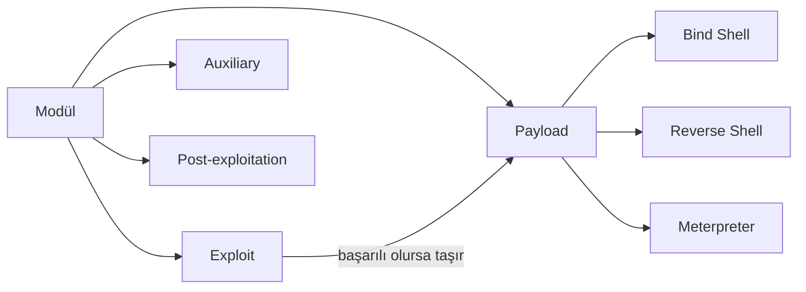

# Bölüm 1 - Giriş ve Temel Terminoloji

> 📚 [İndeks](00_Metasploit_Framework_%C4%B0ndeks.md)

## 1. Metasploit Nedir?
**2003** yılında **HD Moore** tarafından başlatılan Metasploit, kısa sürede güvenlik topluluğu tarafından benimsendi ve hızla gelişti. Başlangıçta birkaç uzmana yönelik bir araçken zamanla etik hackerlar, güvenlik araştırmacıları ve bilgi güvenliği profesyonelleri arasında vazgeçilmez bir kaynak oldu. **2009**'da **Rapid7** tarafından satın alınmasıyla daha profesyonel hale geldi.

Metasploit iki üründen oluşur:

| Ürün | Özet |
|---|---|
| **Metasploit Framework** | Açık kaynaklı, komut satırı odaklı sürüm. Bu eğitimin konusu. |
| **Metasploit Pro** | Web arayüzü sunan, **ücretli** sürüm. |

## 2. Metasploit Pro
Pro, daha çok **web arayüzü** üzerinden penetrasyon testi yapmayı tercih eden kullanıcılar için idealdir ve Framework'te bulunmayan birçok özellik içerir:

- **Görev zincirleri:** Otomatik görev zincirleriyle karmaşık test senaryolarını basitleştirir.
- **Sosyal mühendislik araçları:** Phishing gibi tekniklerin uygulanmasını kolaylaştırır.
- **Güvenlik açığı doğrulama:** Bulunan açıkların hızlıca doğrulanmasını sağlar.
- **Grafiksel kullanıcı arayüzü (GUI):** Kullanıcı dostu bir arayüzle çalışmayı kolaylaştırır.
- **Hızlı başlangıç sihirbazları:** Yeni başlayanların yön bulmasına yardımcı olur.
- **Nexpose entegrasyonu:** Açıkların tespiti ve yönetimi için Nexpose ile bütünleşir.

Pro ayrıca komut satırı kullanıcıları için `msfconsole`'a benzer bir deneyim sunan özel bir **konsol** içerir.

### 2.1 Gelişmiş Özellikler
Pro, gerçek dünya saldırılarını simüle etmek, veri toplamak ve bulunan açıkların giderilmesine yardımcı olmak için şu özellikleri sunar:

- Manuel sömürü ve AV/IPS kaçınma
- Post-exploitation modülleri ve oturum temizleme
- Kimlik bilgisi yeniden kullanımı ve sosyal mühendislik
- Hızlı penetrasyon testleri ve VPN pivoting
- Veri toplama ve işaretleme (düzenleme ve raporlama)

### 2.2 Arayüz Seçenekleri
- **Web arayüzü:** `https://localhost:3790` adresinden erişilir.
- **Pro Console:** Komut satırından Pro ile etkileşim sağlar; Framework konsoluyla benzer özelliklere sahiptir.

## 3. Metasploit Framework
Metasploit Framework, siber güvenlikte kullanılan en güçlü ve esnek araçlardan biridir. **Açık kaynaklı** bir proje olarak güvenlik açıklarını keşfetmek, test etmek ve saldırı senaryoları geliştirmek için kapsamlı bir platform sunar. Bir sistemdeki zafiyetleri değerlendirmek ve savunma mekanizmaları geliştirmek için değerli bir kaynaktır. Geniş modül ve exploit veritabanı sayesinde karmaşık güvenlik testlerini basit ve erişilebilir hale getirir.

Bu eğitimde açık kaynaklı **Metasploit Framework** üzerinde duracağız. Framework, penetrasyon testleri ve kapsamlı güvenlik denetimleri için gerekli altyapıyı, içeriği ve araçları sağlar.

> [!NOTE]
> Metasploit genellikle Nmap taramasından sonra kullanılır. Hedefte hangi servislerin çalıştığını bulmak için: [Nmap ile Ağ Tarama](../Nmap_ile_A%C4%9F_Tarama/00_Nmap_ile_A%C4%9F_Tarama_%C4%B0ndeks.md)

## 4. Temel Terminoloji ve Bileşenler
Metasploit Framework'ü anlamak için temel terimleri ve bileşenleri bilmek gerekir.

| Terim | Açıklama |
|---|---|
| **Modül** | Çeşitli görevleri yerine getirmek üzere tasarlanmış bağımsız bileşenler. Exploitler, auxiliary modülleri, post-exploitation modülleri ve payloadlar bu kategoriye girer. |
| **Exploit** | Bir güvenlik açığından yararlanan ve hedef sisteme erişim sağlayan program. Genellikle bir payload taşır ve bunu hedef sistemde çalıştırır. |
| **Payload** | Exploit başarılı olduğunda hedef sistemde çalıştırılmak üzere tasarlanmış kod. Yetki elde etmek, veri çalmak veya sistem davranışını değiştirmek için kullanılabilir. |
| **Auxiliary** | Zafiyet taraması, servis reddi gibi doğrudan sömürü olmayan destekleyici görevleri yerine getiren modüller. |
| **Shellcode** | Hedef sistemde rastgele komutlar çalıştırmak için kullanılan bir payload türü. |
| **Meterpreter** | Etkileşimli kabuk sağlayan, ileri düzey ve çok fonksiyonlu bir payload. Dosya indirme, kullanıcı hesaplarının parola hash'lerini alma ve diğer ağlara geçiş yapma gibi işlemler yapılabilir. RAM'de çalıştığı için birçok sızma tespit sistemince tespit edilmesi zordur. |
| **Bind Shell** | Sömürülen sistemde bir dinleyici başlatır ve saldırgan makinenin bu dinleyiciye bağlanmasını bekler. |
| **Reverse Shell** | Hedef sistem, saldırgan makineye komut istemi olarak geri bağlanır. |

> [!TIP]
> Meterpreter'in RAM'de çalışması diske iz bırakmayı azaltır, ama onu **görünmez yapmaz**. Modern EDR ve antivirüs çözümleri bellekteki Meterpreter'i de yakalayabilir.

### 4.1 Bind Shell ve Reverse Shell Farkı

| | Bind Shell | Reverse Shell |
|---|---|---|
| Dinleyen taraf | Hedef sistem | Saldırgan makine |
| Bağlantıyı başlatan | Saldırgan | Hedef sistem |

Metasploit Framework'ün anlamı ve kullanımı bu temel kavram ve bileşenlerle başlar. Her biri platformu güçlü ve esnek yapan önemli bir parçadır.

> [!WARNING]
> Metasploit'i yalnızca izinli hedeflerde ve kendi lab ortamında kullan.

---
> 📚 [İndeks](00_Metasploit_Framework_%C4%B0ndeks.md) · ➡️ [Bölüm 2](02_MSFConsole.md)
