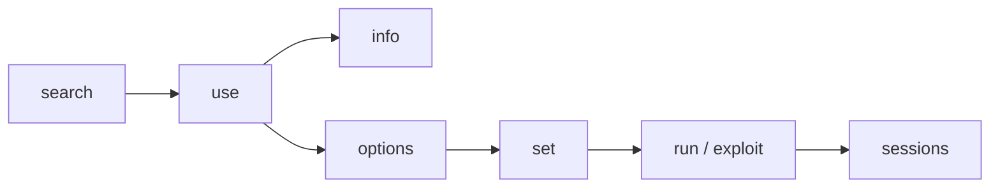

# Bölüm 2 - MSFConsole

> 📚 [İndeks](00_Metasploit_Framework_%C4%B0ndeks.md)

## 1. MSFConsole Nedir?
**MSFConsole**, Metasploit Framework'e erişim ve bu çerçevede çalışma imkânı sunan bir **komut satırı arayüzüdür**. Metasploit Framework kullanılırken genellikle MSFConsole tercih edilir. Bu arayüz; hedef tarama, güvenlik açıklarını kullanma ve veri toplama gibi işlemleri gerçekleştirmeye olanak tanır.

## 2. MSFConsole'u Başlatma
Linux'ta MSFConsole'u başlatmak için terminalde `msfconsole` komutu çalıştırılır.

```bash
root💀hackerbox:~# msfconsole
```

MSFConsole her başlatıldığında farklı bir **banner** gösterir. Bannersız (sessiz) başlatmak için `-q` parametresi kullanılır:

```bash
root💀hackerbox:~# msfconsole -q
```

## 3. Yardım Alma Komutları
- **`help`** → Geçerli mod için kullanılabilir komutların listesini gösterir.
  - **Ana moddayken** (modül seçili değilken) genel komutlar için yardım menüsünü gösterir.
  - **Modül modundayken** o modüle ait komutları ve seçenekleri gösterir.
- **`info <module_name>`** → Bir modül hakkında detaylı bilgi verir.

## 4. Temel Komutlar

### 4.1 search
MSFConsole'da modül aramak için kullanılır.

```text
search [<options>] [<keywords>:<value>]
```

| Parametre | Açıklama |
|---|---|
| `-h, --help` | Yardım menüsü |
| `-I, --ignore` | Tek eşleşme, aramayla aynı ada sahipse komutu yok say |
| `-o, --output <filename>` | Çıktıyı CSV formatında bir dosyaya yaz |
| `-S, --filter <filter>` | Arama sonuçlarını regex ile filtrele |
| `-s, --sort-ascending <column>` | Sonuçları belirtilen sütuna göre artan sırada sırala |

**Örnek:**

```text
msf6 > search type:exploit platform:windows smb
```

### 4.2 use
Bir modülü seçmek için kullanılır. Arama sonucundaki listeden **numarasıyla** ya da modülün **tam yoluyla** seçilebilir.

```text
use <module-number>
use <module-path>
```

### 4.3 info
Bir modül hakkında detaylı bilgi almak için kullanılır. Bir modül seçiliyken doğrudan `info` yazılabilir.

### 4.4 options
Seçili modülün yapılandırmalarını görüntüler.

> [!IMPORTANT]
> Exploit'i çalıştırmak için **Required** sütununda `yes` yazan alanların doldurulması gerekir. Diğer seçenekler opsiyoneldir.

### 4.5 show
Şunları görüntülemek için kullanılır: `encoders`, `nops`, `exploits`, `payloads`, `auxiliary`, `post`, `plugins`, `options`.

```text
show payloads
```

### 4.6 set ve get
- **`set`** → Bir seçeneğin değerini değiştirir.
- **`get`** → Bir seçeneğin değerini görüntüler.

```text
set RHOSTS 10.10.10.5
get RHOSTS
```

### 4.7 unset
Bir seçeneğin değerini temizler.

### 4.8 advanced
O anda etkin olan modülün **gelişmiş seçeneklerini** gösterir.

### 4.9 history
Komut geçmişini gösterir.

### 4.10 sessions
Aktif oturumları listeler.

### 4.11 back
Seçili modülden çıkıp ana moda döner.

## 5. Komut Özeti

| Komut | Görevi |
|---|---|
| `help` | Geçerli moddaki komutları listeler |
| `search` | Modül arar |
| `use` | Modül seçer |
| `info` | Modül detaylarını gösterir |
| `options` | Modül yapılandırmasını gösterir |
| `show` | Modül / payload / seçenek listeler |
| `set` / `get` | Seçenek değeri atar / gösterir |
| `unset` | Seçenek değerini temizler |
| `advanced` | Gelişmiş seçenekleri gösterir |
| `history` | Komut geçmişini gösterir |
| `sessions` | Aktif oturumları listeler |
| `back` | Seçili modülden çıkar |



> [!WARNING]
> Metasploit'i yalnızca izinli hedeflerde ve kendi lab ortamında kullan.

---
> 📚 [İndeks](00_Metasploit_Framework_%C4%B0ndeks.md) · ⬅️ [Bölüm 1](01_Giri%C5%9F_ve_Temel_Terminoloji.md)
