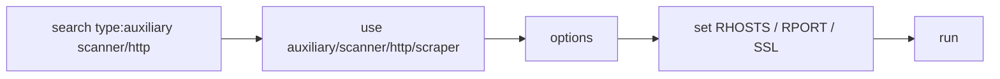

# Bölüm 3 - Auxiliary

> 📚 [İndeks](00_Metasploit_Framework_%C4%B0ndeks.md)

## 1. Auxiliary Nedir?
Yardımcı modüller (**auxiliary**) hedefi **istismar etmez**, ancak aşağıdaki gibi faydalı işlemler gerçekleştirebilir:

| Kategori | Açıklama |
|---|---|
| **Yönetim** | Hedef makinede değişiklik yapma, işletme veya manipülasyon |
| **Analiz** | Çoğunlukla şifre kırma gibi analiz işlemleri gerçekleştiren araçlar |
| **Veri Toplama** | Tek bir hedeften veri toplama, derleme veya sıralama |
| **Hizmet Reddi** | Bir hedef makineyi veya servisi çökertme veya yavaşlatma |
| **Tarama** | Hedefleri bilinen zafiyetler açısından tarama |
| **Sunucu Desteği** | SMB, FTP gibi yaygın protokoller için sunucular çalıştırma |

> [!NOTE]
> Exploit'lerden farkı: auxiliary modüller **payload taşımaz**, hedefte oturum açmaz. Terimler için: [Bölüm 1](01_Giri%C5%9F_ve_Temel_Terminoloji.md)

## 2. Web Scraping Uygulaması
MSFConsole'daki `auxiliary/scanner/http/scraper` modülünü kullanarak hedef sistemde **80 portunda** çalışan bir web sayfasındaki `<title></title>` etiketleri arasında yazanları bulalım.

### 2.1 Modülü Arama
HTTP tarayıcı auxiliary modüllerini listeleyelim:

```text
msf6 > search type:auxiliary scanner/http
```

### 2.2 Modülü Seçme ve Seçenekleri Görüntüleme

```text
msf6 > use auxiliary/scanner/http/scraper
msf6 auxiliary(scanner/http/scraper) > options
```

### 2.3 Hedefi Ayarlama ve Çalıştırma

```text
msf6 auxiliary(scanner/http/scraper) > set RHOSTS <hedef-ip>
msf6 auxiliary(scanner/http/scraper) > run
```

## 3. HTTPS Kullanan Bir Sitede Web Scraping
HTTPS protokolü kullanan bir websitesinde web scraping uygulaması. Önce seçenekleri görüntüleyelim:

```text
msf6 auxiliary(scanner/http/scraper) > options
```

HTTPS için port **443** olmalı ve **SSL** açılmalı:

```text
msf6 auxiliary(scanner/http/scraper) > set RHOSTS <hedef-ip>
msf6 auxiliary(scanner/http/scraper) > set RPORT 443
msf6 auxiliary(scanner/http/scraper) > set SSL true
msf6 auxiliary(scanner/http/scraper) > run
```



> [!WARNING]
> Metasploit'i yalnızca izinli hedeflerde ve kendi lab ortamında kullan.

---
> 📚 [İndeks](00_Metasploit_Framework_%C4%B0ndeks.md) · ⬅️ [Bölüm 2](02_MSFConsole.md)
