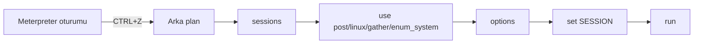

# Bölüm 6 - Exploit Sonrası

> 📚 [İndeks](00_Metasploit_Framework_%C4%B0ndeks.md)

## 1. Exploit Sonrası
Post exploitation modülleri, bir makine ele geçirildikten ve bir meterpreter oturumu açıldıktan sonra kullanılır. Bir makineden veri toplama, yetki yükseltme gibi çeşitli görevleri yerine getirirler.

Bir sisteme sızdıktan sonra, hedefin iç ağlarına daha fazla erişim kazanmak için yönlendirme (pivoting) yapmak ve sistemler arası ilerlerken izlerimizi temizlemek isteyebiliriz. Bir sızma testi uzmanı, diğer potansiyel hedefler için paketleri dinlemeyi, daha fazla bilgi veya erişim elde etmek için kayıt defterlerini düzenlemeyi veya daha kalıcı sistem erişimi sağlamak için bir backdoor yerleştirmek isteyebilir.

> [!NOTE]
> Post exploitation modülleri hali hazırda açılmış bir Metasploit oturumu gerektirir.

## 2. Bilgi Toplama
Bilgi toplama ile ilgili post exploitation modüllerini aramak için `search type:post gather` şeklinde arama yapabiliriz.

```text
msf6 > search type:post gather
```

## 3. Uygulama
Öncelikle bir hedefe sızarak meterpreter oturumu almamız gerekiyor. Bu uygulamada ilk meterpreter oturumunun alınmasından sonrası anlatılacaktır. (Oturum alma: [Bölüm 4 - Exploits](04_Exploits.md))

### 3.1 Oturumu Arka Plana Atma
Meterpreter oturumumuzu `CTRL+Z` tuş kombinasyonunu kullanarak arka plana atalım. Ardından `sessions` komutunu çalıştırdığımızda aktif oturumların listesini görebiliriz.

```text
meterpreter > ^Z
Background session 1? [y/N]  y
msf6 exploit(linux/http/supervisor_xmlrpc_exec) > sessions
```

### 3.2 Post Modülünü Seçme
Şimdi bir post-exploitation modülünü seçelim. Sistem hakkında bilgi toplamak için `post/linux/gather/enum_system` modülünü seçebiliriz. `use` komutu ile bu modülü seçelim.

```text
msf6 > use post/linux/gather/enum_system
```

### 3.3 SESSION Ayarı
Seçtiğimiz modülün `options` komutu ile konfigürasyonlarına baktığımızda SESSION değerini ayarlamamız gerektiğini görüyoruz. Bu SESSION değerine aktif olan meterpreter oturumumuzun id sini atamamız gerekiyor. Bunun için `sessions` komutunu kullanarak aktif oturumumuzun id sini öğrenip gerekli konfigürasyonu yapalım.

```text
msf6 post(linux/gather/enum_system) > options
msf6 post(linux/gather/enum_system) > sessions
msf6 post(linux/gather/enum_system) > set SESSION <oturum-id>
```

### 3.4 Modülü Çalıştırma
Şimdi `run` komutu ile post exploitation modülünü çalıştıralım.

```text
msf6 post(linux/gather/enum_system) > run
```



> [!WARNING]
> Metasploit'i yalnızca izinli hedeflerde ve kendi lab ortamında kullan.

---
> 📚 [İndeks](00_Metasploit_Framework_%C4%B0ndeks.md) · ⬅️ [Bölüm 5](05_Payloadlar.md) · ➡️ [Bölüm 7](07_Kodlay%C4%B1c%C4%B1lar.md)
