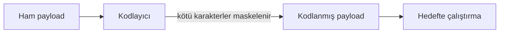

# Bölüm 7 - Kodlayıcılar

> 📚 [İndeks](00_Metasploit_Framework_%C4%B0ndeks.md)

## 1. Kodlayıcılar (Encoders)
Encoders, bir payload'ın ham verisini alır ve belirli bir kodlama algoritması kullanarak yeniden düzenler. Bu işlem, genellikle **"kötü karakterler"** olarak adlandırılan, hedef sistemde sorunlara neden olabilecek veya payload'ın düzgün çalışmasını engelleyebilecek karakterleri maskeler.

Örneğin, birçok sistemde null byte (`\x00`) gibi karakterler, bir stringin sonunu işaret eder. Eğer bir payload içerisinde bu tür karakterler bulunursa, sistem payload'ı doğru şekilde işleyemeyebilir. Kodlayıcılar, bu tür sorunlardan kaçınmamıza yardımcı olur.

## 2. Neden Kodlayıcılar Kullanılır?

| Amaç | Açıklama |
|---|---|
| **Kötü Karakterleri Maskeler** | Kötü karakterler, payload'ın hedef sistemde beklenildiği gibi çalışmamasına neden olabilir. Kodlayıcılar, bu karakterleri maskeleyerek payload'ın sorunsuz çalışmasını sağlar. |
| **Güvenlik Ürünlerini Atlatma** | Antivirüs yazılımları ve diğer güvenlik ürünleri, bilinen zararlı yazılım imzalarını arar. Kodlayıcılar, payload'ın bu tür güvenlik önlemleri tarafından tespit edilmesini zorlaştırarak, saldırının başarılı olma şansını artırır. |
| **Esneklik Sağlar** | Farklı kodlayıcılar, çeşitli durumlar ve hedef sistemler için özelleştirilebilir. Bu, saldırganın ihtiyaçlarına göre en uygun kodlama yöntemini seçebilmesini sağlar. |

> [!TIP]
> Kodlama bir **şifreleme ya da gizleme** yöntemi değildir. Metasploit'in kendi kodlayıcıları (ör. `x86/shikata_ga_nai`) çok bilindiği için modern antivirüs ve EDR çözümleri kodlanmış payload'ları da büyük ölçüde yakalar. Kodlayıcıların asıl güvenilir kullanımı **kötü karakterlerden kaçınmaktır**.

## 3. Kodlayıcılar Nasıl Kullanılır?
MSFConsole'da kodlayıcıları listelemek için aşağıdaki komut kullanılabilir.

```text
msf6 > show encoders
```

Bu komut, Metasploit'in sunduğu çeşitli kodlayıcıları ve her birinin ne için kullanıldığını listeler. Daha sonra, bir exploit veya payload ile birlikte kullanılmak üzere uygun bir kodlayıcı seçebilirsiniz.

Örneğin, bir payload için belirli bir kodlayıcı kullanmak istiyorsanız, şu adımları takip edebilirsiniz:

1. Payload'ınızı seçin.
2. `set encoder <encoder_name>` komutu ile kodlayıcıyı ayarlayın.
3. `generate` komutu ile payloadı oluşturun.
4. Payload'ı hedefte çalıştırın.

```text
msf6 > use payload/linux/x86/shell_bind_tcp
msf6 payload(linux/x86/shell_bind_tcp) > set encoder x86/shikata_ga_nai
msf6 payload(linux/x86/shell_bind_tcp) > generate -f python
```

> [!NOTE]
> Aynı işlem `generate` seçenekleriyle de yapılabilir: `-e` kodlayıcıyı, `-i` kaç kez kodlanacağını, `-b` kaçınılacak kötü karakterleri belirtir. Örnek: `generate -e x86/shikata_ga_nai -i 3 -b '\x00' -f python`. Tüm seçenekler için: Bölüm 5 - Payloadlar.



> [!WARNING]
> Metasploit'i yalnızca izinli hedeflerde ve kendi lab ortamında kullan.

---
> 📚 [İndeks](00_Metasploit_Framework_%C4%B0ndeks.md) · ⬅️ [Bölüm 6](06_Exploit_Sonras%C4%B1.md) · ➡️ [Bölüm 8](08_Nops.md)
