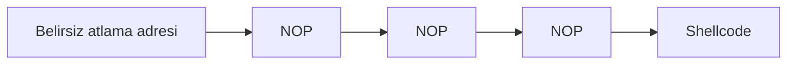

# Bölüm 8 - Nops

> 📚 [İndeks](00_Metasploit_Framework_%C4%B0ndeks.md)

## 1. Nops
"Nop", **"No Operation"** ifadesinin kısaltmasıdır. Adından da anlaşılacağı üzere, bu komutlar herhangi bir işlem yapmazlar. Nops genellikle bir işlemciye herhangi bir işlem yapmadan sonraki komuta geçmesi talimatı verir.

Nops modülleri, exploitler sırasında **"NOP sled"** veya **"NOP slide"** olarak bilinen teknikleri uygulamak için kullanılır. Bu teknik, exploitin başarılı bir şekilde çalışmasını sağlamak için önemli bir role sahiptir.

## 2. Nops'un Kullanım Amacı
Nops'un başlıca kullanım amacı, hedef sistemin belleğindeki belirli bir konuma güvenilir bir şekilde "kayma" sağlamaktır. Bir exploit, hedef sistemin belleğinde bir kod parçasını çalıştırmayı amaçlar. Ancak, bu kodun bellekte tam olarak nereye yerleşeceğini önceden bilmek her zaman mümkün olmayabilir. Nops sledi, bu belirsizliği yönetmenin bir yoludur.

Bir Nops sledi, zararlı kodun önüne yerleştirilen bir dizi "nop" komutundan oluşur. Saldırgan, exploitin nerede başlayacağını tam olarak bilemese bile, exploit koduna herhangi bir bellek adresinden "kayarak" ulaşabilir.

> [!TIP]
> x86 mimarisinde NOP komutu tek bayttır: `\x90`. Örneğin `\x90\x90\x90...` dizisinin herhangi bir yerine düşen yürütme, sırayla kayarak arkasındaki shellcode'a ulaşır.



## 3. Nops'un Kullanımı
Metasploit'te Nops kullanımı genellikle otomatiktir ve MSFConsole, bir exploit oluşturulurken uygun noktalara Nops ekler. Ancak, kullanıcılar msfconsole üzerinden Nops modüllerini manuel olarak da yönetebilirler.

Nops modüllerini listelemek için aşağıdaki komut kullanılır.

```text
msf6 > show nops
```

Bu komut, kullanılabilir Nops modüllerini listeler. Bir exploit oluştururken veya bir payload hazırlarken, bu Nops modüllerinden birini seçerek exploitin/payloadın daha esnek ve güvenilir hale gelmesini sağlayabilirsiniz.

Örneğin, bir payload için belirli bir Nops modülü kullanmak istiyorsanız, şu adımları izleyebilirsiniz:

1. Payload'ınızı seçin.
2. `set NOP <nop_module>` komutu ile Nops modülünü ayarlayın.
3. `generate` komutu ile payloadı oluşturun.
4. Payload'ı hedefte çalıştırın.

```text
msf6 > use payload/linux/x86/shell_bind_tcp
msf6 payload(linux/x86/shell_bind_tcp) > set NOP x86/single_byte
msf6 payload(linux/x86/shell_bind_tcp) > generate -n 16 -f python
```

> [!NOTE]
> `generate` komutunun `-n` seçeneği payload'ın önüne belirtilen uzunlukta bir NOP sled ekler. `-P` ise istenen toplam boyuta göre NOP sled uzunluğunu otomatik ayarlar. Tüm seçenekler için: Bölüm 5 - Payloadlar.

> [!WARNING]
> Metasploit'i yalnızca izinli hedeflerde ve kendi lab ortamında kullan.

---
> 📚 [İndeks](00_Metasploit_Framework_%C4%B0ndeks.md) · ⬅️ [Bölüm 7](07_Kodlay%C4%B1c%C4%B1lar.md) · ➡️ [Bölüm 9](09_Evasion.md)
