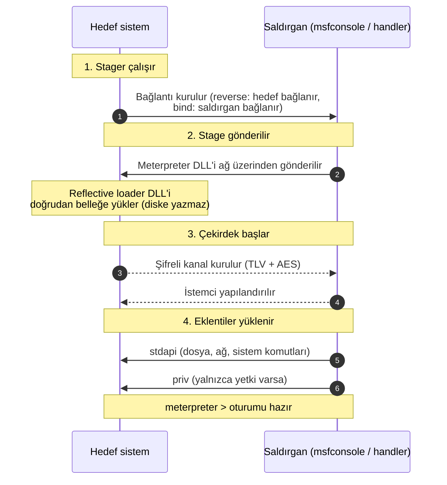

# Bölüm 10 - Meterpreter

> 📚 [İndeks](00_Metasploit_Framework_%C4%B0ndeks.md)

## 1. Meterpreter
Meterpreter, hedef sistem üzerinde gelişmiş etkileşim sağlayan, RAM'de çalışan bir payload türüdür. Standart shell erişiminden çok daha fazlasını sunar; dosya sistemi manipülasyonu, sistemde bilgi toplama ve ağ etkileşimleri gibi işlemleri gerçekleştirebilir. Meterpreter bellekte çalıştığı için diskte çok az iz bırakır ve bu da güvenlik araçları tarafından yakalanmasını zorlaştırır.

Meterpreter, bellek içi DLL enjeksiyon stager'larını kullanan ve çalışma zamanında ağ üzerinden genişletilebilen gelişmiş, dinamik olarak genişletilebilir bir payload'dır. Stager soketi üzerinden iletişim kurar ve kapsamlı bir istemci tarafı Ruby API'si sunar.

> [!NOTE]
> **"Diske hiçbir şey yazmaz" ne kadar doğru?**
> Bu yalnızca Meterpreter'ın kendisi için geçerli. İlk aşamada çalıştırılan dosya (örneğin msfvenom ile üretilmiş bir `.exe`) genellikle diske düşer.

## 2. Meterpreter Nasıl Çalışır?
1. Hedef, ilk olarak **stager**'ı çalıştırır. Bu genellikle bind, reverse, findtag, passivex vb. olur.
2. Stager, **DLL**'i yükler. Reflective stub, DLL'in yüklenmesini/enjekte edilmesini yönetir.
3. Meterpreter **çekirdeği** başlatılır ve saldırganla şifreli bir iletişim kanalı kurulur. Metasploit istemciyi yapılandırır.
4. Son olarak Meterpreter **eklentileri** (extension) yükler. Genellikle `stdapi`'yi yükler; modül yönetici hakları veriyorsa `priv`'i de yükler. Tüm eklentiler TLV protokolü kullanılarak şifreli kanal üzerinden yüklenir.

> [!NOTE]
> **Eski tarif:** Bazı kaynaklarda "TLS/1.0 bağlantısı kurar ve bir GET gönderir" yazar. Bu eski dokümantasyondan kalma. Güncel Meterpreter'da TLV paketleri AES ile şifrelenir; GET isteği yalnızca HTTP/HTTPS taşımalarında (`reverse_http(s)`) olur.

### 2.1 Akış Şeması



### 2.2 Adım Adım Tablo

| Adım | Ne olur? | Nerede çalışır? | Kullanılan teknik | Savunmada iz |
|---|---|---|---|---|
| **1. Stager** | Küçük bir kod parçası çalışır ve saldırganla bağlantı kurar. | Hedef (genelde diskteki bir dosyadan başlar) | `reverse_tcp`, `bind_tcp`, `reverse_https` vb. | Beklenmedik bir porta giden dış bağlantı. Sysmon Event ID 1 (süreç oluşturma) ve 3 (ağ bağlantısı) |
| **2. Stage (DLL)** | Meterpreter'ın asıl kodu ağdan gelir. | Hedefin belleği | Reflective DLL Injection: DLL, Windows yükleyicisi kullanılmadan belleğe yüklenir | Bağlantıdan hemen sonra gelen büyük indirme. Diskte karşılığı olmayan RWX bellek bölgesi |
| **3. Çekirdek** | Meterpreter başlar ve şifreli iletişim kanalı açılır. | Hedef ile saldırgan arası | TLV protokolü, AES şifreleme. HTTP(S) taşımasında GET/POST istekleri | Düzenli aralıklarla tekrarlanan "beacon" trafiği |
| **4. Eklentiler** | Komut setleri çalışma anında yüklenir. | Hedefin belleği | `stdapi` her zaman yüklenir. `priv` (`getsystem`, `hashdump`) yalnızca yetki varsa yüklenir | EDR bellek taraması. `migrate` sırasında başka sürece yazma (Event ID 8) |

> [!TIP]
> **Özet:** Stager kapıyı açar, stage içeri girer, çekirdek kanalı kurar, eklentiler yetenek kazandırır. Diskte iz bırakabilen tek adım 1. adımdır; geri kalan her şey bellekte olur.

## 3. Meterpreter Tasarım Hedefleri

### 3.1 Gizlilik
- Meterpreter tamamen bellekte bulunur ve diske hiçbir şey yazmaz.
- Varsayılan olarak yeni süreç oluşturulmaz; Meterpreter, tehlikeye atılan sürece enjekte edilir ve diğer çalışan süreçlere kolayca geçiş yapabilir (`migrate`).
- Varsayılan olarak şifreli iletişim kullanır.
- Bunların tümü hedef makinede çok sınırlı iz bırakır.

### 3.2 Güçlü
- Kanallaştırılmış bir iletişim sistemi kullanır.
- TLV protokolünün çok az sınırlaması vardır.

### 3.3 Genişletilebilir
- Özellikler çalışma zamanında artırılabilir ve ağ üzerinden yüklenir.
- Meterpreter'a yeni özellikler eklemek basittir.

## 4. Meterpreter Komutları
Meterpreter oturumu açmayı başardığımızda hedef sistem üzerinde çalıştırabileceğimiz gelişmiş komutlar otomatik olarak yüklenir ve kullanımımıza sunulur. Çalıştırabileceğimiz komutlar, oturumun açıldığı sisteme göre (Android, Windows, Linux vb.) değişiklik gösterebilir.

> [!NOTE]
> Aşağıdaki liste, Linux sistemde açılan bir Meterpreter oturumunda çalıştırılabilir komutları içerir. Android gibi farklı işletim sistemlerinde apk dosyası yükleme ya da çalıştırma gibi farklı komutlar da bulunur.

Komut listesini almak için:

```text
meterpreter > help
```

### 4.1 Temel Komutlar

| Komut | Açıklama |
|---|---|
| `?` | Yardım menüsü |
| `background` | Mevcut oturumu arka plana alır |
| `bg` | background komutunun kısaltması |
| `bgkill` | Arka planda çalışan bir meterpreter betiğini sonlandırır |
| `bglist` | Arka planda çalışan betikleri listeler |
| `bgrun` | Bir meterpreter betiğini arka planda çalıştırır |
| `channel` | Aktif kanalları gösterir veya yönetir |
| `close` | Bir kanalı kapatır |
| `detach` | Meterpreter oturumundan ayrılır (http/https için) |
| `disable_unicode_encoding` | Unicode metinlerin kodlanmasını kapatır |
| `enable_unicode_encoding` | Unicode metinlerin kodlanmasını açar |
| `exit` | Meterpreter oturumunu sonlandırır |
| `guid` | Oturumun GUID değerini verir |
| `help` | Yardım menüsü |
| `info` | Bir Post modülü hakkında bilgi gösterir |
| `irb` | Mevcut oturumda etkileşimli Ruby kabuğu açar |
| `load` | Bir veya daha fazla meterpreter eklentisi yükler |
| `machine_id` | Oturuma bağlı makinenin MSF kimliğini verir |
| `pry` | Mevcut oturumda Pry hata ayıklayıcısını açar |
| `quit` | Meterpreter oturumunu sonlandırır |
| `read` | Bir kanaldan veri okur |
| `resource` | Bir dosyada kayıtlı komutları çalıştırır |
| `run` | Bir meterpreter betiğini veya Post modülünü çalıştırır |
| `secure` | Oturumdaki TLV paket şifrelemesini (yeniden) kurar |
| `sessions` | Başka bir oturuma hızlıca geçer |
| `use` | "load" komutunun eski kısaltması |
| `uuid` | Mevcut oturumun UUID değerini verir |
| `write` | Bir kanala veri yazar |

### 4.2 Dosya Sistemi Komutları

| Komut | Açıklama |
|---|---|
| `cat` | Bir dosyanın içeriğini ekrana yazdırır |
| `cd` | Dizin değiştirir |
| `checksum` | Bir dosyanın sağlama toplamını (checksum) verir |
| `chmod` | Bir dosyanın izinlerini değiştirir |
| `cp` | Kaynağı hedefe kopyalar |
| `del` | Belirtilen dosyayı siler |
| `dir` | Dosyaları listeler (ls kısaltması) |
| `download` | Bir dosya veya dizini indirir |
| `edit` | Bir dosyayı düzenler |
| `getlwd` | Yerel çalışma dizinini gösterir |
| `getwd` | Çalışma dizinini gösterir |
| `lcat` | Yerel bir dosyanın içeriğini ekrana yazdırır |
| `lcd` | Yerel çalışma dizinini değiştirir |
| `lls` | Yerel dosyaları listeler |
| `lmkdir` | Yerel makinede yeni dizin oluşturur |
| `lpwd` | Yerel çalışma dizinini gösterir |
| `ls` | Dosyaları listeler |
| `mkdir` | Dizin oluşturur |
| `mv` | Kaynağı hedefe taşır |
| `pwd` | Çalışma dizinini gösterir |
| `rm` | Belirtilen dosyayı siler |
| `rmdir` | Dizini siler |
| `search` | Dosya arar |
| `upload` | Bir dosya veya dizini yükler |

> [!TIP]
> Başında `l` olan komutlar (`lls`, `lcd`, `lpwd`...) hedefte değil, **kendi makinende** çalışır.

### 4.3 Ağ Komutları

| Komut | Açıklama |
|---|---|
| `arp` | Hedefin ARP önbelleğini gösterir |
| `getproxy` | Mevcut proxy ayarlarını gösterir |
| `ifconfig` | Ağ arayüzlerini gösterir |
| `ipconfig` | Ağ arayüzlerini gösterir |
| `netstat` | Ağ bağlantılarını gösterir |
| `portfwd` | Yerel bir portu uzaktaki bir servise yönlendirir |
| `resolve` | Hedef üzerinde alan adlarını çözümler |
| `route` | Yönlendirme tablosunu gösterir ve değiştirir |

> [!TIP]
> `portfwd` ve `route`, ele geçirilen makine üzerinden iç ağa erişmek (pivoting) için kullanılır.

### 4.4 Sistem Komutları

| Komut | Açıklama |
|---|---|
| `execute` | Bir komut çalıştırır |
| `getenv` | Bir veya daha fazla ortam değişkeninin değerini verir |
| `getpid` | Mevcut sürecin kimliğini (PID) verir |
| `getuid` | Oturumun hangi kullanıcıyla çalıştığını verir |
| `kill` | Bir süreci sonlandırır |
| `localtime` | Hedef sistemin yerel tarih ve saatini gösterir |
| `pgrep` | Süreçleri isme göre filtreler |
| `pkill` | Süreçleri isme göre sonlandırır |
| `ps` | Çalışan süreçleri listeler |
| `shell` | Sistem komut kabuğuna geçer |
| `suspend` | Süreçleri duraklatır veya devam ettirir |
| `sysinfo` | Uzak sistem hakkında bilgi verir (işletim sistemi vb.) |

### 4.5 Webcam Komutları

| Komut | Açıklama |
|---|---|
| `webcam_chat` | Görüntülü sohbet başlatır |
| `webcam_list` | Kameraları listeler |
| `webcam_snap` | Belirtilen kameradan fotoğraf çeker |
| `webcam_stream` | Belirtilen kameradan canlı görüntü akışı açar |

### 4.6 Mikrofon Komutları

| Komut | Açıklama |
|---|---|
| `listen` | Kayıtlı bir ses kaydını oynatıcıyla dinletir |
| `mic_list` | Tüm mikrofonları listeler |
| `mic_start` | Hedef mikrofondan ses kaydı başlatır |
| `mic_stop` | Ses kaydını durdurur |

### 4.7 Ses Çıkış Komutları

| Komut | Açıklama |
|---|---|
| `play` | Hedef sistemde .wav ses dosyası çalar |

## 5. Savunma Tarafı

> [!TIP]
> - **Bellek:** EDR araçları belleğe enjekte edilmiş kodu tarar. İşareti: okuma-yazma-çalıştırma (RWX) izinli ve diskteki bir dosyaya bağlı olmayan bellek bölgeleri.
> - **Ağ:** Tek bir hosta düzenli aralıklarla giden "beacon" bağlantıları ve 4444 gibi varsayılan portlar. Suricata/Snort'ta Meterpreter için hazır imzalar var.
> - **Davranış:** `migrate` sırasında başka sürece yazma (Sysmon Event ID 8, CreateRemoteThread) ve `shell` ile açılan beklenmedik `cmd.exe` süreçleri.

> [!NOTE]
> **Pratik:** TryHackMe "Metasploit: Meterpreter" odası bu bölümle birebir örtüşüyor.

> [!WARNING]
> Metasploit'i yalnızca izinli hedeflerde ve kendi lab ortamında kullan.

---
> 📚 [İndeks](00_Metasploit_Framework_%C4%B0ndeks.md) · ⬅️ [Bölüm 9](09_Evasion.md) · ➡️ [Bölüm 11](11_MSFVenom.md)
