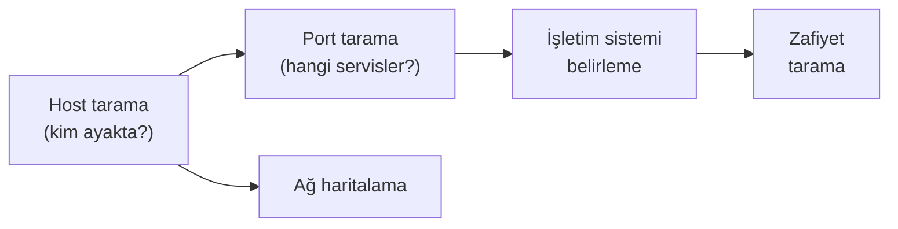
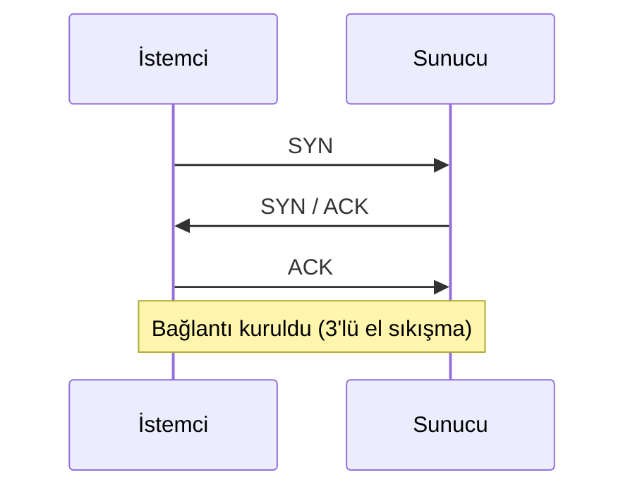
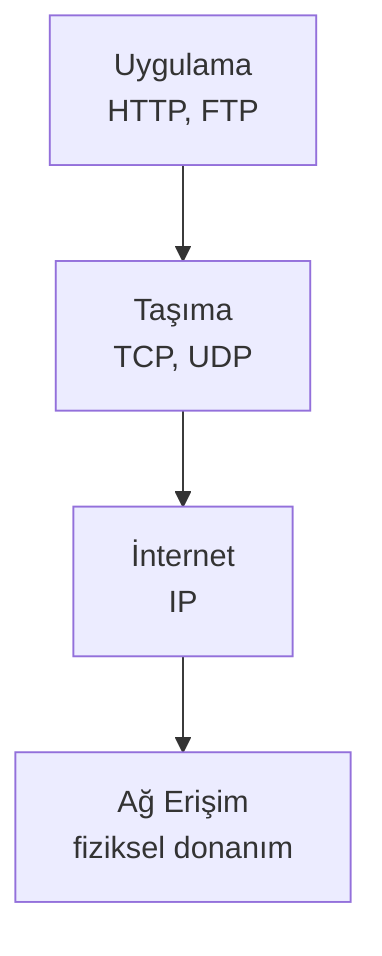

# Bölüm 1 - Giriş ve Temel Ağ Bilgisi

> 📚 [İndeks](00_Nmap_ile_A%C4%9F_Tarama_%C4%B0ndeks.md)

## 1. Giriş
Modern ağ ortamları, sayısız cihaz ve servisin birbiriyle karmaşık bir şekilde etkileşimde olduğu **canlı ekosistemlerdir**. Bu ortamların güvenliğini sağlamak ve yönetmek, ağ profesyonelleri için büyük bir zorluk teşkil eder.

**Sızma testi**, günümüzün karmaşık ağ ortamlarında güvenliği sağlamanın en etkili yollarından biridir. Bu eğitimde, sızma testi uzmanlarının ağ güvenliğini değerlendirmede en güçlü araçlarından biri olan **Nmap**'in ağ tarama yeteneklerini kullanmayı öğreneceğiz.

## 2. Ağ Tarama
**Ağ tarama**, bir ağdaki **cihazların, servislerin ve bu servislerin çalıştığı portların** belirlenmesi işlemidir. Bu işlem, ağın mevcut durumunun bir fotoğrafını çeker ve ağın güvenliğinin değerlendirilmesine yardımcı olur.

### 2.1 Ağ Taramanın Amaçları
- **Güvenlik açıklarının** belirlenmesi
- **Ağ topolojisinin** haritalanması
- **Servislerin** izlenmesi

### 2.2 Ağ Tarama Çeşitleri

| Tür | Ne yapar? |
|---|---|
| **Host Tarama** | Belirli bir ağın IP seviyesinde taranmasıdır. Hangi cihazların **aktif** olduğunu belirlemeyi amaçlar. |
| **Port Tarama** | Belirli bir IP veya host üzerinde çalışan **servislerin** tespit edilmesidir. |
| **Ağ Haritalama** | Ağda bulunan aktif cihazların ve bunların konfigürasyonlarının (örneğin **firewall kuralları**) belirlenmesidir. |
| **İşletim Sistemi Belirleme** | Ağdaki cihazların **işletim sistemlerinin** tespit edilmesi. |
| **Zafiyet Tarama** | Ağdaki cihazların **güvenlik açıkları** açısından incelenmesi. |

## 3. Temel Ağ Bilgisi

### 3.1 TCP Nedir?
**Transmission Control Protocol (TCP)**, internet üzerinden veri iletimi sağlayan temel protokollerden biridir. **Güvenilir, sıralı ve hata kontrolü sağlayan** bir iletişim modelidir. TCP, veri paketlerinin hedeflerine **doğru sırada ve eksiksiz** ulaşmasını garanti eder.

### 3.2 TCP İletişim Bayrakları
TCP iletişiminde bağlantı kurma, veri transferi ve bağlantı sonlandırma işlemleri için çeşitli **bayraklar (flags)** kullanılır. En yaygın TCP bayrakları:

| Bayrak | Açılım | Görevi |
|---|---|---|
| `SYN` | Synchronize | TCP bağlantısı **başlatmak** için kullanılır. |
| `ACK` | Acknowledgment | Bir paketin **alındığını onaylamak** için kullanılır. |
| `FIN` | Finish | TCP bağlantısını **sonlandırma isteğini** gönderir. |
| `RST` | Reset | Bağlantıyı **hemen sonlandırır**, genellikle bir hata durumunda kullanılır. |
| `PSH` | Push | Verinin **derhal gönderilmesini** sağlar. |
| `URG` | Urgent | **Acil veri** olduğunu belirtir. |

> [!TIP]
> **Taramayla bağlantısı**
> Port taramaları bu bayraklara verilen cevaplara dayanır: kapalı bir port `SYN` paketine genellikle `RST` ile, açık bir port `SYN/ACK` ile cevap verir.

### 3.3 IP Nedir?
**Internet Protocol (IP)**, ağ cihazlarının birbirleriyle iletişim kurmasını sağlayan bir protokoldür. Her cihazın ağ üzerinde **benzersiz bir IP adresi** vardır ve bu adres, cihazın ağ üzerindeki **konumunu** belirler.

### 3.4 Port Nedir?
Bir ağ servisinin dinlediği **mantıksal bir noktadır**. IP adresi bir cihazın ağdaki adresini belirlerken, **port numarası** o cihaz üzerindeki belirli bir servise erişimi sağlar.

Örneğin:
- **HTTP** trafiği genellikle port `80`
- **HTTPS** trafiği ise port `443` üzerinden gerçekleşir.

### 3.5 TCP/IP Protokol Ailesi
**TCP/IP**, internetin temelini oluşturan protokol setidir. Bu aile, veri iletiminin nasıl gerçekleştirileceğini tanımlayan bir dizi kural ve standarttan oluşur. TCP/IP; **uygulama, taşıma, internet ve ağ erişim** katmanları olmak üzere **dört temel katmandan** oluşur.

### 3.6 TCP/IP Katmanları

| # | Katman | Görevi | Örnek |
|---|---|---|---|
| 1 | **Uygulama Katmanı** (Application Layer) | Kullanıcıların ağ üzerindeki servislerle etkileşimde bulunduğu katmandır. | HTTP, FTP |
| 2 | **Taşıma Katmanı** (Transport Layer) | Veri aktarımının yönetildiği katmandır. | TCP, UDP |
| 3 | **İnternet Katmanı** (Internet Layer) | Paketlerin gönderildiği ve yönlendirildiği katmandır. | IP |
| 4 | **Ağ Erişim Katmanı** (Network Access Layer) | Fiziksel ağ donanımı üzerinden veri iletiminin gerçekleştiği katmandır. | Ethernet, Wi-Fi |

Her katman, önceki katmandan aldığı veriyi işler ve sonraki katmana aktarır. Bu şekilde veriler kaynaktan hedefe iletilir.

> [!NOTE]
> Buradaki temel ağ bilgileri, eğitimin ilerleyen bölümlerinde yapacağımız ağ tarama işlemlerini daha iyi anlamaya yardımcı olacaktır.

## 4. Diğer Notlarla İlişkisi
- TCP/IP katmanları, yaygın portlar ve servisler: [Ağ Trafiği Analizi - Hatırlatmalar](../A%C4%9F_Trafi%C4%9Fi_Analizi/02_Hat%C4%B1rlatmalar.md)
- Tarama trafiğini yakalayıp incelemek: [Wireshark ile Ağ Analizi](../A%C4%9F_Trafi%C4%9Fi_Analizi/06_Wireshark_ile_A%C4%9F_Analizi.md)
- Port ve bağlantı komutları (`ss`, `netstat`): [Ağ Yapılandırması ve Güvenliği](../Linux_Komutlar%C4%B1/06_A%C4%9F_Yap%C4%B1land%C4%B1rmas%C4%B1_ve_G%C3%BCvenli%C4%9Fi.md)
- Taramayı engelleyen/filtreleyen güvenlik duvarı: [Iptables](../Linux_Komutlar%C4%B1/07_Iptables_G%C3%BCvenlik_Duvar%C4%B1.md)

---
> 📚 [İndeks](00_Nmap_ile_A%C4%9F_Tarama_%C4%B0ndeks.md) · [Bölüm 2 - Genel Bakış](02_Genel_Bak%C4%B1%C5%9F.md) ▶
