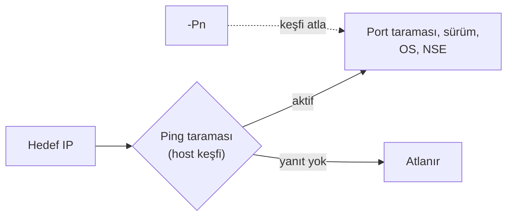

# Bölüm 3 - Host Keşfi

> 📚 [İndeks](00_Nmap_ile_A%C4%9F_Tarama_%C4%B0ndeks.md) · ◀ [Bölüm 2 - Genel Bakış](02_Genel_Bak%C4%B1%C5%9F.md)

## 1. Host Keşfi Nedir?
Ağ keşfindeki ilk adımlardan biri, genellikle **geniş IP aralıklarını aktif veya ilgi çekici hostlara indirgemektir**. Her tekil IP adresinin her portunu taramak yavaş ve genellikle gereksizdir. Bir hostun ilgi çekici olup olmadığı taramanın amacına bağlıdır: ağ yöneticileri belirli bir hizmeti çalıştıran hostlarla ilgilenebilirken, sızma testi uzmanları IP adresine sahip her cihazla ilgilenebilir.

Host keşfinin ihtiyaçları bu kadar çeşitli olduğu için Nmap, kullanılan teknikleri özelleştirmek için geniş bir seçenek yelpazesi sunar. Örneğin ping taraması, yalnızca ping aracıyla ilişkilendirilen basit **ICMP echo** isteklerini göndermekten ibaret değildir.

Tarama yaparken ping adımı tamamen atlanabilir ya da **TCP SYN/ACK, UDP ve ICMP** paketleri kullanılabilir. Amaç, bir IP adresinin gerçekten aktif olduğunu (bir host veya ağ cihazı tarafından kullanıldığını) gösteren yanıtları almaktır. Genellikle IP adreslerinin yalnızca küçük bir kısmı aktif çıkar; bu, özellikle `10.0.0.0/8` gibi özel adres alanlarında yaygındır. Host keşfi, bu geniş aralıktan aktif makineleri bulur.

## 2. Host Keşfi Kontrolleri
Varsayılan olarak Nmap, daha saldırgan taramalardan (port taraması, işletim sistemi tespiti, NSE, sürüm tespiti) önce bir **ping taraması** yapar. Bu taramalar yalnızca host aktif bulunursa gerçekleştirilir. Böylece her IP'ye kapsamlı tarama yapmadan önce hostun aktif olduğu anlaşılır ve **zaman ile bant genişliğinden önemli ölçüde tasarruf** edilir.

Bu yaklaşım her durum için ideal değildir; Nmap bu davranışı kontrol etmek için `-sL`, `-sn` ve `-Pn` seçeneklerini sunar.

| Seçenek | Ad | Kısaca |
|---|---|---|
| `-sL` | List Scan | Hedeflere paket göndermeden listeler |
| `-sn` | Ping Scan | Host keşfi yapar, port taraması yapmaz |
| `-Pn` | Ping'siz tarama | Host keşfini atlar, hostları aktif sayar |



### 2.1 List Scan (`-sL`)
Hedef hostlara **hiçbir paket göndermeden**, belirtilen ağlardaki her host için basitçe bir liste oluşturur. Varsayılan olarak Nmap yine de host adlarını öğrenmek için **reverse-DNS çözümlemesi** yapar ve sonunda toplam IP sayısını raporlar.

Doğru IP adreslerine sahip olduğunu doğrulamak için iyi bir gerçeklik kontrolüdür. Tanımadığın alan adları görüyorsan yanlış bir şirketin ağını tarıyor olabilirsin; bunu araştırmak faydalıdır.

```
root💀hackerbox:~# nmap -sL stanford.edu/24
Starting Nmap 7.94 ( https://nmap.org ) at 2024-03-29 16:15 +03
Nmap scan report for dc-webinfr-wwwprxy-net.stanford.edu (171.67.215.0)
Nmap scan report for dcf1-srtr-vl895.SUNet (171.67.215.1)
Nmap scan report for dc-auth-acctdb-net.stanford.edu (171.67.215.32)
<SNIP>
Nmap scan report for stanford.edu (171.67.215.200)
rDNS record for 171.67.215.200: web.stanford.edu
Nmap scan report for ms-sts.stanford.edu (171.67.215.201)
<SNIP>
Nmap done: 256 IP addresses (0 hosts up) scanned in 1.06 seconds
```

> [!NOTE]
> Çıktıdaki `0 hosts up`, hiçbir paket gönderilmediği içindir; host aktif mi sorusunun cevabı değildir.

### 2.2 Port Taramasını Devre Dışı Bırakma (`-sn`)
Nmap'e host keşfinden sonra **port taraması yapmamasını** söyler. Tek başına kullanıldığında host keşfi yapar ve yanıt veren hostları yazdırır. Bu tarama sıklıkla **"ping taraması"** olarak anılır.

Port taraması yapılmasa da NSE host betikleri (`--script`) ve traceroute (`--traceroute`) çalıştırılabilir. Ping taraması, liste taramasına benzer ama biraz daha saldırgandır ve genellikle aynı amaçlarla kullanılır.

Sistem yöneticileri bu seçeneği sıkça kullanır: ağdaki makineleri saymak veya sunucu erişilebilirliğini izlemek için.

```
root💀hackerbox:~# nmap -sn stanford.edu/24
Starting Nmap 7.94 ( https://nmap.org ) at 2024-03-29 16:45 +03
Stats: 0:00:02 elapsed; 0 hosts completed (0 up), 256 undergoing Ping Scan
Ping Scan Timing: About 5.37% done; ETC: 16:46 (0:00:53 remaining)
Stats: 0:00:44 elapsed; 0 hosts completed (0 up), 256 undergoing Ping Scan
Ping Scan Timing: About 82.03% done; ETC: 16:46 (0:00:10 remaining)
Nmap scan report for stanford.edu (171.67.215.200)
Host is up (0.23s latency).
rDNS record for 171.67.215.200: web.stanford.edu
Nmap scan report for ms-sts.stanford.edu (171.67.215.201)
Host is up (0.22s latency).
Nmap scan report for lemon-uat-lb.stanford.edu (171.67.215.209)
Host is up (0.22s latency).
Nmap scan report for www-uat.stanford.edu (171.67.215.211)
Host is up (0.22s latency).
Nmap scan report for lemon-lb.stanford.edu (171.67.215.212)
Host is up (0.22s latency).
Nmap done: 256 IP addresses (5 hosts up) scanned in 54.39 seconds
```

Bu örnekte 256 adresten yalnızca **5'i aktif** çıktı; host keşfinin geniş aralığı nasıl daralttığını gösterir.

### 2.3 Ping'i Devre Dışı Bırakma (`-Pn`)
Normalde Nmap, aktif makineleri belirlemek için ping tarama aşamasını kullanır ve port taraması, sürüm veya işletim sistemi tespiti gibi işlemleri yalnızca aktif görünen hostlara uygular. Host ping aşamasında aktif görünmezse diğer taramalar yapılmaz.

Bu her zaman ihtiyacı karşılamaz: hedefler **ping taramasına karşı korumalı** olabilir ve aktif olduğu anlaşılmayabilir, ama port taramasında sonuç alınabilir. `-Pn` bu durumda host keşfini atlar ve hedefi aktif kabul eder.

```
root💀hackerbox:~# nmap -Pn scanme.nmap.org
Nmap scan report for scanme.nmap.org (45.33.32.156)
Host is up (0.24s latency).
Not shown: 996 filtered tcp ports (no-response)
PORT      STATE SERVICE
22/tcp    open  ssh
80/tcp    open  http
9929/tcp  open  nping-echo
31337/tcp open  Elite

Nmap done: 1 IP address (1 host up) scanned in 134.65 seconds
```

> [!TIP]
> `-Pn` ile her hedef aktif sayıldığı için, ölü adreslere de tam tarama yapılır ve süre uzar. Örnekte tek hostun taranması **134 saniye** sürdü.

## 3. Subnet Taraması
Subnet tarama, ağın belirli bir bölümündeki cihazları hızlıca keşfetmek, ağ yapılandırmasını analiz etmek ve bağlı cihazları belirlemek için kullanılır.

```
nmap 192.168.1.0/24
```

Bu komut `192.168.1.0` ile `192.168.1.255` arasındaki tüm adresleri tarar. `/24` notasyonu subnet maskesinin `255.255.255.0` olduğunu, yani **son oktetin** tarama için kullanıldığını belirtir. Aynı ağ segmentindeki erişilebilir tüm cihazları keşfetmek için kullanışlıdır.

> [!WARNING]
> Örnek çıktılardaki hedefler (`stanford.edu`, `scanme.nmap.org`) yalnızca gösterim içindir. Taramayı yalnızca izinli hedeflerde ve kendi lab ortamında yap.

---
> 📚 [İndeks](00_Nmap_ile_A%C4%9F_Tarama_%C4%B0ndeks.md) · ◀ [Bölüm 2 - Genel Bakış](02_Genel_Bak%C4%B1%C5%9F.md)
