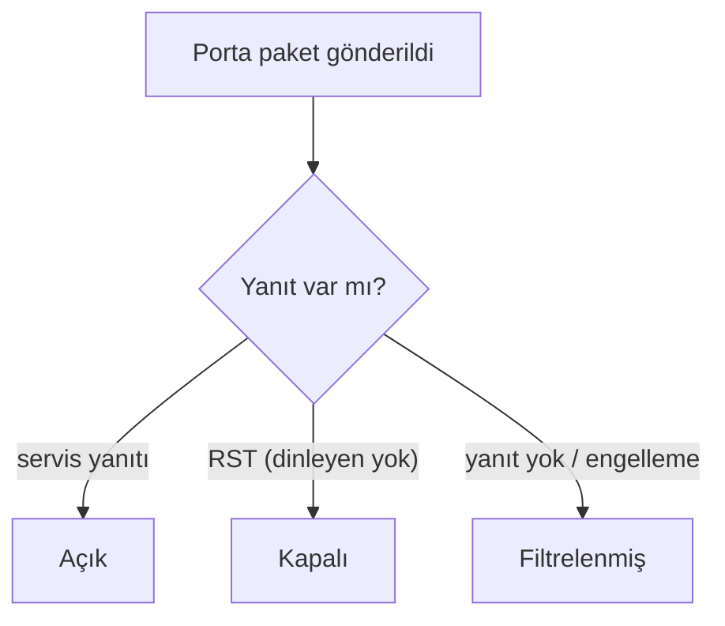

# Bölüm 4 - Port Tarama

> 📚 [İndeks](00_Nmap_ile_A%C4%9F_Tarama_%C4%B0ndeks.md) · ◀ [Bölüm 3 - Host Keşfi](03_Host_Ke%C5%9Ffi.md)

## 1. Port Tarama Nedir?
Port tarama, ağ güvenliği ve yönetiminde temel bir araçtır. Nmap yıllar içinde çok sayıda işlevsellik kazansa da temel olarak bir **port tarayıcısı** olarak başlamıştır.

### 1.1 Port Nedir?
Port, veri iletişimi için harici cihazlarla bağlantı kurmayı sağlayan bir arayüz veya noktadır. USB, HDMI veya Ethernet gibi **fiziksel** bağlantı noktaları olabileceği gibi, yazılımların kullandığı **sanal** portlar da olabilir.

Örneğin web tarayıcıları varsayılan olarak HTTP sitelerinin barındırıldığı makinelerin **TCP port 80**'ine, HTTPS ile bağlanıldığında ise **port 443**'e bağlanır.

## 2. Sık Kullanılan Portlar

### 2.1 Popüler TCP Portları

| Port | Servis | Açıklama |
|---|---|---|
| 80 | HTTP | Web sunucuları için standart port. |
| 23 | Telnet | Şifrelenmemiş uzaktan yönetim protokolü. Güvenli olmayan ve kullanımı azalan bir hizmet. |
| 443 | HTTPS | SSL ile şifrelenmiş web sunucuları için standart port. |
| 21 | FTP | Dosya aktarım protokolü. Güvenli olmayan ve alternatiflerine göre daha az tercih edilen bir hizmet. |
| 22 | SSH | Şifreli uzaktan yönetim protokolü. |
| 25 | SMTP | E-posta iletim protokolü. Güvenli olmayan. |
| 3389 | ms-term-server | Microsoft Terminal Hizmetleri için kullanılır. |
| 110 | POP3 | E-posta alma protokolü. Güvenli olmayan. |
| 445 | Microsoft-DS | Microsoft Windows ağlarındaki SMB iletişimi için kullanılır. |
| 139 | NetBIOS-SSN | Microsoft Windows ağ hizmetleri için kullanılır. |
| 143 | IMAP | E-posta alma protokolü. Güvenli olmayan. |
| 53 | Domain | Domain Name System (DNS). |
| 135 | MSRPC | Microsoft Windows ağ hizmetleri için kullanılır. |
| 3306 | MySQL | MySQL veritabanı sunucuları için. |
| 8080 | HTTP-Proxy | Alternatif web sunucuları ve HTTP proxy servisleri için kullanılır. |
| 1723 | PPTP | VPN kurulumları için kullanılır. |
| 111 | RPCBind | SunRPC program numaralarını ilgili TCP veya UDP port numaralarına eşler. |
| 995 | POP3S | POP3 protokolüne SSL eklenerek güvenlik sağlanmış hali. |
| 993 | IMAPS | IMAP protokolüne SSL eklenerek güvenlik sağlanmış hali. |
| 5900 | VNC | Grafik masaüstü paylaşım sistemi. Güvenli olmayan. |

### 2.2 Popüler UDP Portları

| Port | Servis | Açıklama |
|---|---|---|
| 631 | IPP | Internet Printing Protocol. |
| 161 | SNMP | Basit Ağ Yönetim Protokolü. |
| 137 | NETBIOS-NS | Windows ağ hizmetleri için. |
| 123 | NTP | Ağ Zaman Protokolü. |
| 138 | NETBIOS-DGM | Windows ağ hizmetleri için. |
| 1434 | MS-SQL-DS | Microsoft SQL Server. |
| 445 | Microsoft-DS | Windows ağ hizmetleri için. |
| 135 | MSRPC | Microsoft Windows ağ hizmetleri için. |
| 67 | DHCPS | Dinamik Ana Bilgisayar Yapılandırma Protokolü Sunucusu. |
| 53 | Domain | Domain Name System (DNS) sunucusu. |
| 139 | NETBIOS-SSN | Windows ağ hizmetleri için. |
| 500 | ISAKMP | IPsec VPN'leri kurmak için kullanılır. |
| 68 | DHCPC | DHCP istemci portu. |
| 520 | Route | Yönlendirme Bilgi Protokolü (RIP). |
| 1900 | UPNP | Evrensel Tak ve Çalıştır cihazlarının keşfi için kullanılır. |
| 4500 | nat-t-ike | IPsec bağlantıları başlatılırken Ağ Adresi Çevirisi geçişini müzakere etmek için kullanılır. |
| 514 | Syslog | UNIX log servisi. |
| 49152 | Varies | Dinamik/özel portlar için IANA tarafından belirlenmiş başlangıç noktası. |
| 162 | SNMPTrap | SNMP tuzak portu. SNMP ajanı tipik olarak 161'i, bir SNMP yöneticisi tipik olarak 162'yi kullanır. |
| 69 | TFTP | Basitleştirilmiş Dosya Transfer Protokolü. |

## 3. Port Durumları
Nmap, portları **altı farklı duruma** ayırır.

| Durum | Anlamı |
|---|---|
| **Açık** (Open) | Bir uygulama bu port üzerinden aktif olarak TCP bağlantıları veya UDP paketleri kabul ediyor. |
| **Kapalı** (Closed) | Port erişilebilir ama üzerinde dinleyen uygulama yok. |
| **Filtrelenmiş** (Filtered) | Paket filtreleme nedeniyle Nmap portun açık olup olmadığını belirleyemiyor. |
| **Filtrelenmemiş** (Unfiltered) | Port erişilebilir ama Nmap açık mı kapalı mı olduğunu belirleyemiyor. |
| **Açık\|Filtrelenmiş** (Open\|Filtered) | Nmap portun açık mı filtrelenmiş mi olduğuna karar veremiyor. |
| **Kapalı\|Filtrelenmiş** (Closed\|Filtered) | Nmap portun kapalı mı filtrelenmiş mi olduğuna karar veremiyor. |

### 3.1 Açık (Open)
Bir uygulama, bu port üzerinden aktif bir şekilde TCP bağlantıları veya UDP paketleri kabul ediyor. Port taramasının temel amacı genellikle açık portları bulmaktır. Her açık port, bir **saldırı noktası** olarak görülebilir.

### 3.2 Kapalı (Closed)
Bu durumdaki port erişilebilirdir (Nmap paketlerini alır ve yanıt verir), ancak üzerinde herhangi bir uygulama dinlemiyor. Kapalı portlar, bir makinenin çevrimiçi olduğunu ve bir IP adresi kullandığını göstermede yardımcı olabilir. Erişilebilir oldukları için ileride açılma ihtimaline karşın daha sonra tekrar taranabilirler.

### 3.3 Filtrelenmiş (Filtered)
Paket filtrelemesi nedeniyle gönderilen paketler porta ulaşamaz, bu yüzden Nmap portun açık olup olmadığını belirleyemez. Filtreleme; özel bir güvenlik duvarı cihazından, router kurallarından veya ana bilgisayar tabanlı güvenlik duvarı yazılımından kaynaklanabilir.

### 3.4 Filtrelenmemiş (Unfiltered)
Port erişilebilirdir ancak Nmap açık mı kapalı mı olduğunu belirleyemez. Yalnızca **ACK taraması** ile portlar bu duruma sınıflandırılır. Bu portları SYN veya FIN taraması gibi diğer tarama türleriyle taramak, portun açık olup olmadığını çözmeye yardımcı olabilir.

### 3.5 Açık|Filtrelenmiş (Open|Filtered)
Nmap, bir portun açık mı yoksa filtrelenmiş mi olduğunu belirleyemediğinde portu bu duruma yerleştirir. Bu, açık portların yanıt vermediği tarama türlerinde olur; yanıt gelmediği için Nmap portun açık mı filtrelenmiş mi olduğundan emin olamaz.

### 3.6 Kapalı|Filtrelenmiş (Closed|Filtered)
Nmap, bir portun kapalı mı yoksa filtrelenmiş mi olduğunu belirleyemediğinde bu durumu kullanır.



> [!NOTE]
> Şema, TCP SYN taramasındaki tipik davranışı özetler. `Unfiltered` ve `Open|Filtered` gibi belirsiz durumlar tarama türüne göre ortaya çıkar.

## 4. Nmap ile Port Taraması
Basit bir port taraması için en temel komut:

```
nmap <target>
```

Bu komut hedefte **en sık kullanılan 1.000 TCP portunu** tarar ve her portu yukarıdaki durumlardan biriyle sınıflandırır.

```
root💀hackerbox:~# nmap scanme.nmap.org
Starting Nmap 7.94 ( https://nmap.org ) at 2024-03-30 12:39 +03
Nmap scan report for scanme.nmap.org (45.33.32.156)
Host is up (0.24s latency).
Not shown: 996 filtered tcp ports (no-response)
PORT      STATE SERVICE
22/tcp    open  ssh
80/tcp    open  http
9929/tcp  open  nping-echo
31337/tcp open  Elite

Nmap done: 1 IP address (1 host up) scanned in 132.85 seconds
```

## 5. Hızlı Tarama
Hızlı tarama, ağ güvenliğini çabucak denetlemek ve cihazlar hakkında hızlı bir genel bakış elde etmek için iyi bir yoldur. Nmap bunun için `-F` ve `--top-ports` parametrelerini sunar.

### 5.1 `-F` Parametresi
Hızlı tarama modunu etkinleştirir. Yalnızca **en sık kullanılan portları** taramaya dahil ederek süreyi önemli ölçüde azaltır. Geniş ağlarda veya ilk değerlendirmede zamanı verimli kullanmak isteyenler için idealdir.

```
nmap -F 192.168.1.1
```

Bu komut, hedefteki en yaygın portları tarayarak hızlı ve yüzeysel bir analiz sağlar.

```
root💀hackerbox:~# nmap -F scanme.nmap.org
Starting Nmap 7.94 ( https://nmap.org ) at 2024-03-30 13:08 +03
Nmap scan report for scanme.nmap.org (45.33.32.156)
Host is up (0.24s latency).
Not shown: 98 filtered tcp ports (no-response)
PORT   STATE SERVICE
22/tcp open  ssh
80/tcp open  http

Nmap done: 1 IP address (1 host up) scanned in 20.42 seconds
```

> [!TIP]
> Aynı hedef varsayılan taramada **132 saniye**, `-F` ile **20 saniye** sürdü.

### 5.2 `--top-ports` Parametresi
Belirtilen sayıda **en çok kullanılan portu** taramak için kullanılır. Belirli bir hedefe yönelik daha odaklı tarama yapmak için kullanışlıdır.

```
nmap --top-ports 10 192.168.1.1
```

Bu komut, hedefteki en çok kullanılan ilk 10 portu tarar. Potansiyel güvenlik açıklarını hızla tespit etmek ve kritik noktaları değerlendirmek için etkili bir yöntemdir.

```
root💀hackerbox:~# nmap --top-ports 10 scanme.nmap.org
Nmap scan report for scanme.nmap.org (45.33.32.156)
Host is up (0.24s latency).

PORT     STATE    SERVICE
21/tcp   filtered ftp
22/tcp   open     ssh
23/tcp   filtered telnet
25/tcp   filtered smtp
80/tcp   open     http
110/tcp  filtered pop3
139/tcp  filtered netbios-ssn
443/tcp  filtered https
445/tcp  filtered microsoft-ds
3389/tcp filtered ms-wbt-server

Nmap done: 1 IP address (1 host up) scanned in 5.42 seconds
```

## 6. Spesifik Port Taraması
Belirli portları taramak için `-p` parametresi kullanılır.

| Kullanım | Komut | Açıklama |
|---|---|---|
| Tek port | `nmap -p 80 192.168.1.1` | Yalnızca 80 numaralı portu tarar. |
| Birden çok port | `nmap -p 22,80,443 192.168.1.1` | Virgülle ayrılan portları tarar. |
| Port aralığı | `nmap -p 1000-2000 192.168.1.1` | 1000'den 2000'e kadar olan aralığı tarar. |
| Tüm portlar | `nmap -p- 192.168.1.1` | 1'den 65535'e kadar tüm portları tarar. |

### 6.1 Tek Port Taraması
Tek bir portu taramak için `-p` parametresinden sonra port numarası belirtilir.

```
nmap -p 80 192.168.1.1
```

```
root💀hackerbox:~# nmap -p 80 scanme.nmap.org
Starting Nmap 7.94 ( https://nmap.org ) at 2024-03-30 13:14 +03
Nmap scan report for scanme.nmap.org (45.33.32.156)
Host is up (0.24s latency).

PORT   STATE SERVICE
80/tcp open  http

Nmap done: 1 IP address (1 host up) scanned in 0.59 seconds
```

### 6.2 Birden Çok Port Taraması
Port numaraları virgülle ayrılarak `-p` ile belirtilir.

```
nmap -p 22,80,443 192.168.1.1
```

Bu komut 22 (SSH), 80 (HTTP) ve 443 (HTTPS) portlarını tarar.

```
root💀hackerbox:~# nmap -p 22,80,443 scanme.nmap.org
Nmap scan report for scanme.nmap.org (45.33.32.156)
Host is up (0.24s latency).

PORT    STATE    SERVICE
22/tcp  open     ssh
80/tcp  open     http
443/tcp filtered https

Nmap done: 1 IP address (1 host up) scanned in 3.04 seconds
```

### 6.3 Port Aralığı Taraması
Başlangıç ve bitiş port numaraları `-p` ile belirtilir.

```
nmap -p 1000-2000 192.168.1.1
```

```
root💀hackerbox:~# nmap -p 1000-2000 scanme.nmap.org
Starting Nmap 7.94 ( https://nmap.org ) at 2024-03-30 13:23 +03
Nmap scan report for scanme.nmap.org (45.33.32.156)
Host is up (0.24s latency).
All 1001 scanned ports on scanme.nmap.org (45.33.32.156) are in ignored states.
Not shown: 1001 filtered tcp ports (no-response)

Nmap done: 1 IP address (1 host up) scanned in 114.02 seconds
```

### 6.4 Tüm Portların Taranması (`-p-`)
Sistemin tüm portlarını (1-65535) taramak için `-p-` kullanılır. Bu tarama **uzun sürebilir**.

```
nmap -p- 192.168.1.1
```

Bu komut, hedefteki tüm portları tarayarak hangi servislerin ve portların açık olduğunu ayrıntılı gösterir.

## 7. Agresif Tarama (`-A`)
Agresif tarama, ağdaki cihazlar hakkında kapsamlı bilgi toplamak için kullanılır. `-A` parametresi şunları içerir:
- İşletim sistemi tespiti
- Servis ve versiyon tespiti
- Script taraması (NSE)
- Traceroute

Güvenlik uzmanlarının hedef sistemler üzerinde derinlemesine analiz yapmasını sağlar; sistemlerin güvenlik açıklarını tespit etmek ve ağ güvenliği durumunu değerlendirmek için kullanılır.

```
nmap -A 192.168.1.1
```

```
root💀hackerbox:~# nmap -A scanme.nmap.org
Starting Nmap 7.94 ( https://nmap.org ) at 2024-03-30 13:31 +03
Nmap scan report for scanme.nmap.org (45.33.32.156)
Host is up (0.24s latency).
Not shown: 996 filtered tcp ports (no-response)
PORT      STATE SERVICE    VERSION
22/tcp    open  ssh        OpenSSH 6.6.1p1 Ubuntu 2ubuntu2.13 (Ubuntu Linux; protocol 2.0)
| ssh-hostkey: 
|   1024 ac:00:a0:1a:82:ff:cc:55:99:dc:67:2b:34:97:6b:75 (DSA)
|   2048 20:3d:2d:44:62:2a:b0:5a:9d:b5:b3:05:14:c2:a6:b2 (RSA)
|   256 96:02:bb:5e:57:54:1c:4e:45:2f:56:4c:4a:24:b2:57 (ECDSA)
|_  256 33:fa:91:0f:e0:e1:7b:1f:6d:05:a2:b0:f1:54:41:56 (ED25519)
80/tcp    open  http       Apache httpd 2.4.7 ((Ubuntu))
|_http-server-header: Apache/2.4.7 (Ubuntu)
|_http-title: Go ahead and ScanMe!
|_http-favicon: Nmap Project
9929/tcp  open  nping-echo Nping echo
31337/tcp open  tcpwrapped
Service Info: OS: Linux; CPE: cpe:/o:linux:linux_kernel

Service detection performed. Please report any incorrect results at https://nmap.org/submit/ .
Nmap done: 1 IP address (1 host up) scanned in 129.94 seconds
```

> [!WARNING]
> `-A` hedefte çok sayıda istek üretir ve kolayca fark edilir. Örnek hedefler (`scanme.nmap.org`, `192.168.1.1`) yalnızca gösterim içindir; taramayı yalnızca izinli hedeflerde ve kendi lab ortamında yap.

---
> 📚 [İndeks](00_Nmap_ile_A%C4%9F_Tarama_%C4%B0ndeks.md) · ◀ [Bölüm 3 - Host Keşfi](03_Host_Ke%C5%9Ffi.md)
