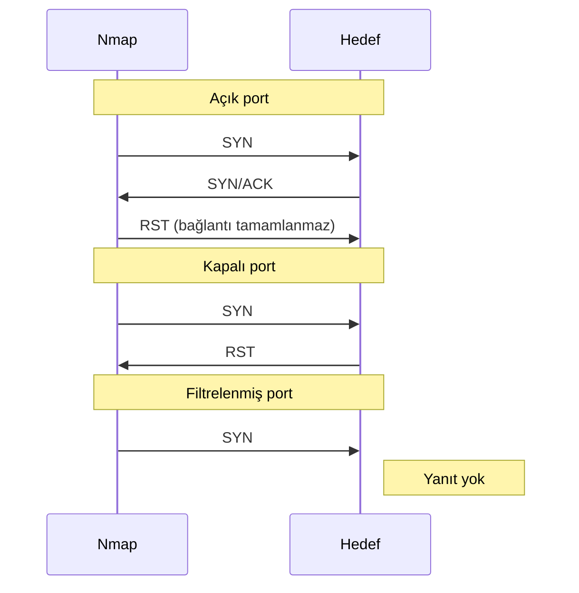

# Bölüm 5 - TCP SYN (Stealth) Tarama

> 📚 [İndeks](00_Nmap_ile_A%C4%9F_Tarama_%C4%B0ndeks.md) · ◀ [Bölüm 4 - Port Tarama](04_Port_Tarama.md)

## 1. TCP SYN Scan Nedir?
TCP SYN (Stealth) Scan, ağ güvenliği ve port tarama işlemlerinde sıklıkla başvurulan bir yöntemdir. Hedef sistemdeki açık portları **hızlı ve görece düşük profille** tespit etmek için kullanılır.

Yöntem, TCP bağlantılarının **başlatılma aşamasını** kullanır ama bağlantıyı **tamamlamaz**; bu nedenle **"half-open scan"** olarak da adlandırılır.

> [!NOTE]
> TCP bayrakları ve 3'lü el sıkışma için: [Bölüm 1 - Giriş ve Temel Ağ Bilgisi](01_Giri%C5%9F_ve_Temel_A%C4%9F_Bilgisi.md)



## 2. `-sS` Parametresi
`-sS`, Nmap'e TCP SYN Scan yapmasını söyler. **root veya Administrator** haklarıyla çalıştırıldığında Nmap tarafından **varsayılan olarak** kullanılır. Hızlı, göze çarpmayan ve etkili olduğu için tercih edilir.

### 2.1 Uygulama
```
root💀hackerbox:~# nmap -sS -p22,113,139 scanme.nmap.org
Starting Nmap 7.94 ( https://nmap.org ) at 2024-03-30 14:12 +03
Nmap scan report for scanme.nmap.org (45.33.32.156)
Host is up (0.25s latency).

PORT    STATE    SERVICE
22/tcp  open     ssh
113/tcp filtered ident
139/tcp filtered netbios-ssn

Nmap done: 1 IP address (1 host up) scanned in 3.42 seconds
```

Bu komut, `scanme.nmap.org` üzerindeki 22, 113 ve 139 numaralı portları TCP SYN Scan ile tarar. Sonuçta her portun durumu (açık, kapalı veya filtrelenmiş) belirlenir.

| Port | Durum | Yorum |
|---|---|---|
| `22/tcp` (SSH) | **open** | Hedef, gelen SYN paketine SYN/ACK ile yanıt verir. Port aktif ve dinlemededir. |
| `113/tcp` (ident) | **filtered** | Yanıt alınamadı; port filtrelenmiş. |
| `139/tcp` (netbios-ssn) | **filtered** | Hedef gelen SYN paketlerine hiçbir yanıt vermez. Bu genellikle bir güvenlik duvarının portu engellediğini gösterir. |

## 3. SYN Scan'ın Avantajları
- **Hızlı tarama:** Ağ üzerinde hızlı taramalara olanak tanır; binlerce port saniyeler içinde taranabilir.
- **Düşük profil:** Tam bir TCP bağlantısı kurulmadığı için ağda daha az iz bırakır.
- **Güvenilir sonuçlar:** Açık, kapalı ve filtrelenmiş portlar arasında net bir ayrım yapılabilir.

## 4. Dikkat Edilmesi Gerekenler
SYN Scan, özellikle yüksek güvenlikli ağlarda **IDS (Intrusion Detection Systems)** ve güvenlik duvarları tarafından tespit edilebilir. Bu yüzden izinsiz tarama yapmadan önce hedef ağın politikalarını ve yasal gereklilikleri göz önünde bulundur.

> [!WARNING]
> "Stealth" adı, taramanın görünmez olduğu anlamına gelmez; yalnızca tam bağlantı kurmadığı için daha az iz bırakır. Taramayı yalnızca izinli hedeflerde ve kendi lab ortamında yap.

## 5. Özet
TCP SYN (Stealth) Scan, ağ güvenliği uzmanlarının sıkça kullandığı güçlü bir yöntemdir. Hızlı, etkili ve göze çarpmayan bir tarama için `-sS` parametresi bu ihtiyacı karşılar.

---
> 📚 [İndeks](00_Nmap_ile_A%C4%9F_Tarama_%C4%B0ndeks.md) · ◀ [Bölüm 4 - Port Tarama](04_Port_Tarama.md) · [Bölüm 6 - TCP Connect Tarama](06_TCP_Connect_Tarama.md) ▶
