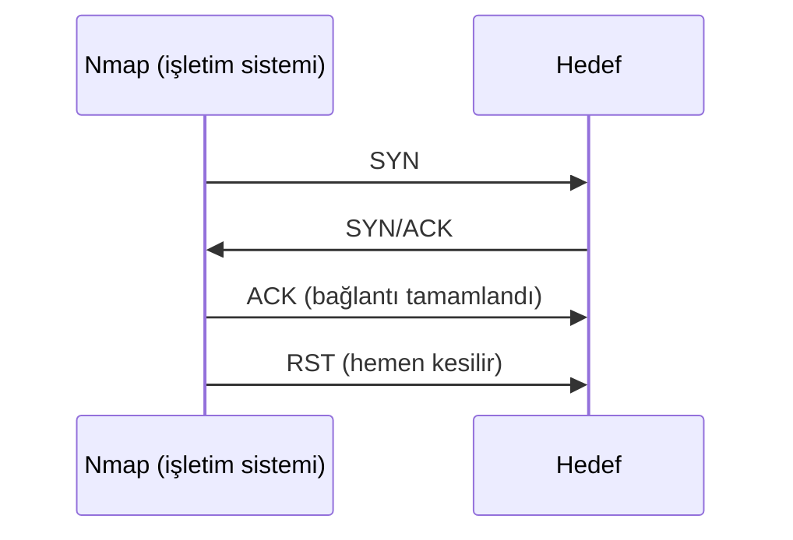

# Bölüm 6 - TCP Connect Tarama

> 📚 [İndeks](00_Nmap_ile_A%C4%9F_Tarama_%C4%B0ndeks.md) · ◀ [Bölüm 5 - TCP SYN Tarama](05_TCP_SYN_Stealth_Tarama.md)

## 1. TCP Connect Scan Ne Zaman Kullanılır?
TCP Connect Scan, ağ güvenliği ve port tarama işlemlerinde kullanılan temel yöntemlerden biridir. **SYN Scan kullanımı mümkün olmadığında** tercih edilir. Örneğin:
- Kullanıcının **raw paket ayrıcalıklarına** sahip olmadığı durumlarda
- **IPv6** ağlarını taramak istendiğinde

## 2. TCP Connect Scan Nedir?
Nmap, işletim sisteminin alt düzeyde sağladığı **connect system call** ile hedef makine ve portlarla **tam bir TCP bağlantısı** kurar. Bu yöntem, web tarayıcıları, P2P istemcileri ve diğer birçok ağ uygulamasının kullandığı **Berkeley Sockets API**'sinin bir parçasıdır. Nmap, bu API üzerinden her bağlantı denemesinin durumu hakkında bilgi alır.

> [!NOTE]
> Paketleri Nmap kendisi üretmez; bağlantıyı işletim sistemi kurar. Bu yüzden özel ayrıcalık gerekmez. Karşılaştırma için: [Bölüm 5 - TCP SYN Tarama](05_TCP_SYN_Stealth_Tarama.md)

## 3. İşleyiş
1. **Bağlantı kurma:** Hedef porta bir `SYN` gönderilir ve karşılığında `SYN/ACK` alınır. Bu aşama SYN Scan ile aynıdır.
2. **Bağlantıyı tamamlama:** SYN Scan'den farklı olarak bağlantı `RST` ile sonlandırılmaz; **`ACK`** gönderilerek tamamlanır. Yani tam bir TCP bağlantısı kurulur.
3. **Bağlantıyı sonlandırma:** İşletim sistemi bağlantının kurulduğunu bildirdikten sonra bağlantı hemen kesilir. TCP bağlantıları normalde `FIN` ile biter, ama Nmap bağlantıyı hemen bir **`RST`** ile keser.



## 4. Uygulama
```
root💀hackerbox:~# nmap -sT scanme.nmap.org
Starting Nmap 7.94 ( https://nmap.org ) at 2024-03-30 14:21 +03
Nmap scan report for scanme.nmap.org (45.33.32.156)
Host is up (0.24s latency).
Not shown: 996 filtered tcp ports (no-response)
PORT      STATE SERVICE
22/tcp    open  ssh
80/tcp    open  http
9929/tcp  open  nping-echo
31337/tcp open  Elite

Nmap done: 1 IP address (1 host up) scanned in 119.28 seconds
```

Bu komut `scanme.nmap.org` üzerindeki portları TCP Connect Scan ile tarar.

## 5. Avantajlar ve Dezavantajlar

| | Açıklama |
|---|---|
| ✅ **Avantaj** | Çalıştırmak için kullanıcı ayrıcalığı gerektirmez; her ortamda kolayca kullanılabilir. |
| ✅ **Avantaj** | IPv6 desteği sağlar. |
| ❌ **Dezavantaj** | SYN Scan'e göre daha fazla paket gönderilir; hedef sistemlerde daha kolay loglanır. |

### SYN ve Connect Scan Karşılaştırması

| | SYN Scan (`-sS`) | Connect Scan (`-sT`) |
|---|---|---|
| Bağlantı | Tamamlanmaz (half-open) | Tamamlanır (tam bağlantı) |
| Üçüncü adım | `RST` | `ACK`, ardından `RST` |
| Ayrıcalık | root / Administrator | Gerekmez |
| İz bırakma | Daha az | Daha fazla |

## 6. Dikkat Edilmesi Gerekenler
Tarama sırasında kurulan **tam bağlantılar hedef sistemlerin loglarına düşebilir** ve izinsiz tarama faaliyetlerinin tespit edilmesine yol açabilir. Bu yüzden taramadan önce uygun izinleri almak önemlidir.

> [!WARNING]
> Örnek hedef (`scanme.nmap.org`) yalnızca gösterim içindir. Taramayı yalnızca izinli hedeflerde ve kendi lab ortamında yap.

## 7. Özet
TCP Connect Scan, SYN Scan'in mümkün olmadığı durumlarda, özellikle **düşük ayrıcalıklı hesaplardan** veya **IPv6 ağlarında** tarama yapmak için etkili bir alternatiftir. Daha fazla paket gönderimi ve tam bağlantı kurulması nedeniyle hedef sistemde iz bırakma olasılığı daha yüksektir.

---
> 📚 [İndeks](00_Nmap_ile_A%C4%9F_Tarama_%C4%B0ndeks.md) · ◀ [Bölüm 5 - TCP SYN Tarama](05_TCP_SYN_Stealth_Tarama.md) · [Bölüm 7 - UDP Tarama](07_UDP_Tarama.md) ▶
