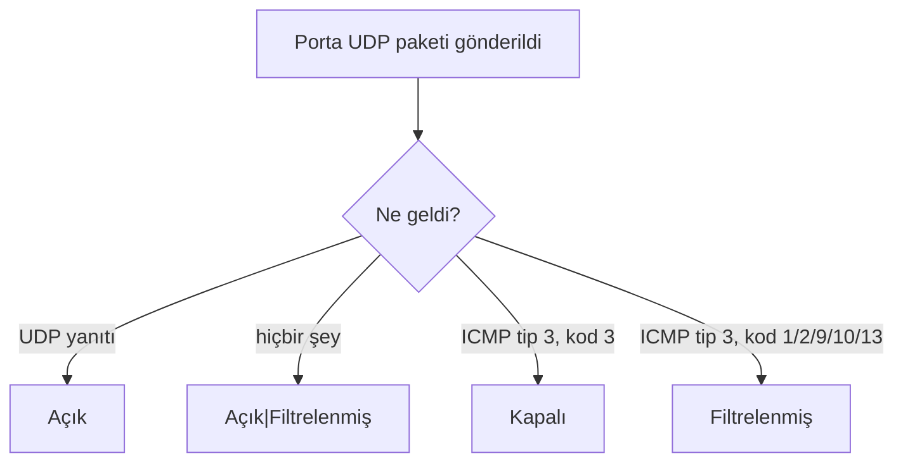

# Bölüm 7 - UDP Tarama

> 📚 [İndeks](00_Nmap_ile_A%C4%9F_Tarama_%C4%B0ndeks.md) · ◀ [Bölüm 6 - TCP Connect Tarama](06_TCP_Connect_Tarama.md)

## 1. Neden UDP Taraması?
İnternet üzerindeki birçok popüler servis TCP üzerinde çalışsa da, **UDP** üzerinde çalışan servisler de geniş çapta kullanılır. **DNS, SNMP ve DHCP** UDP üzerinde çalışan en yaygın servislerden bazılarıdır.

> [!NOTE]
> UDP taraması genellikle TCP taramasına kıyasla **daha yavaştır**. Sık kullanılan UDP portları için: [Bölüm 4 - Port Tarama](04_Port_Tarama.md)

## 2. UDP Scan Nasıl Çalışır?
UDP taraması **`-sU`** seçeneğiyle etkinleştirilir. Aynı taramada hem TCP hem UDP kontrol edilmek istenirse SYN taraması gibi bir TCP tarama türüyle birleştirilebilir.

Nmap, hedeflenen her port için bir **UDP paketi** gönderir. Çoğu port için bu paket boştur; daha yaygın portlar için ise **protokole özgü bir payload** gönderilir. Yanıtın olup olmamasına göre port dört durumdan birine girer.

### 2.1 UDP Scan Durumları

| Durum | Ne zaman? |
|---|---|
| **Açık** (open) | Hedef porttan herhangi bir UDP yanıtı alındığında. |
| **Açık\|Filtrelenmiş** (open\|filtered) | Hedef porttan hiçbir yanıt alınamazsa. |
| **Kapalı** (closed) | ICMP port erişilemez hatası alınırsa (tip 3, kod 3). |
| **Filtrelenmiş** (filtered) | Diğer ICMP erişilemez hataları alınırsa (tip 3, kod 1, 2, 9, 10 veya 13). |



## 3. Uygulama
```
root💀hackerbox:~# nmap -sU scanme.nmap.org
Starting Nmap 7.94 ( https://nmap.org ) at 2024-03-30 14:38 +03
Warning: 45.33.32.156 giving up on port because retransmission cap hit (2).
Nmap scan report for scanme.nmap.org (45.33.32.156)
Host is up (0.27s latency).
Not shown: 823 closed udp ports (port-unreach), 176 open|filtered udp ports (no-response)
PORT    STATE SERVICE
123/udp open  ntp

Nmap done: 1 IP address (1 host up) scanned in 893.97 seconds
```

Bu komut `scanme.nmap.org` üzerindeki UDP portlarını tarar. Çıktıda 823 port kapalı (`port-unreach`), 176 port `open|filtered` (`no-response`) olarak görünür; yalnızca **123/udp (ntp)** kesin olarak açık çıkmıştır.

## 4. UDP Taramasındaki Sorunlar
- **Açık|Filtrelenmiş durumu:** En büyük zorluklardan biri, açık UDP portlarının boş isteklere nadiren yanıt vermesidir. Nmap'in protokole özgü payload gönderdiği portlarda yanıt alma ihtimali daha yüksektir, ama geri kalan portlarda bu yöntem pek iyi çalışmaz.
- **Tarama hızı:** UDP taraması yavaştır. Yukarıdaki taramanın **yaklaşık 15 dakika** (893 saniye) sürdüğü görülüyor.

> [!TIP]
> Süreyi kısaltmak için tüm portlar yerine seçili portları tarayabilirsin, örneğin `nmap -sU -p 53,123,161 <hedef>` ya da `nmap -sU --top-ports 20 <hedef>`. Bu iki komut notun kaynak metninde yok, `-p` ve `--top-ports` seçeneklerinin [Bölüm 4](04_Port_Tarama.md)'teki kullanımının UDP'ye uygulanmış halidir.

> [!WARNING]
> Örnek hedef (`scanme.nmap.org`) yalnızca gösterim içindir. Taramayı yalnızca izinli hedeflerde ve kendi lab ortamında yap.

---
> 📚 [İndeks](00_Nmap_ile_A%C4%9F_Tarama_%C4%B0ndeks.md) · ◀ [Bölüm 6 - TCP Connect Tarama](06_TCP_Connect_Tarama.md)
