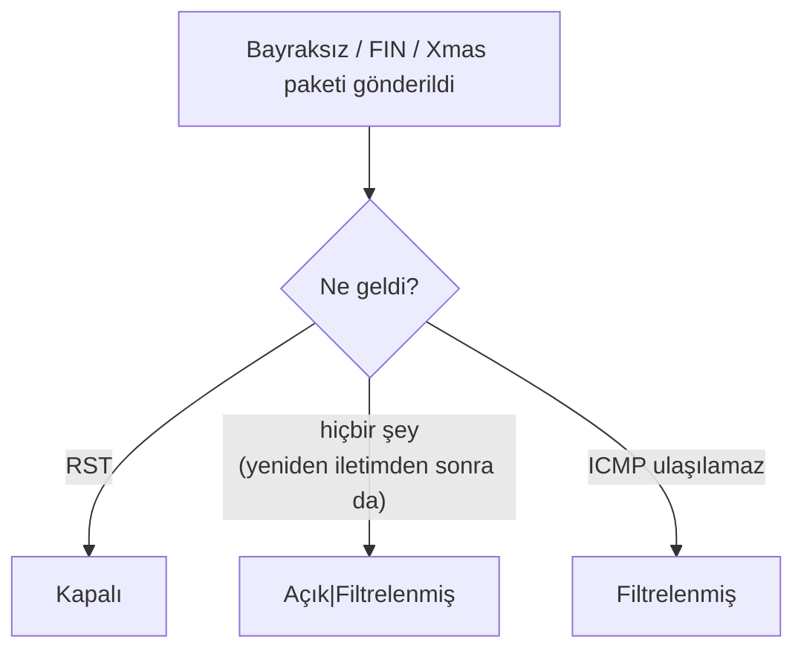

# Bölüm 8 - TCP FIN, NULL ve Xmas Tarama

> 📚 [İndeks](00_Nmap_ile_A%C4%9F_Tarama_%C4%B0ndeks.md) · ◀ [Bölüm 7 - UDP Tarama](07_UDP_Tarama.md)

## 1. Temelleri
TCP üzerinde çalışan servisler ağ güvenliği ve sızma testlerinde sıkça incelenir. Bunun yanında **RFC 793**'teki bir boşluktan yararlanarak açık ve kapalı portları tespit etmeyi sağlayan özel teknikler de vardır: **TCP FIN, NULL ve Xmas taramaları**.

Bu üç yöntem, TCP RFC'sinde belirtilen şu davranışa dayanır:
- Hedef port **kapalıysa** ve gelen segment `RST` içermiyorsa, yanıt olarak bir **`RST`** gönderilir.
- Port **açıksa** ve gelen pakette `SYN`, `RST` veya `ACK` bitleri ayarlı değilse, paket **düşürülür** ve yanıt verilmez.

> [!NOTE]
> Kaynak metnin FIN, NULL ve Xmas bölümlerinde kapalı portların "ICMP port unreachable" ile yanıt verdiği yazıyordu. Metnin kendi "Yanıtların Değerlendirilmesi" kısmında ve RFC davranışında kapalı port `RST` ile yanıt verir. Notta `RST` yazdım. ICMP ulaşılamaz mesajları, filtrelenmiş portlar için geçerlidir.



## 2. Tarama Türleri

| Tarama | Parametre | Gönderilen paket |
|---|---|---|
| **FIN** | `-sF` | Yalnızca `FIN` bayrağı ayarlı |
| **NULL** | `-sN` | Hiçbir bayrak ayarlı değil |
| **Xmas** | `-sX` | `PSH`, `FIN` ve `URG` bayrakları ayarlı |

### 2.1 FIN Taraması (`-sF`)
TCP `FIN` paketlerini hedefe gönderir. **Açık portlar** bu paketleri görmezden gelir, **kapalı portlar** yanıt verir.

```
root💀hackerbox:~# nmap -sF scanme.nmap.org
Starting Nmap 7.94 ( https://nmap.org ) at 2024-03-30 14:58 +03
Nmap scan report for scanme.nmap.org (45.33.32.156)
Host is up (0.25s latency).
All 1000 scanned ports on scanme.nmap.org (45.33.32.156) are in ignored states.
Not shown: 1000 open|filtered tcp ports (no-response)

Nmap done: 1 IP address (1 host up) scanned in 62.71 seconds
```

### 2.2 NULL Taraması (`-sN`)
TCP başlığında **hiçbir bayrağın ayarlanmadığı** paketler gönderir. Açık portlar yanıt vermez, kapalı portlar yanıt verir.

```
root💀hackerbox:~# nmap -sN scanme.nmap.org
Starting Nmap 7.94 ( https://nmap.org ) at 2024-03-30 15:01 +03
Host is up (0.29s latency).
All 1000 scanned ports on scanme.nmap.org (45.33.32.156) are in ignored states.
Not shown: 1000 open|filtered tcp ports (no-response)

Nmap done: 1 IP address (1 host up) scanned in 62.87 seconds
```

### 2.3 Xmas Taraması (`-sX`)
`PSH`, `FIN` ve `URG` bayraklarının ayarlandığı paketler gönderir. Kapalı portlar yanıt verir, açık portlardan genellikle yanıt alınamaz.

```
root💀hackerbox:~# nmap -sX scanme.nmap.org
Starting Nmap 7.94 ( https://nmap.org ) at 2024-03-30 15:03 +03
Nmap scan report for scanme.nmap.org (45.33.32.156)
Host is up (0.25s latency).
All 1000 scanned ports on scanme.nmap.org (45.33.32.156) are in ignored states.
Not shown: 1000 open|filtered tcp ports (no-response)

Nmap done: 1 IP address (1 host up) scanned in 62.97 seconds
```

> [!TIP]
> Üç taramada da 1000 port `open|filtered` çıktı. Hedefin önünde bir güvenlik duvarı olduğunda (veya hedef portlar gerçekten açıksa) bu yöntemler kesin sonuç veremez, çünkü ikisinde de yanıt gelmez.

## 3. Kullanım ve Davranış
Üç yöntemin kullanımı basittir. Gönderilen paketlerdeki TCP bayrakları dışında **davranışları aynıdır**. Yanıtlar şöyle değerlendirilir:

| Durum | Ne zaman? |
|---|---|
| **Açık\|Filtrelenmiş** | Yeniden iletimlerden sonra bile hiçbir yanıt alınamazsa. |
| **Kapalı** | TCP `RST` paketi alınırsa. |
| **Filtrelenmiş** | ICMP ulaşılamaz hata mesajları alınırsa. |

## 4. Avantajlar ve Dezavantajlar
- ✅ **Avantaj:** Durum bilgisi tutmayan (stateless) bazı güvenlik duvarlarından ve router'lardan kaçınabilecek şekilde tasarlanmıştır. SYN taramasından da daha gizli kabul edilir.
- ❌ **Dezavantaj:** Tüm sistemler RFC 793'e tam uymaz. Bazı sistemler port açık olsa bile bu paketlere `RST` gönderir; bu da tüm portların **kapalı** görünmesine yol açabilir.
- ❌ **Dezavantaj:** Bu taramalar çoğunlukla **Unix tabanlı** sistemlerde işe yarar.

> [!WARNING]
> Örnek hedef (`scanme.nmap.org`) yalnızca gösterim içindir. Taramayı yalnızca izinli hedeflerde ve kendi lab ortamında yap.

---
> 📚 [İndeks](00_Nmap_ile_A%C4%9F_Tarama_%C4%B0ndeks.md) · ◀ [Bölüm 7 - UDP Tarama](07_UDP_Tarama.md) · [Bölüm 9 - TCP ACK Tarama](09_TCP_ACK_Tarama.md) ▶
