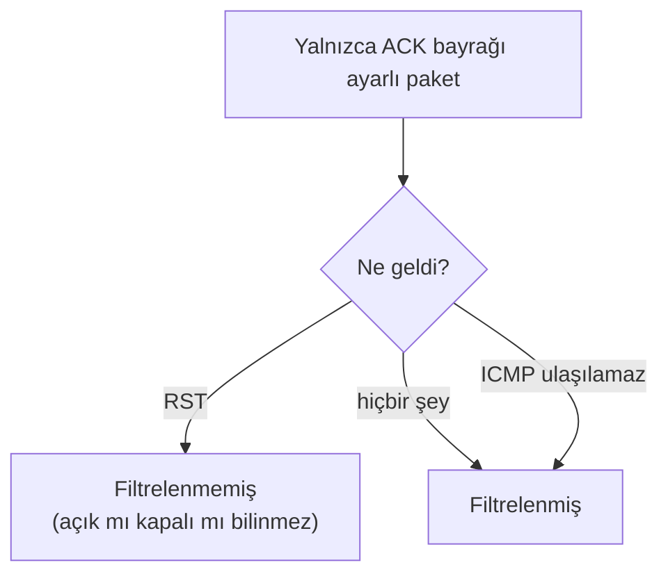

# Bölüm 9 - TCP ACK Tarama

> 📚 [İndeks](00_Nmap_ile_A%C4%9F_Tarama_%C4%B0ndeks.md) · ◀ [Bölüm 8 - FIN, NULL ve Xmas](08_TCP_FIN_NULL_Xmas_Tarama.md)

## 1. ACK Taraması Ne İşe Yarar?
TCP ACK taraması, önceki tarama türlerinden farklı olarak **açık portları (veya `open|filtered` portları) belirlemez**. Bunun yerine bir ağdaki **güvenlik duvarı kurallarını haritalamak**, bunların **durum bilgisi (stateful)** tutup tutmadığını ve **hangi portların filtrelendiğini** belirlemek için kullanılır.

## 2. Temelleri
ACK taraması **`-sA`** parametresiyle etkinleştirilir. Gönderilen pakette **yalnızca `ACK` bayrağı** ayarlıdır.

Filtrelenmemiş bir sistem tarandığında açık ve kapalı portların **ikisi de `RST`** döndürür. Nmap bu portları **filtrelenmemiş (unfiltered)** olarak etiketler: ACK paketi hedefe ulaşmıştır ama portun açık mı kapalı mı olduğu anlaşılamaz. Yanıt vermeyen veya ICMP hata mesajı gönderen portlar **filtrelenmiş** olarak etiketlenir.

### 2.1 ACK Tarama Yanıtları

| Yanıt | Durum |
|---|---|
| TCP `RST` | **Filtrelenmemiş** (unfiltered) |
| Yanıt yok | **Filtrelenmiş** (filtered) |
| ICMP ulaşılamaz hatası | **Filtrelenmiş** (filtered) |



> [!NOTE]
> Port durumlarının tanımları için: [Bölüm 4 - Port Tarama](04_Port_Tarama.md). `Unfiltered` durumunun yalnızca ACK taramasıyla ortaya çıktığı orada da geçiyordu. Bu portları SYN veya FIN gibi başka bir tarama türüyle taramak, açık olup olmadıklarını çözmeye yardımcı olur.

## 3. Uygulama
```
root💀hackerbox:~# nmap -sA scanme.nmap.org
Starting Nmap 7.94 ( https://nmap.org ) at 2024-03-30 15:19 +03
Nmap scan report for scanme.nmap.org (45.33.32.156)
Host is up (0.25s latency).
All 1000 scanned ports on scanme.nmap.org (45.33.32.156) are in ignored states.
Not shown: 1000 filtered tcp ports (no-response)

Nmap done: 1 IP address (1 host up) scanned in 62.85 seconds
```

Bu komut `scanme.nmap.org` adresine bir ACK taraması yapar. Çıktıda 1000 portun tamamı `filtered (no-response)` çıktı; yani ACK paketlerine hiç yanıt gelmedi ve hedefin önünde paketleri düşüren bir filtre olduğu anlaşılıyor.

> [!WARNING]
> Örnek hedef (`scanme.nmap.org`) yalnızca gösterim içindir. Taramayı yalnızca izinli hedeflerde ve kendi lab ortamında yap.

---
> 📚 [İndeks](00_Nmap_ile_A%C4%9F_Tarama_%C4%B0ndeks.md) · ◀ [Bölüm 8 - FIN, NULL ve Xmas](08_TCP_FIN_NULL_Xmas_Tarama.md) · [Bölüm 11 - Zamanlama Şablonları](11_Zamanlama_%C5%9Eablonlar%C4%B1.md) ▶
