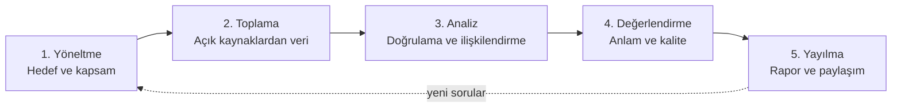

# OSINT Döngüsü

> ◀ [OSINT Nedir?](01_OSINT_Nedir.md) · 📚 [İndeks](00_OSINT_%C4%B0ndeks.md) · [Temel Kavramlar](03_Temel_Kavramlar.md) ▶

> [!NOTE]
> **Özet**
> OSINT döngüsü 5 aşamadan oluşan, **tekrarlanan** bir süreçtir: **Yöneltme → Toplama → Analiz → Değerlendirme → Yayılma**. Sonuçlar yeni sorular doğurursa döngü yeniden başlar.

## 1. Yöneltme (Direction)
Operasyonun **amacı, hedefi, kapsamı ve önceliği** belirlenir. Hedef bir kuruluş, kişi, olay veya konu olabilir. Net bir soru olmadan toplanan veri dağınık kalır.

## 2. Toplama (Collection)
Yöneltmede belirlenen hedefe yönelik veri açık kaynaklardan toplanır: web siteleri, sosyal medya, haberler, kamu veritabanları. Kaynağı ve toplama zamanını not etmek, sonraki aşamalar için önemlidir.

## 3. Analiz (Analysis)
Toplanan veri düzenlenir, birbiriyle ilişkilendirilir ve anlamlı sonuçlara dönüştürülür. Bu aşamada bilginin **doğruluğu, güvenilirliği ve önemi** de sınanır ([doğrulama](03_Temel_Kavramlar.md#doğrulama)).

## 4. Değerlendirme (Evaluation)
Bulguların **anlamı, önemi ve etkisi** yorumlanır. İki şey sorulur:
- Operasyonun hedefine ulaşıldı mı?
- Elde edilen istihbaratın kalitesi yeterli mi?

## 5. Yayılma (Dissemination)
Bulgular, hedef kitleye uygun formatta (rapor, özet, sunum) paylaşılır. Rapor, operasyonun amacına ve okuyacak kişiye göre hazırlanır.

> [!NOTE]
> **Etik her aşamada**
> Yasal ve etik kurallara uyum yalnızca son aşamanın değil, **tüm aşamaların** ortak şartıdır ([etik ve yasal sınırlar](01_OSINT_Nedir.md#etik-ve-yasal-sınırlar)).

---
> ◀ [OSINT Nedir?](01_OSINT_Nedir.md) · 📚 [İndeks](00_OSINT_%C4%B0ndeks.md) · [Temel Kavramlar](03_Temel_Kavramlar.md) ▶
