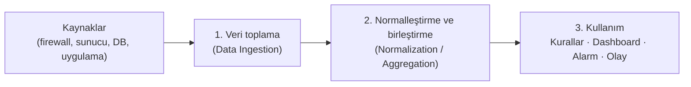

# SIEM Tanımı ve Temelleri

> 📚 [İndeks](00_SIEM_%C4%B0ndeks.md)

> [!NOTE]
> **Özet**
> **SIEM (Security Information and Event Management, güvenlik bilgisi ve olay yönetimi)**, farklı kaynaklardan gelen logları tek bir yerde toplayan, ortak formata çeviren, aralarında bağlantı kuran ve şüpheli durumlarda alarm üreten sistemdir. Bir kurumun güvenlik izlemesinin merkezidir.

> [!INFO]
> **Kaynak:** HTB Academy, Modül 211, Bölüm 1/11

---

## 🎯 SIEM Nedir?

İki işi bir arada yapar:
- **Güvenlik verisi yönetimi:** Logları toplamak, saklamak ve aranabilir hale getirmek.
- **Güvenlik olayı izleme:** Ağ cihazları ve uygulamalardan gelen olayları **gerçek zamanlı (real-time)** değerlendirip alarm üretmek.

Temel yetenekleri:
- Log toplama ve yönetimi
- Birden fazla kaynaktan gelen logları birlikte analiz etme
- Olay müdahalesi (**incident handling**), görsel panolar (**dashboard**) ve raporlama

**Neden önemli?** Saldırıyı gerçekleştiği anda, hatta başlamadan önceki işaretlerden fark etmeyi sağlar. Böylece müdahale (**incident response**) hızlanır.

## 🕰️ Tarihçe: SIM + SEM = SIEM

"SIEM" terimini **2005'te iki Gartner analisti** ortaya attı. Daha önce ayrı olan iki teknolojinin birleşimidir:

| Teknoloji | Açılımı | Odak noktası |
|---|---|---|
| **SIM** (1. nesil) | Security Information Management | Logların **uzun süre saklanması**, analizi ve raporlanması; tehdit istihbaratıyla eşleştirme |
| **SEM** (2. nesil) | Security Event Management | Antivirüs, firewall, IDS, sunucu ve veritabanı gibi cihazlardan gelen **olayları birleştirme, ilişkilendirme ve bildirme** |
| **SIEM** | İkisinin birleşimi | Hem saklama/analiz hem gerçek zamanlı olay yönetimi |

> [!TIP]
> **Kolay hatırlama**
> SIM = **geçmişe** bakar (arşiv, rapor). SEM = **şimdiye** bakar (canlı olay, alarm). SIEM ikisini birlikte yapar.

## ⚙️ SIEM Nasıl Çalışır?

1. Bilgisayar, ağ cihazı, sunucu gibi kaynaklardan veri toplanır.
2. Veri **standartlaştırılır (normalization)** ve **birleştirilir (aggregation)**.
3. Güvenlik analistleri bu veriyi inceleyip tehditleri tespit eder.
4. Gerekirse **alarm (alert)** üretilir ve SOC ekibine e-posta, konsol bildirimi, SMS ya da telefonla iletilir.

> [!WARNING]
> **Alarm yorgunluğu (alert fatigue)**
> İzlenen her sistem saatte yüzlerce hatta binlerce olay üretebilir. SIEM iyi **ayarlanmazsa (tuning)** ekip gereksiz alarmlar arasında boğulur ve **yanlış pozitifler (false positive)** artar. Bu yüzden asıl hedef yalnızca **yüksek riskli** olaylarda alarm üretmektir.

### SIEM, IDS/IPS'in yerini alır mı?

**Hayır.** IDS/IPS kendi loglarını üretmeye devam eder. SIEM bu logları **diğer kaynaklarla birleştirip ilişkilendirir (correlation)**. Tek bir cihazın göremeyeceği saldırı zincirini ancak bu sayede görebilirsin.

## 🔄 SIEM İçindeki Veri Akışı

| Aşama | İngilizce terim | Ne olur? |
|---|---|---|
| 1 | **Data ingestion / collection** | Loglar farklı kaynaklardan SIEM'e çekilir. Her SIEM ürününün desteklediği kaynaklar farklıdır. |
| 2 | **Normalization / aggregation** | Farklı formatlardaki ham loglar, korelasyon motorunun anlayacağı **ortak bir formata** dönüştürülür. |
| 3 | **Detection & analysis** | SOC ekibi normalleştirilmiş veriyle **tespit kuralları (detection rules)**, panolar, görselleştirmeler, alarmlar ve olay kayıtları oluşturur. |

## 💼 İş Gereksinimleri ve Kullanım Senaryoları

### 1. Log Birleştirme ve Normalleştirme (Log Aggregation & Normalization)
Firewall'lar, kritik veritabanları ve önemli uygulamalardan gelen terabaytlarca log tek yerde toplanır. Bu sayede SOC ekibi olaylar arasındaki bağlantıyı görür, **örüntüleri (pattern)** ve **anormallikleri (anomaly)** yakalar.

### 2. Tehdit Alarmı (Threat Alerting)
SIEM, analitik ve **tehdit istihbaratı (threat intelligence)** kullanarak yığınla veri arasından gerçek tehditleri ayıklar ve gerçek zamanlı alarm üretir. Böylece inceleme daha hızlı ve hedefli olur.

### 3. Bağlamlandırma ve Müdahale (Contextualization & Response)
Sadece alarm üretmek yetmez. Her alarmın **bağlamı** bilinmelidir:
- Olayda **kimler** var?
- Ağın **hangi kısmı** etkilendi?
- Olay **ne zaman** oldu?

Otomatik filtreleme ile gereksiz alarmlar azaltılır. İyi bir SIEM, inceleme sürerken ilgili işlemleri durdurmaya da imkân verir.

### 4. Uyumluluk (Compliance)
**PCI DSS**, **HIPAA**, **GDPR** gibi düzenlemeler gerçek zamanlı izleme ve log analizi ister. SIEM'in otomatik raporlama ve **denetim (audit)** özellikleri, kurumun denetçilere uyumluluğunu kanıtlamasını kolaylaştırır.

> [!NOTE]
> Bankacılık, finans, sigorta ve sağlık gibi düzenlemeye tabi sektörlerde yerinde (**on-premise**) ya da bulutta yönetilen bir SIEM bulundurmak genelde **zorunludur**. ISO ve HIPAA gibi standartlarda **log saklama politikalarına (log retention)** uyulduğunun kanıtı da SIEM'den gelir.

## ✅ SIEM Kullanmanın Faydaları

| SIEM yoksa | SIEM varsa |
|---|---|
| Loglar dağınık, merkezi görünüm yok | Tek pano üzerinden tüm olaylar |
| Kritik olaylar gözden kaçar | Eşik değeri (**threshold**) ve kategoriye göre otomatik bildirim |
| İncelenmeyi bekleyen olaylar birikir | Olay müdahalesi hızlanır |
| İhlal maliyeti yüksek | Erken tespit sayesinde maddi ve itibar kaybı azalır |

### 📌 Örnek senaryolar
- **Brute force:** Firewall'da üst üste **5 hatalı giriş** yapılıyor ve admin hesabı kilitleniyor. Bunu izlemek için tüm logları ilişkilendiren merkezi bir sistem gerekir.
- **Zararlı siteye bağlantı:** Web filtresi bir bilgisayarın **1 saat içinde 100 kez** zararlı bir siteye bağlandığını logluyor. SIEM'de bu tek ekranda görülür ve hemen aksiyon alınır.

> [!TIP]
> Modern SIEM'ler belirli zaman aralığındaki eşik aşımlarını kendiliğinden yakalar. Gelişmiş olanlar **davranış ve örüntü analizi (behavioral analysis)** için yapay zekâ da kullanıyor.

## 📖 Terim Sözlüğü

| Terim | Türkçesi |
|---|---|
| SIEM | Güvenlik bilgisi ve olay yönetimi |
| SOC (Security Operations Center) | Güvenlik operasyon merkezi |
| Log aggregation | Log birleştirme |
| Normalization | Normalleştirme (ortak formata çevirme) |
| Correlation | İlişkilendirme / korelasyon |
| Alert / Alert fatigue | Alarm / Alarm yorgunluğu |
| False positive | Yanlış pozitif (yanlış alarm) |
| Tuning | İnce ayar |
| Threat intelligence | Tehdit istihbaratı |
| Log retention | Log saklama |
| Incident response | Olay müdahalesi |
