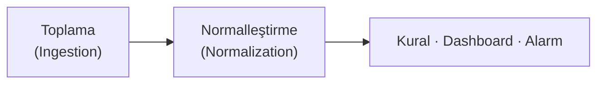

# SIEM Tanımı ve Temelleri

> 📚 [İndeks](00_SIEM_%C4%B0ndeks.md)

> [!NOTE]
> **SIEM (Security Information and Event Management):** Farklı kaynaklardan gelen logları tek yerde toplayan, ortak formata çeviren, ilişkilendiren (**correlation**) ve şüpheli durumda alarm (**alert**) üreten sistem.

## 🕰️ SIM + SEM = SIEM (Gartner, 2005)
- **SIM:** Logları saklar, analiz eder, raporlar → *geçmiş*
- **SEM:** Olayları canlı birleştirir, ilişkilendirir, bildirir → *şimdi*

## 🔄 Veri Akışı

## 💼 Ne İşe Yarar?
- **Log birleştirme:** Tüm kaynaklar tek ekranda
- **Tehdit alarmı:** Gerçek zamanlı tespit
- **Bağlam:** Kim, nerede, ne zaman?
- **Uyumluluk:** PCI DSS, HIPAA, GDPR denetimleri

> [!WARNING]
> **Alert fatigue:** İyi ayarlanmamış (**tuning**) bir SIEM binlerce alarm üretir ve gerçek tehdit gözden kaçar. Hedef yalnızca yüksek riskli olaylarda alarm üretmektir.

> [!TIP]
> SIEM, IDS/IPS'in yerini **almaz**. Onların loglarını diğer kaynaklarla birleştirir.
> Örnek: 5 hatalı giriş → hesap kilitlendi. 1 saatte 100 kez zararlı siteye bağlantı. İkisi de SIEM'de tek ekranda görülür.
