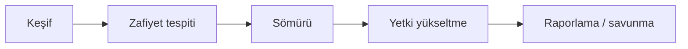

# Siber Güvenlik

> [!abstract] Merkez
> Tüm siber güvenlik notlarının giriş noktası.

| Konu | Not |
|---|---|
| Yapay zeka / LLM güvenliği | [[00 - Yapay zeka\|Yapay Zeka Güvenliği (10 bölüm)]] |
| Kablosuz ağlar | [[00_Wi-Fi_Hackleme_İndex\|Wi-Fi Hackleme]] |
| Web zafiyetleri | [[00_Web_Hacking_Index\|Web Hacking / SQL Injection]] |
| CMS | [[00_WordPress_İndeks\|WordPress Pentest]] |
| Yetki yükseltme | [[00_Yetki_Yükseltme\|Yetki Yükseltme]] |
| Linux | [[00_Linux_Komutları\|Linux Komutları]] |

