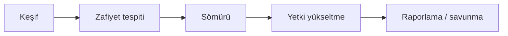

# Siber Güvenlik

> [!NOTE]
> **Merkez**
> Tüm siber güvenlik notlarının giriş noktası.

| Konu | Not |
|---|---|
| Yapay zeka / LLM güvenliği | [Yapay Zeka Güvenliği (10 bölüm)](Yapay_Zeka_G%C3%BCvenli%C4%9Fi/00%20-%20Yapay%20zeka.md) |
| Açık kaynak istihbaratı | [OSINT](OSINT/00_OSINT_%C4%B0ndeks.md) |
| Kablosuz ağlar | [Wi-Fi Hackleme](Wi-Fi%20Hackleme/00_Wi-Fi_Hackleme_%C4%B0ndex.md) |
| Web zafiyetleri | [Web Hacking / SQL Injection](Web_Hack%C4%B1ng/00_Web_Hacking_Index.md) |
| CMS | [WordPress Pentest](WordPress/00_WordPress_%C4%B0ndeks.md) |
| Yetki yükseltme | [Yetki Yükseltme](Yetki%20Y%C3%BCkseltme/00_Yetki_Y%C3%BCkseltme.md) |
| Kriptoloji | [Kriptoloji](Kriptoloji/00_Kriptoloji_%C4%B0ndeks.md) |
| Linux | [Linux Komutları](Linux_Komutlar%C4%B1/00_Linux_Komutlar%C4%B1.md) |
| Linux (teori) | [Linux Temelleri](Linux_Temelleri/00_Linux_Temelleri_%C4%B0ndeks.md) |
| Ağ trafiği analizi | [Ağ Trafiği Analizi](A%C4%9F_Trafi%C4%9Fi_Analizi/00_A%C4%9F_Trafi%C4%9Fi_Analizi_%C4%B0ndeks.md) |
| Ağ tarama | [Nmap ile Ağ Tarama](Nmap_ile_A%C4%9F_Tarama/00_Nmap_ile_A%C4%9F_Tarama_%C4%B0ndeks.md) |

