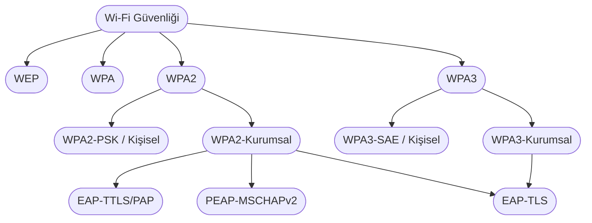

# Wi-Fi Güvenlik Protokolleri ve Sızma Testi Temelleri

> ◀ [İndeks](00_Wi-Fi_Hackleme_%C4%B0ndex.md) · 📚 [İndeks](00_Wi-Fi_Hackleme_%C4%B0ndex.md) · [Wi-Fi Kimlik Doğrulama Yöntemleri](02_Wi-Fi_Kimlik_Do%C4%9Frulama_Y%C3%B6ntemleri.md) ▶

> [!NOTE]
> **Özet**
> Kablosuz ağ güvenliği; **şifreleme protokolünün** (WEP/WPA/WPA2/WPA3) ve **kimlik doğrulama yönteminin** (PSK, SAE, 802.1X/EAP) birleşimidir. Hangi protokolün kullanıldığı, hangi saldırının işe yarayacağını belirler.

## Protokollere genel bakış

| Protokol | Şifreleme | Kimlik doğrulama | Durum |
|---|---|---|---|
| **WEP** (Wired Equivalent Privacy) | RC4 + CRC-32 | Open / Shared Key | **Tamamen kırık**, dakikalar içinde kırılır → [WEP](08_WEP_Zafiyetleri_ve_RC4.md) |
| **WPA** | TKIP (RC4 tabanlı) | PSK veya 802.1X | WEP'in geçici yamasıydı, **eski** |
| **WPA2** | AES-CCMP | PSK veya 802.1X (EAP) | Yıllardır standart. PSK modunda **4-way handshake yakalanıp sözlükle kırılabilir** |
| **WPA3** | AES-CCMP / GCMP | SAE (kişisel) veya 802.1X (kurumsal) | En güncel. **Offline sözlük saldırısına dirençli**, PMF zorunlu |

> [!NOTE]
> **WPA3'ün farkı**
> WPA2-PSK'da yakalanan handshake'i eve götürüp **çevrimdışı** kaba kuvvetle kırabilirsin. WPA3'te **SAE** bunu engeller: her tahmin için AP ile etkileşim gerekir. Ayrıca **PMF (Protected Management Frames)** zorunlu olduğu için deauth saldırısı da işe yaramaz. Eski cihazlar desteklemediği için WPA3 hâlâ WPA2 kadar yaygın değildir.

Kimlik doğrulama adımlarının ayrıntısı: [02_Wi-Fi_Kimlik_Doğrulama_Yöntemleri](02_Wi-Fi_Kimlik_Do%C4%9Frulama_Y%C3%B6ntemleri.md).

## Wi-Fi sızma testinin 4 bileşeni

Kablosuz ağlar kurumların dış güvenlik çevresinin **fiziksel olarak en erişilebilir** parçasıdır. Kapsamlı bir Wi-Fi testi dört alanı kapsar:

1. **Parolaların değerlendirilmesi:** Sözlük ve kaba kuvvetle parola direncini ölçmek ([06.6_Aircrack-ng_Parola_Kırma](06.6_Aircrack-ng_Parola_K%C4%B1rma.md)).
2. **Yapılandırmanın değerlendirilmesi:** Router/AP ayarları, şifreleme protokolü, WPS açık mı, ağ bölümlendirmesi.
3. **Altyapının test edilmesi:** Eski firmware, zayıf cihaz yapılandırmaları, mimari zayıflıklar.
4. **İstemcilerin test edilmesi:** Laptop, telefon, IoT cihazlarındaki sürücü ve ağ yığını zafiyetleri.

> [!WARNING]
> **Yasal uyarı**
> Bu notlardaki teknikler **yalnızca kendi laboratuvar ağında veya yazılı izin alınmış ortamlarda** uygulanmalıdır. İzinsiz kablosuz ağ saldırıları suçtur.

---
> ◀ [İndeks](00_Wi-Fi_Hackleme_%C4%B0ndex.md) · 📚 [İndeks](00_Wi-Fi_Hackleme_%C4%B0ndex.md) · [Wi-Fi Kimlik Doğrulama Yöntemleri](02_Wi-Fi_Kimlik_Do%C4%9Frulama_Y%C3%B6ntemleri.md) ▶
