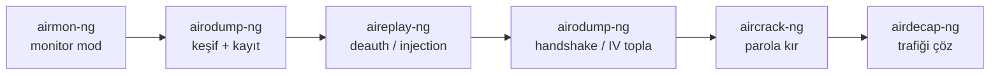

# Aircrack-ng Genel Bakış

> ◀ [Wi-Fi Çalışma Modları](05_Wi-Fi_%C3%87al%C4%B1%C5%9Fma_Modlar%C4%B1.md) · 📚 [İndeks](00_Wi-Fi_Hackleme_%C4%B0ndex.md) · [Airmon-ng](06.1_Airmon-ng.md) ▶

Aircrack-ng, Wi-Fi ağ güvenliğinin değerlendirilmesi için tasarlanmış kapsamlı bir araç setidir (suite). Kablosuz ağları analiz etmeye veya istismar etmeye (exploit) başlamadan önce, bu araçların temel işlevlerini kavramak şarttır.

Aircrack-ng, Wi-Fi güvenliğinin dört farklı temel alanına odaklanır:
*   **İzleme (Monitoring):** Paket yakalama (packet capture) ve elde edilen verilerin üçüncü parti araçlarla (örneğin Wireshark) işlenmek üzere pcap/metin dosyalarına aktarılması.
*   **Saldırı (Attacking):** Paket enjeksiyonu yoluyla tekrar saldırıları (replay attacks), bağlantı koparma (deauthentication), sahte erişim noktaları (fake access points) oluşturma ve ağ trafiği manipülasyonu.
*   **Test Etme (Testing):** Ağ (Wi-Fi) kartlarının ve sürücülerin yeteneklerinin (yakalama ve enjeksiyon yapabilme durumlarının) kontrol edilmesi.
*   **Kırma (Cracking):** WEP ve WPA PSK (WPA 1 ve 2) parolalarının kırılması.

Aircrack-ng içindeki tüm araçlar komut satırı arayüzü (CLI) üzerinden çalışır, bu da otomasyon ve betik (scripting) yetenekleri sağlar. Bu esnek yapı, birçok grafiksel arayüzlü (GUI) sızma testi aracı tarafından altyapı olarak kullanılır. Aircrack-ng ağırlıklı olarak Linux platformlarında çalışır; ancak Windows, macOS, FreeBSD ve çeşitli Unix sistemleriyle de uyumludur.

## Temel Aircrack-ng Araçları
Aircrack-ng seti, Wi-Fi ağlarını denetlemek için 20'den fazla araç içerir. Çeşitli ağ değerlendirmeleri için vazgeçilmez olan ve en sık kullanacağımız **6 temel araç** şunlardır:

| Araç (Tool)       | Açıklama (Description)                                                                                                             |
| :---------------- | :--------------------------------------------------------------------------------------------------------------------------------- |
| **`airmon-ng`**   | Kablosuz ağ kartlarında İzleme Modunu (Monitor Mode) etkinleştirmek ve devre dışı bırakmak için kullanılır.                        |
| **`airodump-ng`** | Havadaki ham (raw) 802.11 çerçevelerini yakalayıp kaydetmeye (sniffing) yarar.                                                     |
| **`airgraph-ng`** | `airodump-ng` tarafından oluşturulan CSV dosyalarını kullanarak, kablosuz ağların görsel grafiklerini ve haritalarını oluşturur.   |
| **`aireplay-ng`** | Havadaki kablosuz ağ trafiğini manipüle etmek ve yapay trafik üretmek için (Paket enjeksiyonu, Deauth vb.) kullanılır.             |
| **`airdecap-ng`** | Yakalanan WEP, WPA PSK veya WPA2 PSK (pcap) trafik dosyalarının şifresini çözerek okunabilir hale getirir.                         |
| **`aircrack-ng`** | Önceden Paylaşılmış Anahtar (PSK) veya PMKID kullanan WEP ve WPA/WPA2 ağlarının parolalarını (hash'lerini) kırmak için kullanılır. |

## Tipik saldırı akışı

## Araç notları
- [06.1_Airmon-ng](06.1_Airmon-ng.md) · [06.2_Airodump-ng](06.2_Airodump-ng.md) · [06.3_Airgraph-ng](06.3_Airgraph-ng.md)
- [06.4_Aireplay-ng](06.4_Aireplay-ng.md) · [06.5_Airdecap-ng](06.5_Airdecap-ng.md) · [06.6_Aircrack-ng_Parola_Kırma](06.6_Aircrack-ng_Parola_K%C4%B1rma.md)

---
> ◀ [Wi-Fi Çalışma Modları](05_Wi-Fi_%C3%87al%C4%B1%C5%9Fma_Modlar%C4%B1.md) · 📚 [İndeks](00_Wi-Fi_Hackleme_%C4%B0ndex.md) · [Airmon-ng](06.1_Airmon-ng.md) ▶
