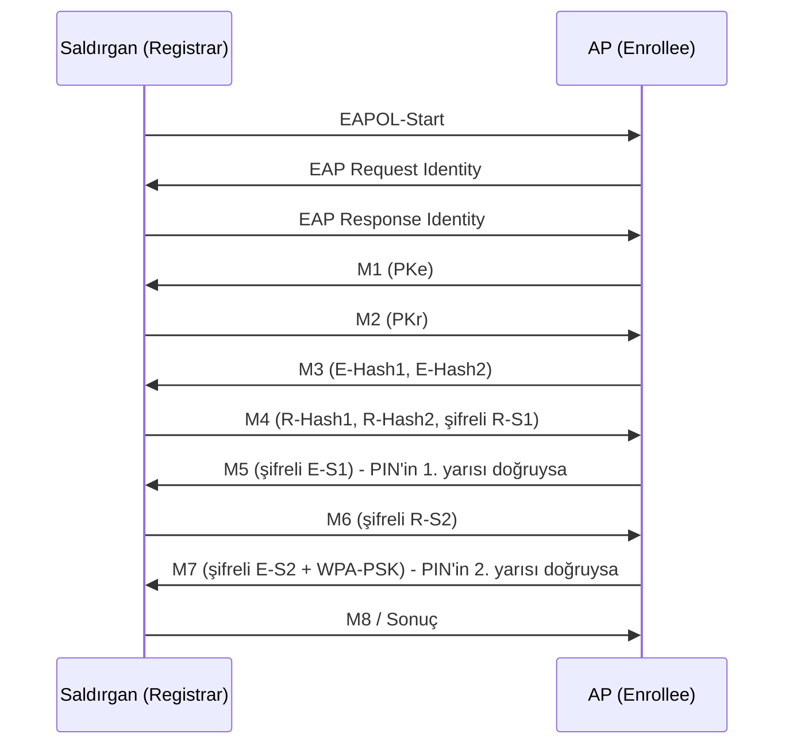

# WPS Temelleri ve Zafiyeti

> ◀ [Aircrack-ng ile Parola Kırma](06.6_Aircrack-ng_Parola_K%C4%B1rma.md) · 📚 [İndeks](00_Wi-Fi_Hackleme_%C4%B0ndex.md) · [WPS Keşif ve Tarama](07.1_WPS_Ke%C5%9Fif_ve_Tarama.md) ▶

> [!NOTE]
> **Özet**
> **WPS**, uzun WPA parolası girmeden tuş veya **8 haneli PIN** ile bağlanmayı sağlar. PIN iki yarı halinde doğrulandığı için yalnızca **11.000** denemede kırılabilir. PIN bulunursa AP, gerçek **WPA/WPA2 parolasını (PSK)** verir. Güçlü bir parola kullanmak bu durumda bile işe yaramaz.

> [!TIP]
> **Saldırı seçimi**
> Kilit yoksa → [online brute-force](07.2_WPS_Online_PIN_Brute-Force.md). Chipset zayıfsa → [Pixie Dust](07.3_WPS_Pixie_Dust.md) (saniyeler). Sadece buton modu açıksa → [PBC](07.4_WPS_PBC_Sald%C4%B1r%C4%B1s%C4%B1.md). AP kilitleniyorsa → [MDK4](07.5_MDK4_ile_WPS_Kilidi_DoS.md). Önce hep [keşif](07.1_WPS_Ke%C5%9Fif_ve_Tarama.md).

WPS, kullanıcıların uzun ve karmaşık WPA/WPA2 parolalarını girmek zorunda kalmadan, bir tuşa basarak veya **8 haneli bir PIN** girerek ağa kolayca bağlanmasını sağlamak için **Wi-Fi Alliance** tarafından 2006'da sunulmuş bir özelliktir.

Ancak bu kullanım kolaylığı, çok ciddi güvenlik açıklarını beraberinde getirir. Çok güçlü bir WPA2 parolası kullanılsa bile, WPS aktifse saldırganlar PIN'i kırarak doğrudan **WPA/WPA2 parolasını (PSK)** ele geçirebilir.

---

## 1. Temel Kavramlar ve Roller
WPS iletişimi bir dizi **EAP (Extensible Authentication Protocol)** mesajı üzerinden gerçekleşir:
* **Enrollee (İstemci/Station):** Ağa bağlanmak isteyen cihaz.
* **Registrar (Kayıtçı/Access Point):** Ağa giriş yetkisi veren cihaz (genellikle modemin/router'ın kendisi).

> [!IMPORTANT]
> **PIN saldırısında roller ters döner**
> Normal kullanımda AP "Registrar", bağlanan cihaz "Enrollee" olur. **PIN saldırısında** ise **AP = Enrollee** (PIN'i doğrulayan taraf), **saldırgan = Registrar** (PIN'i tahmin eden taraf) olur. Bu yüzden sözlükteki `PKe`, `E-Hash` gibi "E" ile başlayan değerler **AP'ye**, "R" ile başlayanlar **saldırgana** aittir.

---

## 2. WPS Bağlantı Yöntemleri

| Yöntem | Açıklama | Güvenlik Durumu |
| :--- | :--- | :--- |
| **Push Button (PBC)** | Modem ve cihaz üzerindeki fiziksel (veya yazılımsal) bir tuşa basılarak bağlantı kurulur. En yaygın yöntemdir. | **Fiziksel Risk:** Menzil içindeki yetkisiz biri modemin tuşuna basarak ağa sızabilir. |
| **PIN Entry** | Cihazın ürettiği veya modemin altında yazan **8 haneli PIN** kodu girilerek bağlantı sağlanır. | **Kritik Zafiyet:** Protokol PIN'i iki ayrı yarıda doğruladığı için kaba kuvvet (brute-force) saldırılarına karşı çok savunmasızdır. |
| **NFC (Yakın Alan)** | Cihazı modeme yaklaştırarak (okutarak) bağlantı kurulur. Nadir kullanılır. | Fiziksel yakınlık gerektirir. |
| **USB Flash Drive** | Ayarların bir USB bellek ile taşınmasıdır. Pratik olmadığı için artık kullanılmaz. | Düşük risk / Kullanılmıyor. |

---

## 3. Teknik Zafiyet Analizi (Neden Kırılıyor?)

WPS arka planda güvenli kabul edilen **HMAC-SHA-256** özetleme (hashing) fonksiyonunu kullanır. Ancak kriptografi güçlü olsa da protokolün çalışma mantığı hatalıdır:

1. **Bölünmüş PIN Doğrulaması:** 8 haneli PIN tek seferde kontrol edilmez. Erişim noktası (AP), PIN'in **ilk 4 hanesini** ve **son 4 hanesini** ayrı ayrı doğrular ve her yarı için ayrı hata mesajı döner. Bu durum kombinasyon sayısını 100 milyondan **11.000'e** düşürür (8. hane checksum'dır).
2. **Online PIN Kırma:** Modeme doğrudan binlerce PIN denemesi gönderilir. Saatler sürebilir (Ortalama 4-10 saat).
3. **Offline PIN Kırma (Pixie Dust):** İletişim sırasında kullanılan rastgele sayıların (nonce değerlerinin) tahmin edilebilir olması ve EAP mesajlarında sızdırılan bilgiler sayesinde, yakalanan paketler üzerinden **birkaç dakika içinde** çevrimdışı olarak PIN kırılabilir.

> **Savunma (Mitigation):** Ağ güvenliğini sağlamak için modem arayüzünden **WPS özelliği tamamen devre dışı bırakılmalıdır (Disable).**

## 4. WPS PIN Yapısı (Neden Sadece 11.000 İhtimal Var?)

WPS PIN kodu **8 hanelidir** ve iki ana bölümden (4 hane + 4 hane) oluşur. Normalde 8 haneli bir şifre için 100 milyon ($10^8$) ihtimal olması gerekirken, WPS'in tasarımsal hatası yüzünden kaba kuvvet (brute-force) ile denenmesi gereken sayı **11.000'e** düşer:

*   **İlk Yarı (1. - 4. Haneler):** M4 ve M5 mesajlarında kullanılır. 10.000 ($10^4$) olası kombinasyonu vardır.
*   **İkinci Yarı (5. - 8. Haneler):** M6 ve M7 mesajlarında kullanılır. Bu yarının son (8.) hanesi sadece bir **checksum (sağlama toplamı)** basamağıdır ve ilk 7 haneye göre kolayca hesaplanır. Bu nedenle geriye sadece 1.000 ($10^3$) olası kombinasyon kalır.
*   Modem bu iki parçayı tek seferde değil, **ayrı ayrı** doğruladığı için saldırganın maksimum deneme sayısı: 10.000 + 1.000 = **11.000 toplam kombinasyondur**.

---

## 5. WPS EAP Mesajlaşma Süreci (Nasıl Çalışır?)

WPS işlemi, Access Point (AP/Enrollee) ve İstemci (Station/Registrar) arasında gerçekleşen bir dizi **EAP (Extensible Authentication Protocol)** mesajı ile sağlanır.

### WPS Kriptografik Terimler Sözlüğü (Tam Liste)

| Terim | Açıklama |
| :--- | :--- |
| **PKe** | Enrollee'nin (AP/Modem) Diffie-Hellman açık anahtarı (Public Key). *M1 mesajında gönderilir.* |
| **PKr** | Registrar'ın (İstemci/Client) Diffie-Hellman açık anahtarı. *M2 mesajında gönderilir.* |
| **PSK1** | 8 haneli PIN kodunun **ilk 4 hanesi** (10.000 olası kombinasyon). |
| **PSK2** | 8 haneli PIN kodunun **son 4 hanesi** (Son hane checksum olduğu için 1.000 olası kombinasyon). |
| **KDK (Key Derivation Key)** | Auth Key'i (Doğrulama Anahtarı) türetmek için kullanılan anahtar. |
| **KWK (Key Wrap Key)** | Mesajları AES ile şifrelemek için kullanılan anahtar. |
| **Auth Key** | `KDK`, `PSK1` ve `PSK2` değerlerinden türetilen doğrulama anahtarı. Hash'leri oluştururken kullanılır. |
| **E-S1 & E-S2** | Enrollee (AP) tarafından üretilen 128-bitlik gizli rastgele sayılar (Nonce). `E-Hash1` ve `E-Hash2` üretiminde kullanılır. |
| **R-S1 & R-S2** | Registrar (İstemci) tarafından üretilen 128-bitlik gizli rastgele sayılar (Nonce). `R-Hash1` ve `R-Hash2` üretiminde kullanılır. |
| **E-Hash1 & E-Hash2** | AP'nin PIN'in ilk ve ikinci yarısını kanıtlamak için `HMAC-SHA-256` (Auth Key kullanarak) ile ürettiği özetler. İçinde sırasıyla `E-S1/E-S2`, `PSK1/PSK2`, `PKe` ve `PKr` bulunur. *M3 mesajında gönderilir.* |
| **R-Hash1 & R-Hash2** | İstemcinin PIN'in ilk ve ikinci yarısını kanıtlamak için ürettiği özetler. İçinde `R-S1/R-S2`, `PSK1/PSK2`, `PKe` ve `PKr` bulunur. *M4 mesajında gönderilir.* |
| **WPA-PSK** | PIN doğrulaması başarılı olduğunda **M7 mesajında** (AES ile şifrelenmiş olarak) istemciye teslim edilen **asıl Wi-Fi parolası**. |

### EAP Mesaj Trafiği Adımları
Ağ üzerindeki iletişim şu adımlarla ilerler (aşağıdaki diyagrama da bak):

1.  **Başlangıç:** İstemci süreci `EAPOL-Start` mesajı ile başlatır. AP kimlik bilgisi talep eder (`EAP Request Identify`) ve istemci yanıtlar (`EAP Response Identity`).
2.  **M1 ve M2 Mesajları:** Taraflar Diffie-Hellman açık anahtarlarını (PKe ve PKr) karşılıklı olarak iletirler (`EAP Request M1` ve `EAP Response M2`).
3.  **M3 Mesajı:** AP, E-Hash1 ve E-Hash2 değerlerini gönderir (`EAP Request M3`).
4.  **M4 ve M5 Mesajları:** İstemci şifreli R-Hash değerlerini ve R-S1 nonce değerini (`EAP Response M4`), AP ise E-S1 nonce değerini gönderir (`EAP Request M5`).
5.  **M6 ve M7 Mesajları:** İstemci R-S2 nonce değerini yollar (`EAP Response M6`). Eğer girilen PIN doğruysa, AP `EAP Request M7 + Creds` mesajında **asıl Wi-Fi şifresini (WPA-PSK)** şifreli olarak istemciye teslim eder.
6.  **M8 ve Sonuç:** İstemci şifreyi aldığını doğrular (`EAP Response M8 + Creds`). Süreç `EAP NACK` veya `EAP Acknowledgement` ile sonlanarak normal WPA el sıkışma evresine geçilir.

---
> ◀ [Aircrack-ng ile Parola Kırma](06.6_Aircrack-ng_Parola_K%C4%B1rma.md) · 📚 [İndeks](00_Wi-Fi_Hackleme_%C4%B0ndex.md) · [WPS Keşif ve Tarama](07.1_WPS_Ke%C5%9Fif_ve_Tarama.md) ▶
