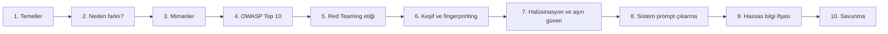

# Yapay Zeka Güvenliği

> [!NOTE]
> **Bu not ne?**
> LLM (Büyük Dil Modeli) tabanlı sistemlerin **nasıl çalıştığını, nasıl saldırıya uğradığını ve nasıl savunulduğunu** anlatan eğitim notlarımın ana sayfası (**MOC**, Map of Content). Her bölüm ayrı bir notta; bu sayfa hepsini birbirine bağlar.

## Bölümler

| # | Bölüm | Ana konular |
|---|---|---|
| 1 | [LLM Güvenliğine Giriş](01%20-%20LLM%20G%C3%BCvenli%C4%9Fine%20Giri%C5%9F.md) | LLM nedir, Transformer, tokenization, attention, eğitim aşamaları, parametreler, system prompt |
| 2 | [Yapay Zeka Güvenliği Neden Farklı?](02%20-%20Yapay%20Zeka%20G%C3%BCvenli%C4%9Fi%20Neden%20Farkl%C4%B1.md) | Deterministik vs olasılıksal, anlamsal boşluk, emergent davranışlar, AI supply chain, savunmacının ikilemi |
| 3 | [LLM Uygulama Mimarileri](03%20-%20LLM%20Uygulama%20Mimarileri.md) | Bağımsız LLM, RAG, ajan, çok ajanlı sistem, MCP ve her birinin saldırı yüzeyi |
| 4 | [OWASP LLM Top 10](04%20-%20OWASP%20LLM%20Top%2010.md) | LLM01-LLM10, saldırı yüzeyi haritası, MITRE ATLAS |
| 5 | [AI Red Teaming Etiği](05%20-%20AI%20Red%20Teaming%20Eti%C4%9Fi.md) | Metodoloji, etik sınırlar, AB AI Yasası, GDPR, bug bounty, sorumlu açıklama, rapor şablonu |
| 6 | [Model Parmak İzi ve Keşif](06%20-%20Model%20Parmak%20%C4%B0zi%20ve%20Ke%C5%9Fif.md) | Model fingerprinting, davranışsal ve API düzeyinde keşif, önlemler |
| 7 | [Halüsinasyonları ve Aşırı Güvenmeyi Anlamak](07%20-%20Hal%C3%BCsinasyonlar%20ve%20A%C5%9F%C4%B1r%C4%B1%20G%C3%BCven.md) | Halüsinasyon türleri, slopsquatting (paket halüsinasyonu), aşırı güven, LLM09, savunma stratejileri |
| 8 | [Sistem Prompt Çıkarma Teknikleri](08%20-%20Sistem%20Prompt%20%C3%87%C4%B1karma%20Teknikleri.md) | LLM07, doğrudan/dolaylı/gelişmiş extraction teknikleri (25 teknik), tespit göstergeleri, savunma |
| 9 | [Hassas Bilgi İfşası](09%20-%20Hassas%20Bilgi%20%C4%B0f%C5%9Fas%C4%B1.md) | LLM02, eğitim verisi ezberleme, kullanıcılar arası sızıntı (ChatGPT 2023), RAG'de PII, API key sızıntısı, hata mesajları, Samsung vakası |
| 10 | [Savunma: Keşif ve Bilgi İfşasının Azaltılması](10%20-%20Ke%C5%9Fif%20ve%20Bilgi%20%C4%B0f%C5%9Fas%C4%B1%20Savunmas%C4%B1.md) | Sır tutmama, çıkarma karşıtı talimat, canary token, PII redaksiyonu (Presidio), hız sınırı, çıktı filtreleme, metadata/header gizleme, 6 katmanlı derinlemesine savunma |

## Hızlı erişim

- **Saldırı yüzeyi haritası:** [Yapay Zeka Saldırı Yüzeyi](04%20-%20OWASP%20LLM%20Top%2010.md#yapay-zeka-saldırı-yüzeyi)
- **OWASP hızlı referans tablosu:** [LLM01-LLM10 tablosu](04%20-%20OWASP%20LLM%20Top%2010.md#owasp-llm-top-10-hızlı-referans)
- **Mimari karşılaştırma tablosu:** [Hangi mimari hangi riski taşır?](03%20-%20LLM%20Uygulama%20Mimarileri.md#doğru-mimariyi-seçmek-güvenlik-konuları)
- **Geleneksel güvenlik vs AI güvenliği:** [Karşılaştırma tablosu](02%20-%20Yapay%20Zeka%20G%C3%BCvenli%C4%9Fi%20Neden%20Farkl%C4%B1.md#geleneksel-güvenlik-ve-yapay-zeka-güvenliği-karşılaştırma)
- **Zafiyet raporu şablonu:** [Rapor şablonu](05%20-%20AI%20Red%20Teaming%20Eti%C4%9Fi.md#yapay-zeka-güvenlik-açığı-raporu-yazma)
- **Etik sınırlar:** [Ne kabul edilebilir, ne edilemez?](05%20-%20AI%20Red%20Teaming%20Eti%C4%9Fi.md#etik-i̇lkeler-ve-sınırlar)
- **Slopsquatting (paket halüsinasyonu) saldırısı:** [Nasıl çalışır?](07%20-%20Hal%C3%BCsinasyonlar%20ve%20A%C5%9F%C4%B1r%C4%B1%20G%C3%BCven.md#paket-halüsinasyon-saldırıları)
- **Halüsinasyona karşı savunma tablosu:** [Savunma stratejileri](07%20-%20Hal%C3%BCsinasyonlar%20ve%20A%C5%9F%C4%B1r%C4%B1%20G%C3%BCven.md#halüsinasyonlara-karşı-savunma)
- **System prompt çıkarma teknikleri (25 teknik):** [Doğrudan](08%20-%20Sistem%20Prompt%20%C3%87%C4%B1karma%20Teknikleri.md#doğrudan-ekstraksiyon-teknikleri) · [Dolaylı](08%20-%20Sistem%20Prompt%20%C3%87%C4%B1karma%20Teknikleri.md#dolaylı-ekstraksiyon-teknikleri) · [Gelişmiş](08%20-%20Sistem%20Prompt%20%C3%87%C4%B1karma%20Teknikleri.md#gelişmiş-ekstraksiyon-teknikleri)
- **Extraction tespit göstergeleri:** [Göstergeler ve detection](08%20-%20Sistem%20Prompt%20%C3%87%C4%B1karma%20Teknikleri.md#sistem-prompt-çıkarma-girişimlerini-algılama)
- **Eğitim verisi ezberleme ve ekstraksiyon:** [Prefix/completion attack](09%20-%20Hassas%20Bilgi%20%C4%B0f%C5%9Fas%C4%B1.md#eğitim-verilerinin-ezberlenmesi)
- **ChatGPT veri sızıntısı vakası (2023):** [Redis bug'ı](09%20-%20Hassas%20Bilgi%20%C4%B0f%C5%9Fas%C4%B1.md#chatgpt-veri-sızıntısı-olayı-mart-2023)
- **API key ve credential sızıntı yolları:** [4 yol](09%20-%20Hassas%20Bilgi%20%C4%B0f%C5%9Fas%C4%B1.md#api-anahtarı-ve-kimlik-bilgilerinin-açığa-çıkması)
- **Derinlemesine savunma (6 katman):** [Katman tablosu](10%20-%20Ke%C5%9Fif%20ve%20Bilgi%20%C4%B0f%C5%9Fas%C4%B1%20Savunmas%C4%B1.md#derinlemesine-savunma-mimarisi)
- **Canary token ve sızıntı tespiti:** [Canary token](10%20-%20Ke%C5%9Fif%20ve%20Bilgi%20%C4%B0f%C5%9Fas%C4%B1%20Savunmas%C4%B1.md#sistem-promptlarda-canary-token) · [Sızıntı tespiti](10%20-%20Ke%C5%9Fif%20ve%20Bilgi%20%C4%B0f%C5%9Fas%C4%B1%20Savunmas%C4%B1.md#sistem-prompt-sızıntı-tespiti)
- **PII redaksiyonu (giriş ve çıkış):** [PII redaksiyonu](10%20-%20Ke%C5%9Fif%20ve%20Bilgi%20%C4%B0f%C5%9Fas%C4%B1%20Savunmas%C4%B1.md#kişisel-bilgilerin-düzenlenmesi-pii-redaksiyonu)
- **Model parmak izi veritabanı yapısı:** [JSON yapısı](06%20-%20Model%20Parmak%20%C4%B0zi%20ve%20Ke%C5%9Fif.md#model-parmak-i̇zi-veritabanı-oluşturma)

## Temel fikirler (tek cümlede)

> [!NOTE]
> **Her bölümden akılda kalacak çıkarım**
> 1. **Context window'da ayrıcalıklı bölge yok.** System prompt ve kullanıcı girdisi aynı alandadır; [[Prompt Injection]]'ın temel nedeni bu.
> 2. **LLM olasılıksaldır.** Bir saldırı bazen çalışır bazen çalışmaz; test istatistiksel olmalı.
> 3. **Her entegrasyon noktası bir saldırı yüzeyidir.** Savunmanın temeli **En Az Ayrıcalık İlkesi**.
> 4. **LLM çıktısı güvenilmez girdidir.** Alt sistemlere geçmeden sanitize et.
> 5. **Yetkilendirme, kapsam uyumu ve sorumlu açıklama tartışılamaz.**
> 6. **Model parmak izi keşfin ilk adımıdır**; modelin kendini tanıtmasına değil, çoklu kanıta güven.
> 7. **LLM doğruluk için değil inandırıcılık için optimize edilir.** Paket adı, URL, içtihat ve yapılandırmayı bağımsız kaynakla doğrula.
> 8. **System prompt gizli kalmaz.** Sırları (API key, şifre) prompt'a koyma, kuralları uygulama kodunda zorla.
> 9. **Veri üç yoldan sızar:** modelin ezberinden, paylaşılan oturum/bellek hatalarından ve kullanıcının kendi yapıştırdığı veriden. Erişim kontrolü, PII redaction ve DLP şart.
> 10. **Savunma katmanlıdır; mükemmel savunma yoktur.** Prompt'ta sır tutma, girişte ve çıkışta PII redakte et, canary ile sızıntıyı tespit et, metadata'yı temizle. Hedef, saldırı maliyetini yükseltip hızlı tespit etmektir.

## Bağlantılı konular
- [[Prompt Injection]] · [[Jailbreak]] · [[RAG]] · [[SSRF]] · [[Excessive Agency]]
- [[MITRE ATLAS]] · [[Defense in Depth]] · [[Principle of Least Privilege]]
- Genel siber güvenlik notlarım: [[Siber Güvenlik]]
