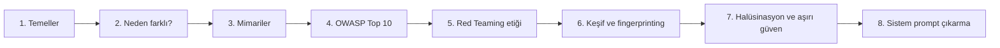

# Yapay Zeka Güvenliği

> [!abstract] Bu not ne?
> LLM (Büyük Dil Modeli) tabanlı sistemlerin **nasıl çalıştığını, nasıl saldırıya uğradığını ve nasıl savunulduğunu** anlatan eğitim notlarımın ana sayfası (**MOC**, Map of Content). Her bölüm ayrı bir notta; bu sayfa hepsini birbirine bağlar.

## Bölümler

| # | Bölüm | Ana konular |
|---|---|---|
| 1 | [[01 - LLM Güvenliğine Giriş\|LLM Güvenliğine Giriş]] | LLM nedir, Transformer, tokenization, attention, eğitim aşamaları, parametreler, system prompt |
| 2 | [[02 - Yapay Zeka Güvenliği Neden Farklı\|Yapay Zeka Güvenliği Neden Farklı?]] | Deterministik vs olasılıksal, anlamsal boşluk, emergent davranışlar, AI supply chain, savunmacının ikilemi |
| 3 | [[03 - LLM Uygulama Mimarileri\|LLM Uygulama Mimarileri]] | Bağımsız LLM, RAG, ajan, çok ajanlı sistem, MCP ve her birinin saldırı yüzeyi |
| 4 | [[04 - OWASP LLM Top 10\|OWASP LLM Top 10]] | LLM01-LLM10, saldırı yüzeyi haritası, MITRE ATLAS |
| 5 | [[05 - AI Red Teaming Etiği\|AI Red Teaming Etiği]] | Metodoloji, etik sınırlar, AB AI Yasası, GDPR, bug bounty, sorumlu açıklama, rapor şablonu |
| 6 | [[06 - Model Parmak İzi ve Keşif\|Model Parmak İzi ve Keşif]] | Model fingerprinting, davranışsal ve API düzeyinde keşif, önlemler |
| 7 | [[07 - Halüsinasyonlar ve Aşırı Güven\|Halüsinasyonları ve Aşırı Güvenmeyi Anlamak]] | Halüsinasyon türleri, slopsquatting (paket halüsinasyonu), aşırı güven, LLM09, savunma stratejileri |
| 8 | [[08 - Sistem Prompt Çıkarma Teknikleri\|Sistem Prompt Çıkarma Teknikleri]] | LLM07, doğrudan/dolaylı/gelişmiş extraction teknikleri (25 teknik), tespit göstergeleri, savunma |

## Hızlı erişim

- **Saldırı yüzeyi haritası:** [[04 - OWASP LLM Top 10#Yapay Zeka Saldırı Yüzeyi|Yapay Zeka Saldırı Yüzeyi]]
- **OWASP hızlı referans tablosu:** [[04 - OWASP LLM Top 10#OWASP LLM Top 10 Hızlı Referans|LLM01-LLM10 tablosu]]
- **Mimari karşılaştırma tablosu:** [[03 - LLM Uygulama Mimarileri#Doğru Mimariyi Seçmek Güvenlik Konuları|Hangi mimari hangi riski taşır?]]
- **Geleneksel güvenlik vs AI güvenliği:** [[02 - Yapay Zeka Güvenliği Neden Farklı#Geleneksel Güvenlik ve Yapay Zeka Güvenliği Karşılaştırma|Karşılaştırma tablosu]]
- **Zafiyet raporu şablonu:** [[05 - AI Red Teaming Etiği#Yapay Zeka Güvenlik Açığı Raporu Yazma|Rapor şablonu]]
- **Etik sınırlar:** [[05 - AI Red Teaming Etiği#Etik İlkeler ve Sınırlar|Ne kabul edilebilir, ne edilemez?]]
- **Slopsquatting (paket halüsinasyonu) saldırısı:** [[07 - Halüsinasyonlar ve Aşırı Güven#Paket Halüsinasyon Saldırıları|Nasıl çalışır?]]
- **Halüsinasyona karşı savunma tablosu:** [[07 - Halüsinasyonlar ve Aşırı Güven#Halüsinasyonlara Karşı Savunma|Savunma stratejileri]]
- **System prompt çıkarma teknikleri (25 teknik):** [[08 - Sistem Prompt Çıkarma Teknikleri#Doğrudan Ekstraksiyon Teknikleri|Doğrudan]] · [[08 - Sistem Prompt Çıkarma Teknikleri#Dolaylı Ekstraksiyon Teknikleri|Dolaylı]] · [[08 - Sistem Prompt Çıkarma Teknikleri#Gelişmiş Ekstraksiyon Teknikleri|Gelişmiş]]
- **Extraction tespit göstergeleri:** [[08 - Sistem Prompt Çıkarma Teknikleri#Sistem Prompt Çıkarma Girişimlerini Algılama|Göstergeler ve detection]]
- **Model parmak izi veritabanı yapısı:** [[06 - Model Parmak İzi ve Keşif#Model Parmak İzi Veritabanı Oluşturma|JSON yapısı]]

## Temel fikirler (tek cümlede)

> [!summary] Her bölümden akılda kalacak çıkarım
> 1. **Context window'da ayrıcalıklı bölge yok.** System prompt ve kullanıcı girdisi aynı alandadır; [[Prompt Injection]]'ın temel nedeni bu.
> 2. **LLM olasılıksaldır.** Bir saldırı bazen çalışır bazen çalışmaz; test istatistiksel olmalı.
> 3. **Her entegrasyon noktası bir saldırı yüzeyidir.** Savunmanın temeli **En Az Ayrıcalık İlkesi**.
> 4. **LLM çıktısı güvenilmez girdidir.** Alt sistemlere geçmeden sanitize et.
> 5. **Yetkilendirme, kapsam uyumu ve sorumlu açıklama tartışılamaz.**
> 6. **Model parmak izi keşfin ilk adımıdır**; modelin kendini tanıtmasına değil, çoklu kanıta güven.
> 7. **LLM doğruluk için değil inandırıcılık için optimize edilir.** Paket adı, URL, içtihat ve yapılandırmayı bağımsız kaynakla doğrula.
> 8. **System prompt gizli kalmaz.** Sırları (API key, şifre) prompt'a koyma, kuralları uygulama kodunda zorla.

## Bağlantılı konular
- [[Prompt Injection]] · [[Jailbreak]] · [[RAG]] · [[SSRF]] · [[Excessive Agency]]
- [[MITRE ATLAS]] · [[Defense in Depth]] · [[Principle of Least Privilege]]
- Genel siber güvenlik notlarım: [[Siber Güvenlik]]
