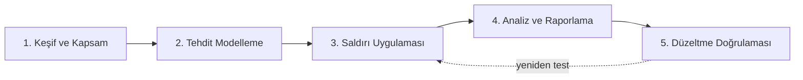
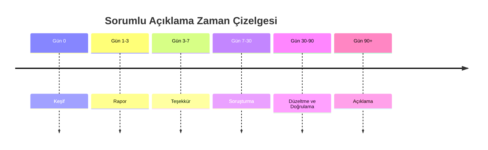

# AI Red Teaming Etiği

> ◀ [[04 - OWASP LLM Top 10|LLM Uygulamaları için OWASP Top 10]] · 📚 [[Yapay zeka|Ana Sayfa (MOC)]] · [[06 - Model Parmak İzi ve Keşif|Model Parmak İzi ve Keşif]] ▶

> [!abstract] Özet
> **AI Red Teaming**, yapay zeka sistemlerini güvenlik açıkları, önyargılar ve güvenlik hataları açısından sistematik olarak sınama uygulamasıdır. Geleneksel sızma testlerinden farklı bir **etik çerçeve** gerektirir; çünkü "zafiyetler" çoğu zaman insan benzeri çıktı üreten bir sistemin manipüle edilmesini içerir ve zarar potansiyeli veri ihlallerinin ötesine geçerek **yanlış bilgilendirme, ayrımcılık ve psikolojik manipülasyonu** da kapsayabilir.

## İçindekiler (Bölüm 5)
- [[#AI Red Teaming Nedir?]]
- [[#AI Red Teaming Metodolojisi]]
- [[#Etik İlkeler ve Sınırlar]]
- [[#Yasal Çerçeve]]
- [[#Yapay Zeka Sistemleri için Bug Bounty Programları]]
- [[#Sorumlu Açıklama Süreci]]
- [[#Yapay Zeka Güvenlik Açığı Raporu Yazma]]
- [[#AI Red Team Çerçeveleri ve Standartları]]
- [[#Temel Çıkarımlar (Bölüm 5)]]

---

## AI Red Teaming Nedir?

Güvenlik profesyonellerinin (**Red Team** üyeleri) gerçek dünyadaki saldırıları simüle ederek AI sistemlerindeki zayıflıkları bulmaya çalıştığı **adversarial bir değerlendirme metodolojisidir**. Amaç, kötü niyetli aktörlerden **önce** güvenlik açıklarını tespit etmektir.

### Geleneksel sızma testi ile AI Red Teaming karşılaştırması

| Boyut | Geleneksel Sızma Testi | AI Red Teaming |
|---|---|---|
| **Hedef** | Yazılım, ağlar, altyapı | AI modelleri, promptlar, hizalama, guardrails |
| **Araçlar** | Tarayıcılar, exploit çerçeveleri, scriptler | Hazırlanmış promptlar, davranış analizi, yaratıcılık |
| **Amaç** | CVE'leri, yanlış yapılandırmaları, kimlik doğrulama atlatmalarını bulmak | Güvenlik önlemlerini atlatmak, veri sızdırmak veya zararlı davranışı tetiklemek |
| **Çıktı** | Proof of Concept ile **tekrarlanabilir** exploit'ler | Saldırı promptları (çoğu zaman **tutarlı biçimde tekrarlanamaz**) |
| **Beceriler** | Programlama, ağ, işletim sistemi iç yapıları | Dilbilim, psikoloji, sosyal mühendislik, makine öğrenimi bilgisi |

> [!tip] Bağlantı
> Tekrarlanamazlık sorunu için bkz. [[02 - Yapay Zeka Güvenliği Neden Farklı#Tekrarlanamayan Güvenlik Açıkları|Tekrarlanamayan Güvenlik Açıkları]].

---

## AI Red Teaming Metodolojisi

Yapılandırılmış bir çalışma **5 aşamadan** oluşur:



### Aşama 1: Keşif ve Kapsam Belirleme
- Hedef yapay zeka sistemini ve mimarisini tanımla.
- Model türünü, sağlayıcıyı ve dağıtım yapılandırmasını belirle.
- **Saldırı yüzeyinin haritasını çıkar** (girdiler, çıktılar, araçlar, entegrasyonlar). Bkz. [[04 - OWASP LLM Top 10#Yapay Zeka Saldırı Yüzeyi|Yapay Zeka Saldırı Yüzeyi]].
- Kapsamı ve **çalışma kurallarını** (rules of engagement) tanımla.

### Aşama 2: Tehdit Modelleme
- Potansiyel **tehdit aktörlerini** ve motivasyonlarını belirle.
- Saldırı senaryolarını **OWASP LLM Top 10** ile eşleştir. Bkz. [[04 - OWASP LLM Top 10#LLM Uygulamaları için OWASP Top 10 (2025)|LLM Uygulamaları için OWASP Top 10 (2025)]].
- Riskleri **etki ve olasılığa** göre önceliklendir.

### Aşama 3: Saldırı Uygulaması
- [[Prompt Injection]] saldırıları (doğrudan ve dolaylı)
- System prompt çıkarma denemeleri
- Bilgi ifşası testleri
- **Jailbreak** teknikleriyle guardrail'leri sınama ([[Jailbreak]])
- Araç ve entegrasyon güvenliği testleri
- Çıktı işleme zafiyetlerinin değerlendirilmesi

### Aşama 4: Analiz ve Raporlama
- Tüm bulguları **önem dereceleriyle** belgele.
- **Tekrarlanabilirlik verisi** sağla (N denemede başarı oranı).
- Her bulgu için **önerilen hafifletici önlemleri** ekle.
- Bulguları **OWASP LLM Top 10** kategorisine göre sınıflandır.

### Aşama 5: Düzeltme Doğrulaması
- Önlemler uygulandıktan sonra **yeniden test et**.
- Düzeltmelerin **yeni zafiyetler oluşturmadığını** doğrula.
- Önlemlerin dayanıklılığını değerlendir (**atlanabiliyorlar mı?**).

---

## Etik İlkeler ve Sınırlar

### İkili Kullanım İkilemi (Dual-Use)
Bu eğitimde öğretilen her saldırı tekniği hem **savunma** (zafiyetleri bulma ve düzeltme) hem **saldırı** (sistemleri kötü amaçla kullanma) için kullanılabilir. Bu ikili kullanım niteliği her uygulayıcı için bir **sorumluluk** yaratır.

### AI Red Teaming için etik ilkeler

| İlke | Açıklama |
|---|---|
| **Yetkilendirme** | Sistem sahibinin **açık yazılı izni** olmadan sistemleri asla test etme |
| **Kapsam uyumu** | Tanımlanan kapsamda kal. Kapsam dışında bir zafiyet bulursan **bildir ama daha fazla istismar etme** |
| **Minimum etki** | Zafiyeti göstermek için gereken **en az müdahaleci** teknikleri kullan |
| **Veri işleme** | Test sırasında hassas veri çıkarırsan, **üzerinde anlaşılan prosedürlere** göre kullan. Çıkarılan kişisel bilgileri asla saklama veya paylaşma |
| **Sorumlu açıklama** | Bulguları uygun kanallardan bildir, **kamuya açıklamadan önce** satıcıya düzeltme için zaman tanı |
| **İkincil hasar yok** | Testin **gerçek kullanıcıları veya üretim verilerini** etkilemediğinden emin ol |

### Etik sınırlar

> [!success] Kabul edilebilir
> - Belirlenen sistemlerde **yetkilendirme ile** test etme
> - Sızıntı riskini değerlendirmek için **system prompt çıkarma** denemeleri
> - **Kontrollü ortamlarda** jailbreak gösterimi
> - **Sentetik veriler** kullanarak PII sızıntısı testi
> - Savunma amaçlı saldırı tekniklerinin belgelenmesi
> - **Sorumlu açıklamayla** araştırma yayınlama

> [!failure] Kabul edilemez
> - Üretim sistemlerini **izinsiz** test etme
> - Gerçek kullanıcı verilerini çıkarma ve saklama
> - Keşfedilen zafiyetleri **kişisel kazanç** için kullanma
> - Satıcıya bildirmeden **sıfır gün (0-day)** saldırılarını yayınlama
> - Yalnızca yapay zeka sistemlerine zarar vermek için tasarlanmış araçlar oluşturma
> - Erişim elde etmek için yapay zeka şirketi **çalışanlarına sosyal mühendislik** uygulama
> - Çalışan jailbreak'leri **düzeltmeler olmadan** herkese açık paylaşma

---

## Yasal Çerçeve

### AB Yapay Zeka Yasası (EU AI Act)

Yapay zeka sistemleri için **risk temelli ve kapsamlı** bir düzenleme çerçevesi. Güvenlik profesyonellerinin bunu anlaması gerekir; çünkü AI sistemlerinin **nasıl test edilebileceğini, dağıtılabileceğini ve izlenebileceğini** doğrudan etkiler.

> [!info] Uygulama zaman çizelgesi (Komisyonun güncel takvimine göre)
> | Tarih | Ne başladı / başlayacak |
> |---|---|
> | **1 Ağustos 2024** | Yasa yürürlüğe girdi |
> | **2 Şubat 2025** | Yasaklı uygulamalar ve AI literacy yükümlülükleri |
> | **2 Ağustos 2025** | Genel amaçlı AI model yükümlülükleri |
> | **2 Ağustos 2026** | Kuralların çoğu uygulanır |
> | **2 Aralık 2027** | Belirli yüksek riskli alanlardaki sistemler (AI Omnibus süreciyle ertelendi) |
> | **2 Ağustos 2028** | Regüle ürünlere gömülü yüksek riskli sistemler (AI Omnibus süreciyle ertelendi) |

#### Risk sınıflandırma sistemi

| Risk seviyesi | Örnekler / Yükümlülükler |
|---|---|
| 🔴 **Kabul edilemez risk (yasaklı)** | Hükümetlerin sosyal puanlama sistemleri · Kamusal alanlarda gerçek zamanlı biyometrik tanımlama (istisnalarla) · Savunmasız grupların manipülasyonu · İşyerinde ve eğitimde duygu tanıma |
| 🟠 **Yüksek risk (sıkı düzenleme)** | Kritik altyapıda AI (enerji, ulaşım, su) · Eğitim ve istihdam kararlarında AI · Kolluk ve sınır kontrolünde AI · Sağlık hizmetleri ve tıbbi cihazlarda AI. **Gereksinimler:** risk değerlendirmeleri, insan gözetimi, şeffaflık, doğruluk ölçümleri, siber güvenlik önlemleri |
| 🟡 **Sınırlı risk (şeffaflık yükümlülükleri)** | Sohbet robotları (AI olduklarını açıklamalı) · Deepfake oluşturucular (çıktıyı etiketlemeli) · Duygu tanıma sistemleri (kullanıcıları bilgilendirmeli) |
| 🟢 **Minimum risk (kısıtlama yok)** | AI destekli oyunlar · Spam filtreleri · Çoğu genel amaçlı AI asistanı |

> [!important] AI Red Teaming için çıkarımlar
> - Uygulama tarihi gelmiş **yüksek riskli** sistemler, güvenlik testlerini de içeren **uygunluk değerlendirmelerinden** geçmelidir.
> - **Genel amaçlı AI ve frontier model** sağlayıcıları, adversarial testler dahil model değerlendirmeleri yapmalıdır.
> - Red Teaming; uygunluk değerlendirmeleri, **post-market monitoring** ve siber güvenlik kontrolleri için pratik bir test yöntemidir.
> - **Cezalar kademelidir:** yasaklı uygulamalar için **35 milyon €'ya veya küresel yıllık gelirin %7'sine** kadar; diğer ihlaller için **15 milyon €'ya veya %3'e** kadar.

### GDPR ve Yapay Zeka Güvenliği

**GDPR**, AB'de ikamet edenlerin kişisel verilerini işleyen **tüm AI sistemleri** için geçerlidir. Bazı ilkeler LLM güvenliğiyle doğrudan ilgilidir:

| Madde | İlke | LLM bağlamı |
|---|---|---|
| **Md. 5(1)(c)** | **Veri minimizasyonu** | LLM'ler gerekenden fazla kişisel veriyle eğitilmemeli veya saklamamalı. Modeller eğitim verisini **ezberlediği** için zor |
| **Md. 17** | **Silme hakkı** | Kişiler verilerinin silinmesini talep edebilir. LLM'de veri bir veritabanında değil **model ağırlıklarında** kodlandığı için teknik olarak zor |
| **Md. 35** | **Veri Koruma Etki Değerlendirmesi (DPIA)** | Profil oluşturma ve otomatik karar içeren yüksek riskli işlemler için gerekli. **AI Red Teaming bu değerlendirmenin bir parçası olabilir** |
| **Md. 33** | **İhlal bildirimi** | LLM kişisel verileri sızdırırsa bu bir veri ihlali olabilir ve **72 saat içinde bildirim** gerektirir |

> [!question] LLM dağıtımları için GDPR kontrol soruları
> **Eğitim verileri**
> - Eğitim setlerindeki kişisel veriler için izin alındı mı?
> - Bireyler silme hakkını kullanabilir mi?
> - Eğitim verileri gereken seviyeye küçültülmüş mü?
>
> **Çıkarım (çalışma zamanı)**
> - Model kullanıcı girişlerini ezberliyor ve tekrarlıyor mu?
> - Kullanıcılar arası veri sızıntısı olabilir mi?
> - Kullanıcı konuşmaları saklanıyor mu, ne kadar süreyle?
>
> **Çıktı**
> - Model yanıtlarda PII üretiyor mu?
> - PII içeren eğitim verisinin ifşası yapılabilir mi?
> - Çıktılar GDPR uyumlu şekilde loglanıyor mu?

### Ulusal siber güvenlik yasaları

AB çapındaki düzenlemelere ek olarak ülkelere özgü kurallar da AI Red Team çalışmasını etkiler:

| Ülke | Yaklaşım |
|---|---|
| **ABD** | Kapsamlı bir AI düzenlemesi **yok**; sektöre özel kurallar var (sağlık AI'ı için **HIPAA**, hizmet sağlayıcılar için **SOC 2**). Ekim 2023 tarihli Başkanlık Kararnamesi (Güvenli, Emniyetli ve Güvenilir AI) Red Team çalışmalarını **teşvik eder** |
| **Birleşik Krallık** | **AI Safety Institute** öncü modellerin değerlendirmelerini yürütür. Yaklaşım AB'nin kuralcı çerçevesinden daha **ilkelere dayalı** |
| **Çin** | *Üretken Yapay Zeka Hizmetlerinin Yönetimine İlişkin Geçici Önlemler*, dağıtımdan **önce güvenlik değerlendirmesi** gerektirir |

---

## Yapay Zeka Sistemleri için Bug Bounty Programları

Birçok büyük AI sağlayıcısının özellikle **LLM zafiyetlerini** kapsayan bug bounty programları vardır.

### Tipik AI Bug Bounty kapsamı

> [!success] Kapsamda
> - Üretim modellerinden **system prompt çıkarma**
> - **Hassas veri ifşası** (PII, API anahtarları, dahili veriler)
> - AI aracılığıyla **kimlik doğrulama ve yetkilendirme atlatma**
> - **Kullanıcılar arası** veri sızıntısı
> - AI aracı kullanımı yoluyla **SSRF** ([[SSRF]])
> - AI kod yorumlayıcıları aracılığıyla **kod yürütme**
> - Önemli **güvenlik filtre geçişleri** (gerçek dünyada etkili)

> [!failure] Kapsam dışı (genellikle)
> - **Genel jailbreak'ler** (modelin kötü sözler söylemesine neden olmak)
> - Bilinen model sınırlamaları (**halüsinasyonlar**)
> - **Somut bir etkiye yol açmayan** Prompt Injection
> - Model yanlılığı raporları (ölçülebilir zarar yoksa)
> - Altyapıya **fiziksel erişim** gerektiren saldırılar
> - Şirket çalışanlarına sosyal mühendislik
> - API uç noktalarına **DDoS**

> [!tip] Kural
> Genel jailbreak genellikle kapsam **dışı**, **veri ifşası kapsam dahilidir**.

### Başlıca AI Bug Bounty programları
> [!warning] Doğrulama
> Aşağıdakiler örnektir; değerlendirme sırasında program sayfalarından doğrula.

| Sağlayıcı | Platform | Kapsam | Not |
|---|---|---|---|
| **OpenAI** | Bugcrowd | ChatGPT, API, görüntü üretimi, tool/agent entegrasyonları | Ödüller program sayfasındaki güncel aralığa göre. Jailbreak'ler, veri ifşasına yol açmadıkça genellikle **kapsam dışı** |
| **Google** (Gemini/DeepMind) | Google VRP | Google ürünlerinde Gemini ve AI entegrasyonları | AI'ya özgü kategoriler içerir |
| **Meta** | Meta Bug Bounty | Llama modelleri, Meta AI ürünleri | Açık kaynak modeldeki zafiyetler dahil |
| **Anthropic** | Sorumlu açıklama programı | Claude modelleri, API | Güvenlikle ilgili **yeni bulgulara** odaklan |
| **Microsoft** | MSRC | Copilot, Azure AI hizmetleri ve ilgili AI entegrasyonları | Ödüller önem derecesine göre |

---

## Sorumlu Açıklama Süreci

Bir AI sisteminde zafiyet keşfettiğinde **yapılandırılmış bir süreç** izlenir:



| Aşama | Yapılacaklar |
|---|---|
| **0. Gün: Keşif** | Zafiyeti kapsamlı belgele · Kanıt yakala (ekran görüntüleri, loglar, promptlar) · Şiddeti ve etkiyi değerlendir · **Gerekenden fazla istismar etme** |
| **1-3. Gün: Rapor** | Satıcının **resmi kanalından** gönder · Açıklama, çoğaltma adımları, etki değerlendirmesi ekle · Mümkünse önerilen hafifletmeyi ekle · **PII söz konusuysa raporu şifrele** |
| **3-7. Gün: Teşekkür** | Satıcı raporun alındığını kabul eder · **İzleme kimliği** atar · İlk triyaj ve ciddiyet değerlendirmesi |
| **7-30. Gün: Soruşturma** | Satıcı düzeltmeyi araştırır ve geliştirir · Araştırmacıdan ek bilgi istenebilir · Düzenli durum güncellemeleri |
| **30-90. Gün: Düzeltme ve Doğrulama** | Satıcı düzeltmeyi dağıtır · Araştırmacı düzeltmeyi doğrular · Karmaşık sorunlar için **uzatılmış ambargo** talep edilebilir |
| **90+. Gün: Açıklama** | **Koordineli kamuya açıklama** · Araştırmacı blog/makale yayınlayabilir · Varsa **CVE** atanır |

---

## Yapay Zeka Güvenlik Açığı Raporu Yazma

Profesyonel bir AI zafiyet raporu şu şablonu izler:

```text
Başlık: [Zafiyetin açık ve kısa açıklaması]

Önem Derecesi: [Kritik / Yüksek / Orta / Düşük]
OWASP LLM Kategorisi: [LLM01-LLM10]
MITRE ATLAS: [Varsa Teknik Kimlik]

Özet:
Zafiyetin ve etkisinin kısa açıklaması.

Etkilenen Sistem:
- Ürün adı ve sürümü
- Model tanımlayıcı (biliniyorsa)
- Dağıtım türü (API, web arayüzü, eklenti)

Çoğaltma Adımları:
1. [URL/uç nokta]'ya gidin
2. Aşağıdaki prompt'u gönderin: [tam prompt]
3. Yanıtı gözlemleyin: [beklenen zafiyetli davranış]

Başarı Oranı: Y denemeden X'i (%Z)
Sıcaklık ayarı: [biliniyorsa]

Etki:
Bir saldırgan neyi başarabilir? Hangi veriler risk altında?
Kim etkileniyor (kullanıcılar, şirket, üçüncü taraflar)?

Konsept Kanıtı:
[Ekran görüntüleri, yanıt logları, API çağrıları]
NOT: Bulunan tüm gerçek PII'leri çıkarın (redakte edin).

Önerilen Azaltma:
[Zafiyetin giderilmesine yönelik öneriniz]

Ortam:
- Test tarihi ve saati
- Kullanılan tarayıcı/istemci
- İlgili herhangi bir konfigürasyon
```

> [!tip] İpucu
> LLM'ler olasılıksal olduğu için rapora mutlaka **başarı oranı (N denemede X)** ve **temperature** bilgisini ekle. Bkz. [[02 - Yapay Zeka Güvenliği Neden Farklı#Güvenlikle İlgili Determinizm Dışı Zorluklar|Güvenlikle İlgili Determinizm Dışı Zorluklar]].

---

## AI Red Team Çerçeveleri ve Standartları

| Çerçeve | Açıklama |
|---|---|
| **NIST AI RMF** (AI Risk Management Framework) | Adversarial testler dahil AI risklerini yönetmek için yapılandırılmış yaklaşım. https://www.nist.gov/itl/ai-risk-management-framework |
| **MITRE ATLAS** | Geleneksel siber güvenlik için **MITRE ATT&CK** örnek alınarak hazırlanmış, AI sistemlerine yönelik adversarial taktik ve teknik bilgi tabanı. https://atlas.mitre.org/ |
| **Microsoft AI Red Team** | Kapsam tanımı, saldırı sınıflandırması ve raporlama standartları dahil yayınlanmış metodoloji |
| **Google SAIF** (Secure AI Framework) | Red Teaming dahil Google'ın AI sistemlerini koruma çerçevesi |
| **OWASP AI Security & Privacy Guide** | AI güvenlik testi metodolojisi için kapsamlı rehber. https://owasp.org/www-project-ai-security-and-privacy-guide/ |

---

## Temel Çıkarımlar (Bölüm 5)

> [!summary] Bölüm özeti
> 1. AI Red Teaming, geleneksel sızma testleri gibi **açık yetkilendirme** gerektirir. Sistemleri asla **yazılı izin olmadan** test etme.
> 2. **AB Yapay Zeka Yasası** dünyadaki en kapsamlı AI düzenlemesidir. Yüksek riskli sistemler **zorunlu güvenlik değerlendirmeleri** gerektirir.
> 3. **GDPR**, kişisel veri işleyen tüm LLM'ler için geçerlidir. Veri ezberleme benzersiz uyumluluk zorlukları yaratır.
> 4. AI bug bounty programlarının belirli kapsamları vardır: **genel jailbreak'ler genellikle kapsam dışı, veri ifşası kapsam dahilidir.**
> 5. Sorumlu açıklama zaman çizelgeleri genellikle **90 günlük** süreyi izler.
> 6. Bu eğitimde öğretilen her teknik **etik ve yasal sınırlar** dahilinde kullanılmalıdır. **Yetkilendirme, kapsam uyumu ve sorumlu açıklama tartışılamaz.**

## İlgili Notlar (Bölüm 5)
- [[AI Red Teaming]]
- [[OWASP LLM Top 10]]
- [[MITRE ATLAS]]
- [[EU AI Act]]
- [[GDPR]]
- [[Sorumlu Açıklama]]
- [[Bug Bounty]]
- [[Jailbreak]]

---
> ◀ [[04 - OWASP LLM Top 10|LLM Uygulamaları için OWASP Top 10]] · 📚 [[Yapay zeka|Ana Sayfa (MOC)]] · [[06 - Model Parmak İzi ve Keşif|Model Parmak İzi ve Keşif]] ▶
